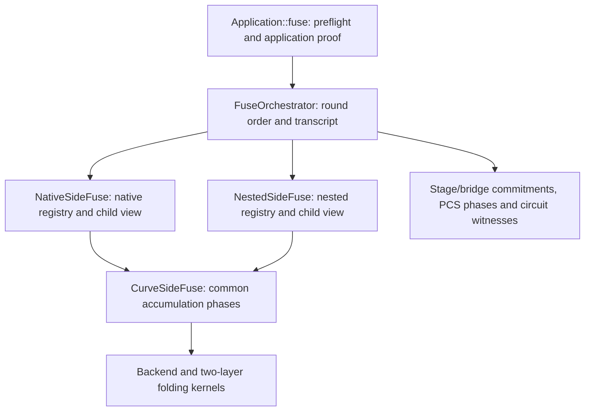

# Curve-side fusion and coordination for #288

This branch implements a private, phase-oriented design for
[issue #288](https://github.com/tachyon-zcash/ragu/issues/288). The comparison
revision is 74575d54d70499c3b8978be3cd45a0aed1bfee14, the earlier s-prime
extraction, based on main at 2ed70cf9ff883b61c01b9b12e28fabee4ead01d2.

Application::fuse now prepares the application proof and hands the recursive
work to FuseOrchestrator. The orchestrator holds a NativeSideFuse and a
NestedSideFuse, asks each side for the current phase's data, commits the
necessary stages and bridges, and then derives the next shared challenge.



## The shared interface

CurveSideFuse lives in crates/ragu_pcd/src/fuse/side.rs. Its associated types
select the field, commitment curve, generators, fold parameters, claim
representation, and folded A representation. Both implementations use its
shared methods for:

- Evaluating the registry at the transcript's w challenge.
- Computing the s-prime registry restrictions and commitments.
- Constructing claims and their first-layer error terms.
- Computing and committing the registry restriction at y.
- Folding claim groups at mu and computing their second-layer error terms.
- Folding the groups at mu_prime into the accumulator polynomials.

The side provides its challenge conversion, child x values, claim enumeration,
and the first-layer fold of A. NativeSideFuse uses tracked polynomials so A's
commitment decomposition survives both layers. NestedSideFuse borrows the
children's polynomials when building claims and produces ordinary owned
polynomials when folding them. Each side selects its profile's own group counts
and group sizes.

A side view borrows its registry, generators, and the same pair of child
proofs. Creating the views copies no proof or polynomial. The common operations
retain static backend dispatch.

## Coordination and specialization

FuseOrchestrator, in crates/ragu_pcd/src/fuse/orchestrator.rs, owns the complete
recursive round sequence. The public entry point in fuse/mod.rs retains child
shape validation, initial randomness, the application Step, and the return of
its output data and auxiliary value. The coordinator finishes the ProofBuilder
and returns the resulting proof to that entry point.

The shared transcript fixes the order:

| Commitment absorbed | Challenges derived next |
| --- | --- |
| Preamble bridge | w |
| S-prime bridge | y, z |
| Inner-error bridge | mu |
| Outer-error bridge | mu_prime |
| AB bridge | x |
| Query bridge | alpha |
| F bridge | u |
| Eval bridge | pre_beta, using the existing rejection sampling |

Both sides advance within each round. Their complete pipelines cannot run one
after the other, because the bridges bind results from the two sides before the
next challenge. The side interface therefore exposes accumulation phases and
leaves the transcript with the coordinator.

The existing phase modules retain stage witness construction, bridge encoding,
PCS query layouts, endoscaling walks, and circuit tracing. Their registered
relations have different responsibilities on the two sides. Native A's
commitment still uses the tracked child commitments; nested A's commitment still
comes from the folded polynomial. Native hash circuits still replay the same
transcript, and nested challenge binding still includes the parent's completion
of beta. The parent or terminal verifier consumes the same accumulated claims.

The fuzzing patcher constructs the same pair of side views and uses the same
phase methods. Its deliberately instrumented transcript path remains available
for circuit capture and corruption tests.

This is a private implementation interface. Applications continue to call the
same fuse method with the same Step and child types. There is no public custom
fuser registration API in this change.

## Validation

Checks completed with Rust 1.97.1 on aarch64-apple-darwin:

- Library compilation in the default and all-features configurations: passed.
- All-features library Clippy with warnings denied: passed, including the fuzzing
  patcher. Pinned-nightly formatting and the diff whitespace check passed.
- Backend, decompression-statement, profile-substitution, extension-binding,
  verifier-setup, and recursive base-case regressions: 40 tests passed. The
  property-test environment set PROPTEST_CASES=2 and PROPTEST_RNG_SEED=288.
- Serial nontrivial proving/compression and built-in profile integrations:
  2 tests passed.
- The ignored nested PCS batch-opening property: 1 test passed, with
  PROPTEST_CASES=1 and PROPTEST_RNG_SEED=288.

An additional independent-build comparison against 74575d54d matched all 60
fingerprint checkpoints: two built-in profiles, three backends, and one/four
workers, each producing two leaves, a parent, a grandparent, and a compressed
grandparent. The probe hashes all 106 ordinary proof fields, the compressed
proof's data, and records the output header and four subsequent RNG draws at
each checkpoint. It uses seed 288 and leaf witnesses 42 and 43; the four RNG
samples are consumed between checkpoints in both executions. Each proof is
also checked by its verifier. The two independently rebuilt test executables
have different SHA-256 hashes.

The built-in profiles currently have the same base layout. Separate regression
tests above exercise nonempty native and nested extensions and reject profile
substitution. These are finite compatibility and rejection checks, not a formal
protocol-equivalence or soundness proof.

The comparison used an identical temporary probe mounted beneath the private
proof module in both snapshots. That mount was removed before committing;
Proof itself has no diff. Local probe sources, complete logs, executable hashes,
retained executables, and the comparison record are in
/private/tmp/ragu-fuse-288-evidence-20261031. The source comparison also matched
all 17 bridge-write and challenge statements in order.

The repository regression commands, run from the worktree root, are:

```sh
cargo check -p ragu_pcd --lib --locked --offline
cargo check -p ragu_pcd --lib --locked --offline --all-features
cargo clippy -p ragu_pcd --lib --locked --offline --all-features -- -D warnings
cargo +nightly-2026-05-23 fmt --all -- --config-path rustfmt.nightly.toml --check
PROPTEST_CASES=2 PROPTEST_RNG_SEED=288 RAYON_NUM_THREADS=4 \
  cargo test --release -p ragu_pcd --locked --offline --features multicore \
  --lib -- --test-threads=1 backend_equivalence:: \
  decompress_statement_tests:: profile_substitution_tests:: \
  noncanonical_unit_children_reject_through_two_generations
PROPTEST_CASES=1 PROPTEST_RNG_SEED=288 RAYON_NUM_THREADS=4 \
  cargo test --release -p ragu_pcd --locked --offline --features multicore \
  --lib fuse::pcs_tests::nested_batch_opens_what_it_claims \
  -- --ignored --exact --test-threads=1
cargo test --release -p ragu_pcd --locked --offline --no-default-features \
  --test nontrivial --test profiles -- --test-threads=1
```
