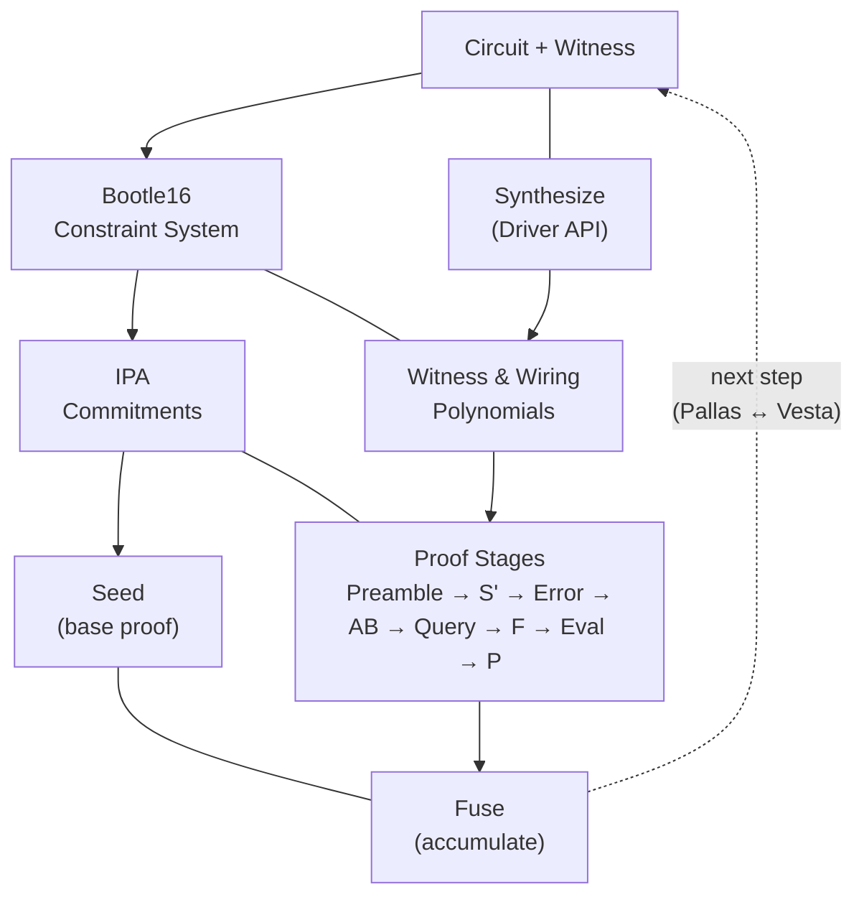
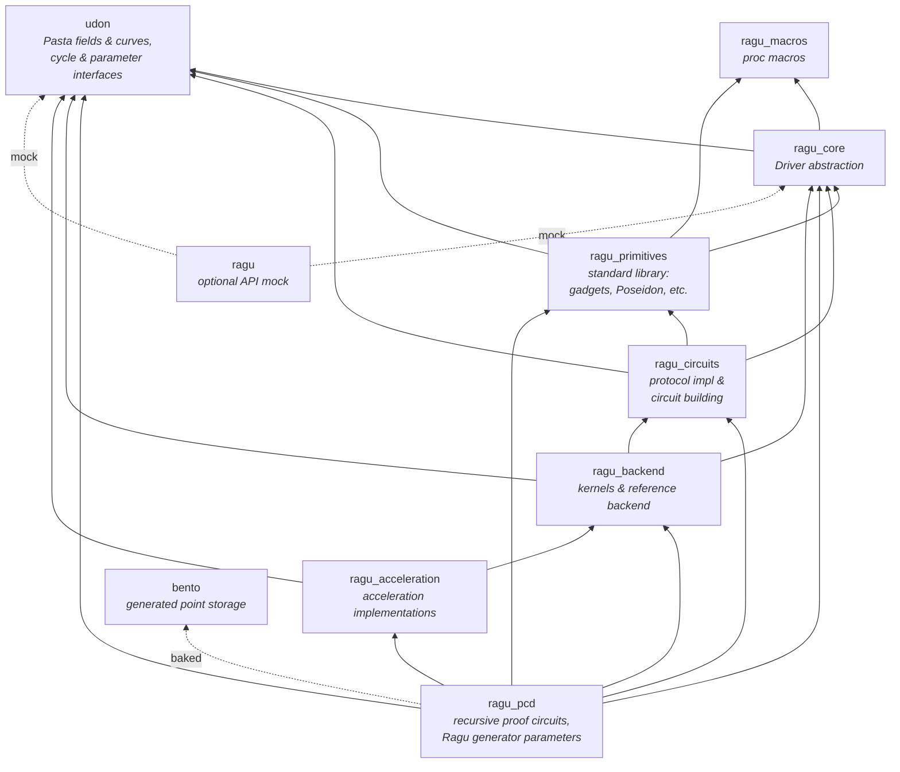

# Architecture Overview

## Overall Flow

The diagram below shows the lifecycle of a Ragu proof. The user defines a
circuit and witness, which are synthesized through the
[`Driver`](../guide/drivers/index.md) API into a
[Bootle16 constraint system](../protocol/core/arithmetization.md). Polynomial
commitments are computed via the IPA scheme, and the proof passes through a
sequence of stages. Recursive composition seeds a base proof and then fuses
(accumulates) subsequent steps, alternating between curves in the Pasta
cycle.

## Core Components

The following diagram is a high-level dependency sketch for the main library
crates in the Ragu workspace. It omits the placeholder `ragu_gadgets` crate,
the `ragu_testing` test helpers, dev-dependencies, and most external utility
dependencies. Arrows point
from a crate to the crates it depends on. The arithmetic comes from outside
the workspace: [`udon`](https://docs.rs/crate/zakura-udon/0.1.0/source/) implements the
Pasta fields, curves, cycle traits, and Poseidon parameter interfaces;
`ragu_core` builds the `Driver` abstraction on top of it;
`ragu_primitives` and `ragu_circuits` extend that layer with gadgets and
protocol logic; and `ragu_pcd` ties those pieces together for recursive proofs
and owns Ragu's fixed generator derivation and loading.
`ragu_backend` defines computational kernels and their reference implementations;
`ragu_acceleration` provides the selectable acceleration implementations.
The optional `bento` dependency stores the generated points loaded by the
`ragu_pcd/baked` feature.

## Project Structure

Ragu is developed as a Cargo workspace.

* **`ragu`**: The repository-root crate provides an opt-in API mock through
  its `mock` feature. Applications using the real proof implementation depend
  on `ragu_pcd` and the circuit and primitive crates they use directly.
* `crates/`
    * **`ragu_macros`**: Internal crate that contains procedural macros both
      used within the project and exposed to users in other crates.
    * **`ragu_core`**: The fundamental crate of the library. Presents the
      `Driver` abstraction and related traits and utilities, and reexports
      `udon`'s [`Cycle`] trait and [Pasta curve cycle] types. All circuit
      development and most algorithms are written using the API provided by
      this crate. The field and curve arithmetic, and the traits generic code
      is written against, are `udon`'s.
    * **`ragu_primitives`**: The standard library for circuit developers.
      Builds on the `Driver` abstraction from `ragu_core` to provide the
      concrete gadgets (`Element`, `Boolean`, `Point`), cryptographic
      primitives (Poseidon hash, endoscalar arithmetic), serialization
      traits, containers, and development tooling (such as the `Simulator`)
      that most circuit code depends on.
    * **`ragu_circuits`**: This crate provides the implementation of the
      Ragu protocol and utilities for building arithmetic circuits in Ragu.
    * **`ragu_backend`**: Computational kernel interfaces and reference
      implementations used by proving and verification.
    * **`ragu_acceleration`**: Selectable backend implementations, including
      a prover-only selection that retains reference verification. They
      currently inherit the reference kernels without overrides.
    * **`ragu_gadgets`**: Placeholder crate; the implemented gadgets live in
      `ragu_core` and `ragu_primitives`.
    * **`ragu_pcd`**: Top-level API for proof-carrying data applications,
      providing `ApplicationBuilder`, `Application`, `Step`, `Header`,
      `Proof`, and `Pcd`. Its `pasta` module derives and loads Ragu's fixed
      generators, exposed through `ragu_pcd::pasta::baked()`.
    * **`ragu_testing`**: Test scaffolding and nontrivial example Steps/Headers
      used in integration tests.

> Ragu is still under active development and the crates that have been
> published so far on [`crates.io`](https://crates.io/) are just
> placeholders.

### From Protocol to Code

The table below maps protocol-level concepts to the primary Rust items and
APIs that represent, compute, or manipulate them.

| Protocol Concept | Rust Item / API | Crate |
|---|---|---|
| Circuit | `Circuit<F>` | `ragu_circuits` |
| Driver | `Driver<'dr>` | `ragu_core` |
| Wire | `D::Wire` (associated type) | `ragu_core` |
| Gadget | `Gadget<'dr, D>` | `ragu_core` |
| Routine | `Routine<F>` | `ragu_core` |
| Witness polynomial $r(X)$ | `trace::Trace<F>`, assembled into `polynomials::sparse::Polynomial<F, R>` | `ragu_circuits` |
| Wiring polynomial $s(X, Y)$ | internal `WiringObject` trait (constructed from `Circuit` impls) | `ragu_circuits` |
| Public input / instance encoding $k(Y)$ | `Circuit::Output: Write<F>` and `CircuitExt::ky()` | `ragu_circuits` |
| Domain | `Domain<F>` | `udon` |
| Polynomial commitment (IPA) | `polynomials::sparse::Polynomial::commit()` | `ragu_circuits` |
| Transcript (Fiat-Shamir) | `Sponge<'dr, D, P>` | `ragu_primitives` |
| PCD step | `Step<C>` | `ragu_pcd` |
| Recursive proof | `Proof<C, R>` | `ragu_pcd` |
| Proof-carrying data | `Pcd<C, R, H>` | `ragu_pcd` |
| Seed (base proof) | `Application::seed()` | `ragu_pcd` |
| Fuse (accumulate) | `Application::fuse()` | `ragu_pcd` |

[Pasta curve cycle]: https://electriccoin.co/blog/the-pasta-curves-for-halo-2-and-beyond/
