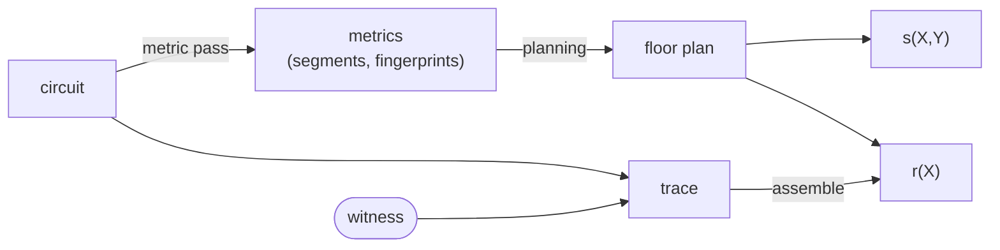

# Routines

The [overview](../protocol/construction/wiring.md) presents $s(X, Y)$ as a
monolithic bivariate polynomial encoding a circuit's linear constraints. In
practice, circuit code is structured into [routines](../guide/routines.md) —
self-contained portions of synthesis logic whose invocations occupy
contiguous blocks of gates and constraints. This page describes how that
structure decomposes $s(X, Y)$ into relocatable pieces and how the
decomposition interacts with the
[registry](../protocol/construction/registry.md).

A routine has a function-like interface: it takes a single [`Input`] gadget
and a [`Driver`] handle, and returns a single [`Output`] gadget. Within its
body it can do anything normal circuit code does with a
[driver](../guide/drivers/index.md) — making gates ([`gate`], [`mul`],
[`alloc`]) and constraining their wires ([`enforce_zero`]).

Three terms recur throughout this page and refer to distinct things:

- **Routine**: the type and its configuration — a function definition. A
  routine's Rust type plus any [runtime parameters](../guide/routines.md#param)
  determines the constraints it produces.
- **Invocation**: a specific call with specific inputs — a call site. Two
  invocations of the same routine produce different wire values but the same
  constraint structure.
- **Segment**: the polynomial footprint of an invocation — the contiguous
  range of gate indices and $Y$-power slots it occupies in $s(X, Y)$. Each
  invocation gets its own segment, and nested calls produce nested segments.

It is possible to invoke a routine by manually calling [`Routine::execute`],
but this defeats the abstraction. Routines are meant to be invoked through
[`Driver::routine`], which preserves the call boundaries the driver needs.

Routines can further invoke other routines, creating **nested routines**.
To avoid complicated call-stack management, drivers keep only _routine-local_
state. When circuit code calls [`Driver::routine`], the driver saves its
scoped state (e.g., running wire monomial evaluations for `sx::Evaluator`,
constraint counters for `metrics::Counter`, the pending-pair slot used by
paired allocation) and initializes a fresh scope for the child routine. The
parent and child scopes are isolated from each other: a child scope runs
against _no_ inherited parent state, so its execution depends only on its
body and inputs. On return, the parent scope is restored unchanged, and the
child's contribution is folded into driver-level output rather than the
parent's scope. The `DriverScope` trait provides a `with_scope` helper that
automates this save-and-restore; some drivers use manual `mem::replace`
instead when they need to inspect the child scope before restoring the
parent.

Because driver behavior does not depend on invocation depth, we call them
_depth insensitive_.

This isolation is hermetic, not conventional: Rust ownership ensures internal
wires cannot escape the routine's body. A routine's constraints can reference
exactly _four classes of wires_ — its own internal wires, the input gadget's
wires, child routines' output gadget wires, and the special ONE wire at the
[fixed location](../protocol/construction/wiring.md#layout).
No other external wire is reachable. This is what makes the algebraic
decomposition below structural rather than conventional: the same routine
instance with type-equivalent inputs produces structurally identical
constraint patterns, which is what makes memoization possible at all.

## Example: Synthesis Trace {#example}

The following circuit is a concrete example for all upcoming discussion:

```
 Circuit Synthesis Trace
 ────────────────────────
 ├─ r0
 ├─ Routine A
 │   └─ a0
 ├─ r1
 ├─ Routine B
 │   ├─ b0
 │   ├─ Routine A
 │   │   └─ a0
 │   └─ b1
 ├─ Routine B
 │   ├─ b2
 │   └─ Routine C
 │       └─ c0
 └─ r2
```

Each label `r0, a0, b0, …, r2` denotes a contiguous section of circuit trace
allocated via [`gate`]. At various points the circuit logic invokes a routine,
which may in turn invoke nested routines.

## Segments {#segments}

Given an execution trace, we need a global indexing of all sub-sections so
that different drivers can refer to them consistently. Ragu divides the trace
into **segments** and orders them in a canonical **DFS order** determined by
routine invocations. Circuit sections at the same invocation depth are merged
into a single segment; wires allocated outside of any routine belong to a
special **root segment**.[^root-segment] Each routine invocation creates a new
**base segment** containing only the wires allocated directly within its own
body, excluding anything its nested sub-routines allocate; nested calls
produce their own segments in turn.

Each segment carries an absolute position $(m, \ell)$ in the polynomial
layout — its **gate offset** $m$ (where its multiplication-gate range starts
in $X$-monomials) and **constraint offset** $\ell$ (where its
linear-constraint range starts in $Y$-powers). The root segment sits at
$(0, 0)$ and is never repositioned. Other segments' offsets are assigned by
the [floor planner](#pipeline) during planning.

[^root-segment]: The root segment is never repositioned. It contains the
    special `ONE` wire (at $X^0 = 1$) and is where all stage wires of
    multi-stage circuits are located.

The DFS-ordered segments are built as [`SegmentRecord`]s during the
[metric pass](#pipeline). During synthesis — which may be parallelized — each
segment is annotated with its **DFS path**: the sequence of routine-call
indices from root to that segment (e.g., $[1, 0]$ means "the root's second
routine call, then its first nested call"). After synthesis completes,
segments are lexicographically sorted by DFS path to recover canonical
encounter order.[^dfs-sort] Because synthesis is deterministic, the resulting
sequence is stable across all drivers of the same circuit code regardless of
the parallelism strategy used.

[^dfs-sort]: The sort is necessary because parallel synthesis may complete
    segments out of order. Lexicographic comparison of the path vectors
    reconstructs the sequential DFS traversal.

For the [example](#example) above, the DFS-ordered segments are:

```
segments[0]: r0 + r1 + r2 (root segment)
segments[1]: a0           (base segment of Routine A)
segments[2]: b0 + b1      (base segment of Routine B)
segments[3]: a0           (in the nested Routine A invoked in Routine B)
segments[4]: b2           (base segment of the second invocation of Routine B)
segments[5]: c0           (base segment of Routine C)
```


## Algebraic Description {#algebraic-description}

Routines exploit the fact that contiguous sections of code tend to have
algebraically convenient structure in the resulting wiring polynomial
$s(X, Y)$:

* [`gate`] advances a counter $i$ and gives the wires $(a, b, c, d)$ of
  gate $i$ the monomials $(X^{2n + i}, X^{2n - 1 - i}, X^{4n - 1 - i}, X^i)$.
* `enforce_zero` advances a counter $j$ and adds a fresh linear
  combination of previous wires multiplied by $Y^j$.

Most constraints within a routine involve only wires created within that
routine. For a routine occupying the segment at position $(m, \ell)$ — gate
offset $m$ and constraint offset $\ell$ — these constraints, the **internal
contribution** to $s(X, Y)$, can be written as:

$$
Y^\ell \Big( X^m \, g_1(X, Y) + X^{-m} \, g_2(X^{-1}, Y) \Big)
$$

where $X^m Y^\ell$ (and $X^{-m} Y^\ell$ for wires allocated in reversed
segments of a [structured](../protocol/construction/arithmetization.md) trace)
are the common factors extracted from all monomial terms in the
contribution[^factoring]. Crucially, $g_1$ and $g_2$ are **invariant to the
routine invocation**: they are the same regardless of where or how many
times the invocation is placed in a circuit. This is what makes _routine
memoization_ possible: given an invocation cache hit, we only need to apply
the appropriate [shifting](#shifting) factors to reposition the cached
contribution at the new invocation's $(m, \ell)$.

[^factoring]: Every wire allocated within the routine, starting at gate
    offset $m$, has a positional monomial $X^{m+k}$ or $X^{-(m+k)}$
    (reversed segment) for some $k\geq 0$. Each constraint on these
    internal wires is a linear combination of these positional monomials
    multiplied by $Y^{\ell+s}$ for some $s \geq 0$. The internal
    contribution — the sum of all $Y$-power-scaled linear combinations of
    $X$ monomials — therefore shares a common factor $X^m Y^\ell$
    (or $X^{-m}Y^\ell$). Extracting these factors yields $g_1$ and $g_2$.

A routine invocation's overall contribution to $s(X, Y)$ decomposes into
three buckets: the internal contribution above, an **interface contribution**
from constraints that reference wires created outside the routine (e.g.,
input gadget wires), and a **system contribution** from constraints that
reference system wires (i.e., `ONE`) at fixed locations. We examine the
remaining two next.

Unlike the internal contribution, the interface contribution cannot be
factored or memoized the same way: the external wires it references are
allocated by the caller at positions unknown to the routine, both absolute
and relative to its start, so there are no a priori $X^m$ factors to
extract. Interface contributions must be computed per-invocation.

A complication arises from nested routines. The depth-insensitive design
requires that output gadgets of child routines are also treated as interface
contributions of the parent routine. It is always safe to classify them
this way and recompute on every invocation of the parent. However, if two
parent routines are known to have identical sub-routines, the output
gadgets can be remapped to matching positions in the parent's context,
allowing further constraints on them to be memoized as internal
contributions. We elaborate on this [below](#memoization).

The system contribution is memoizable by similar reasoning to the internal
contribution. The `ONE` wire occupies $d_0$ at $X^0 = 1$, so its $X$-monomial
is the constant 1, and the system contribution simplifies to:

$$
\sum_{s \in S} c_s \cdot Y^{\ell + s} = Y^\ell \cdot g_3(Y)
$$

where $S$ is the set of relative constraint offsets within the routine
where `ONE` is referenced, $c_s$ is its coefficient at offset $s$, and
$g_3(Y) = \sum_{s \in S} c_s Y^s$ is again invariant to the routine
invocation: the relative offsets within the routine depend only on its
structure, not on the absolute starting index $\ell$.

## Shifting {#shifting}

The internal and system contributions decompose cleanly into three
position-independent pieces $(g_1, g_2, g_3)$ and the placement factors
$(X^m, X^{-m}, Y^\ell)$. Repositioning a cached contribution from
$(m, \ell)$ to $(m', \ell')$ amounts to swapping these factors. The two
dimensions are orthogonal: changing the gate offset does not affect
constraint indexing, and vice versa.

- **$Y$-shift** by $\Delta\ell = \ell' - \ell$: multiply the entire
  contribution by $Y^{\Delta\ell}$. This is a single scalar factor applied
  uniformly to $g_1$, $g_2$, and $g_3$.
- **$X$-shift** by $\Delta m = m' - m$: rescale $g_1$ by $X^{\Delta m}$
  and $g_2$ by $X^{-\Delta m}$. The system polynomial $g_3$ has no
  $X$-dependence, so $X$-shifting leaves it untouched.

Different drivers specialize $g_1, g_2, g_3$ at different points before
shifting, and the size of the form that a driver would cache differs
accordingly:

| Driver  | Specialization | Cached form                                  |
| ------- | -------------- | -------------------------------------------- |
| `sxy`   | $(x, y)$       | three scalars                                |
| `sx`    | $x$            | three $Y$-coefficient vectors                |
| `sy`    | $y$            | two $X$-coefficient vectors and one scalar   |

For `sxy`, replaying a cached contribution would take a few field
multiplications, whatever the size of the routine body. For `sx` and `sy`,
the cached form has the same order as the routine's contribution, so replay
(vector scalar-mult plus an offset write) would be cheaper than fresh
synthesis only when synthesis cost (gadget logic, function dispatch,
constraint accumulation) outweighs the replay cost. No driver caches these
forms yet; [Memoization](#memoization) describes the design.

## Routine Fingerprints {#fingerprint}

A prerequisite of routine memoization is identifying distinct routines.
Consider some naive but incorrect ways to identify one:

- by shape (`num_gates` and `num_constraints`):
  different routines can coincidentally share the same shape.
- by `(Input, Output)` gadget types:
  routines performing different operations (e.g. `square` and `double`)
  can share the same input/output types.
- by `TypeId::of::<Routine>()`: 
  routines can be [parameterized](../guide/routines.md#param) and stateful;
  even the same `ScaledTxz` routine type (or `RoutineB` in our example)
  can synthesize different traces depending on its configuration.
  
Drivers cannot distinguish routines statically but must also consider
their **invocations**. Fingerprinting is the process by which a routine
invocation is succinctly encapsulated so that _matching fingerprints imply
opportunities for routine memoization_. An invocation can carry multiple
fingerprints, each indicating a different memoization strategy or level of
aggressiveness. Ragu produces two:

- A **base fingerprint** that captures _segment-level distinction_: whether
  two individual segments impose the same local constraints and could be
  aligned in the polynomial layout regardless of their subtrees — for
  example, padding one circuit's segment against another circuit's offset.
  Matching base fingerprints signal that the base segment is worth aligning,
  but do not imply that the nested subtrees match.

- A **deep fingerprint** that captures _subtree-level equivalence_: whether
  entire routine invocations are interchangeable and can be substituted via
  memoization. This is strictly stronger — a segment can be base-equivalent
  (same local constraints, worth aligning) but deep-inequivalent (different
  children, so the cached subtree cannot be reused).

Keeping these as distinct types preserves the semantic separation: a floor
planner that aligns segments keys on the base fingerprint, and a memo cache
keys on the deep fingerprint. Consolidating both levels into a single
identity type would lose this distinction and force the floor planner to
treat segments as different when only their subtrees differ. Neither
consumer exists yet: the metric pass records both fingerprints, and the
current [floor planner](#pipeline) does not read them.

### Base fingerprint {#base-fingerprint}

Ragu tracks the gate and constraint counts of a routine invocation's base
segment, together with its polynomial contribution, as the `BaseFingerprint`.
In the [example above](#example), the two invocations of `RoutineB` are
structurally different, but the internal contributions of their base segments
may still be identical and thus memoizable (i.e., `b0 + b1 = b2`).

The polynomial contribution is evaluated so that it is invariant to context and
location. The invocation's internal and system contributions enter as they
are, and each interface wire enters with a stand-in value that depends only on
the wire's position in the routine's interface, as described below. Polynomial
evaluation alone is insufficient because it captures only `enforce_zero`
calls, not the gate count, which the floor planner requires. The constraint
count, already implicit in the contribution scalar, is included purely as
defense-in-depth.

```rust
struct BaseFingerprint {
    /// shape of the **base segment** of a routine
    num_gates: usize,
    num_constraints: usize,
    /// polynomial contribution of the base segment:
    /// the low 64 bits of its evaluation
    eval: u64,
}
```

Conceptually, the simplest approach to `eval` is to pick a random $(x_r, y_r)$
and use the internal contribution of each routine invocation to $s(x_r, y_r)$
as its fingerprint. By the Schwartz-Zippel lemma, two invocations whose
contributions differ as polynomials evaluate differently with overwhelming
probability. However, this requires tracking monomial evaluations in both the
forward direction ($X^i$ terms) and the backward direction ($X^{4n-1-i}$
terms), and involves scalar multiplications (for $X^{2n}$ and $X^{4n}$) and an
expensive inversion (for $X^{-1}$) during initialization.

Instead, Ragu uses a more efficient approach: four _independent_ geometric
sequences for wire values (one for each of the `a/b/c/d`-wires) and
Horner-accumulated contributions from `enforce_zero` constraints with $Y$
powers of a point $Y=y_r$. A wire at local gate index $i \geq 0$ takes value
$x_t^{i+1}$ for its wire type $t \in \{a, b, c, d\}$.[^onebased] This
simplification is possible because the fingerprint need only characterize
constraints in some binding way, not necessarily in the same form as the
wiring polynomial $s(X, Y)$.

The points are not drawn at random. $(x_a, x_b, x_c, x_d)$, $y_r$ and the
base of the remapping sequence below are six fixed field elements, each the
hash of a domain tag and an index, which makes the fingerprints of a circuit
the same on every run. `eval` also keeps only the low 64 bits of the
evaluation. The Schwartz–Zippel argument therefore covers routines that were
written without regard to the points, and for those a matching fingerprint
indicates a matching contribution. It does not cover a routine that was
written to collide with another. Matching fingerprints are evidence of
equivalence and not a proof of it, and a consumer that substitutes one
routine's cached contribution for another's must account for that.

[^onebased]: Exponents start at 1, not 0, to avoid wire-type collisions at
    the routine's first gate: under a 0-based scheme,
    $x_a^0 = x_b^0 = x_c^0 = x_d^0 = 1$, so any constraint involving only
    the first gate's wires would collapse across types, allowing distinct
    constraints to receive identical fingerprints.

The `ONE` wire takes the value $1$, as it does in $s(X, Y)$. The one-based
exponents keep it apart from the $d$ wire of a routine's first gate, whose
value is $x_d$ and not $x_d^0$.

Handling interface contributions is the most delicate part. In our example, the
first invocation of `RoutineB` accepts an input gadget from the parent on entry
and receives an output gadget from the child `RoutineA` during execution. Both
gadgets are allocated outside the scope of `RoutineB`'s base segment, so any
constraint involving them is an interface contribution, and where the caller
placed their wires must not affect the `eval` computation. Concretely,
relocating wires in these interface gadgets must not change the fingerprint.

There are two approaches to handling wires in interface gadgets:

1. Discriminate them as a separate wire type
   (e.g. `enum WireEval { Value, One, Interface }`) so that routines can flag
   them as `WireEval::Interface(F)` and drivers can drop their contribution.
2. Assign context-insensitive values to them so that their contributions are
   the same across otherwise-equivalent invocations and thus cannot affect the
   equivalence test.

Ragu takes the second approach, implemented via a wire remapping [`WireMap`]:
all wires in interface gadgets are remapped to values from an independent
geometric sequence with a separate base.[^x-remap] Every routine,
regardless of invocation depth, re-initializes this sequence on entry so that
input gadget wires hold context-insensitive positional values. Before returning,
the routine remaps its output gadget wires and appends them to the parent's
sequence.

[^x-remap]: For code reference, the variable is named `x_remap`, and the
    $k$-th wire remapped in a scope, counting from zero, takes the value
    `x_remap^(k+1)`, independent of the normal sequences
    $(x_a, x_b, x_c, x_d)$. Intuitively, every routine starts with a
    blank page for interface gadget wires, written sequentially from the start;
    output gadget wires are then appended to the parent's page.

### Deep fingerprint {#deep-fingerprint}

Deep-fingerprint memoization applies when two routine invocations are
tree-level equivalent: structurally identical in both their base segment and all
nested sub-routines. Identical deep fingerprints indicate matching shapes
(gate and constraint counts) and matching polynomial contributions when all
nested sub-routines are _flattened and inlined_.

The gap from the [base fingerprint](#base-fingerprint) lies in how output
gadgets of child sub-routines are handled. In the base fingerprint, output wires
are remapped into the parent's context. This remapping erases their positions
relative to the start of the parent routine, which matters when testing
equivalence of the inlined routine.[^swapped] The deep fingerprint must
therefore capture the positional values of these output wires.

```rust
struct DeepFingerprint {
    base: BaseFingerprint,
    /// deep hash:
    /// H(self.base, output_len, output_gadget,
    ///   children_len, child_deep_hashes)
    deep: u64,
}
```

Ragu augments the base fingerprint with the output gadget's length, its wire
values, the number of child invocations, and the deep fingerprints of all
child invocations (one level deeper). Both lengths delimit the streams that
follow them, so that two routines whose output wires or child lists differ in
length hash different inputs. The monomial evaluation of output wires already
encodes their positions relative to the start of the sub-routine, and thus
transitively relative to the start of the parent routine. Because the parent's
deep fingerprint recursively folds in the deep hashes of all children, the
final hash binds the entire invocation tree.

Composition is via hashing rather than algebraic combination: combining
fingerprints across tree levels with field arithmetic would risk interference
between layers and break the linear independence that Schwartz–Zippel relies
on at the base level. Hashing keeps each level's fingerprint as an opaque
equality tag while still binding the full tree.

Notably, the input and output [`GadgetKind`][gadgetkind-page] types are
deliberately _absent_ from the deep hash. From a polynomial perspective the
contribution to $s(X, Y)$ is type-oblivious, and two invocations whose output
wires resolve to equivalent streams are interchangeable even when their
output Rust types differ — for instance, one routine returning `Element` and
another returning a thin wrapper `MyElement` that encodes a single field
element identically. Including `TypeId`s would mark such pairs as
deep-inequivalent and block legitimate memoization without adding any
soundness margin. The discipline that lets the driver hand back a correctly
typed output gadget without consulting types in the fingerprint is a
gadget-layer property, discussed in
[Output Gadget Reconstruction](#output-reconstruction).


[^swapped]: As an example, suppose two `RoutineB` invocations each nest a call
    to `RoutineA`. The first `RoutineA` invocation runs
    `alloc(w1); alloc(w2); enforce_zero(w1 + w2); return (w1, w2)`;
    the second runs
    `alloc(w2); alloc(w1); enforce_zero(w1 + w2); return (w1, w2)`.
    In the `BaseFingerprint` computation, the output wires `(w1, w2)` from
    both invocations are mapped to the same values in their parent
    `RoutineB` context, so the two `RoutineB` invocations receive
    identical base fingerprints.
    However, after inlining, the invocations differ because of the swapped
    allocation order of `w1` and `w2`.

## Pipeline {#pipeline}



A **metric pass** executes the circuit on a lightweight `Counter` driver that
records the [segment](#segments) decomposition and computes a
[fingerprint](#fingerprint) for every routine invocation. The output is an
ordered sequence of [`SegmentRecord`]s — one per segment in DFS order — each
carrying local gate and constraint counts together with the invocation's base
and deep fingerprints. Because synthesis is deterministic, the sequence is
stable across all subsequent driver executions of the same circuit code.

The registry feeds each circuit's segment records into a **floor planner**
that assigns each segment a non-overlapping absolute position $(m, \ell)$ in
the polynomial layout. Currently, the floor planner lays out each circuit on
its own. It keeps the segments in DFS order and starts each one where the
segment before it ends, so that the offsets are prefix sums of the gate and
constraint counts. It does not read the fingerprints.

The design is for the floor planner to align segments with matching
fingerprints, so that [memoization](#memoization) applies across the entire
registry, both within and between circuits: matching base fingerprints would
enable memoization of the base segment's internal contribution, and matching
deep fingerprints that of entire routine subtrees. Such a planner would only
rearrange segment placement; it would not perform circuit-equivalence
substitutions that alter the circuit logic itself.

The floor plan is an auxiliary input to downstream drivers: the wiring
polynomial evaluators use it to place each segment's contribution at its
assigned offset in $s(X, Y)$, and the trace polynomial evaluator uses it to
scatter each segment's gate values to the correct range in $r(X)$.

## Memoization {#memoization}

```admonish note title="Not yet implemented"
This section and its subsections describe a design. The evaluators currently
run the body of every routine at the offset that the floor plan assigns it,
and nothing consumes the fingerprints that the metric pass records.
```

The [algebraic description](#algebraic-description) decomposes a routine
invocation's contribution to $s(X, Y)$ into **internal** polynomials
$g_1(X, Y)$ and $g_2(X^{-1}, Y)$, a **system** polynomial $g_3(Y)$, and
**interface** terms that cross the routine boundary. The internal and system
polynomials depend only on the routine's constraint structure and are
invariant to invocation context; the interface terms depend on externally
allocated wires and must be recomputed. Memoization caches the invariant
parts — $g_1$, $g_2$, and $g_3$ — and replays them for subsequent
invocations whose [fingerprints](#fingerprint) match, applying the
appropriate [shifting](#shifting) factors to place the cached contribution
at the new offset.

The cached form depends on the driver, and so does the size of the win:

- On the scalar `sxy` path, $g_1, g_2, g_3$ collapse to scalars; replay is
  a few field multiplications, whatever the size of the routine body.
- On the polynomial-valued `sx` and `sy` paths, $g_1, g_2, g_3$ are
  coefficient vectors of size $O(\text{routine})$; replay is a vector
  scalar-mult plus an offset write. The win here is conditional on
  synthesis cost (gadget logic, function dispatch, constraint
  accumulation) outweighing this cheaper-but-not-trivial replay.

Caching follows $s(X, Y)$'s evaluation logic, not the simplified computation
used for [fingerprinting](#base-fingerprint). During fingerprinting,
interface wires receive context-insensitive values so their contributions
cancel across equivalent invocations (approach 2 [above](#base-fingerprint)).
During memoization, the driver must actually _exclude_ interface
contributions from the cached result so that only the invariant part is
stored. This requires approach 1: the wire type carries an `Interface`
discriminant so that the driver can identify interface terms in each
constraint and route them to the per-invocation computation rather than the
cache.

The registry collects fingerprints from the [metric pass](#pipeline) and
records matches — both within a single circuit and across circuits — so that
downstream drivers (the wiring polynomial evaluator for $s(X, Y)$ and the
trace evaluator for $r(X)$) can determine on entry to each routine whether
to record a fresh contribution or replay a cached one.

How much of a routine can be cached depends on which fingerprint matches.

**Base-fingerprint memoization.** When two invocations share a
[base fingerprint](#base-fingerprint), only the _base segment_ of the
routine is known to be equivalent. The driver caches $g_1$, $g_2$, and $g_3$
for that segment and repositions them at the new invocation's offset.
Contributions from nested sub-routines remain **floating**: their absolute
positions are independent of the base segment's, and any constraints the
parent places on their output gadgets stay as interface contributions,
recomputed per invocation.

**Deep-fingerprint memoization.** When two invocations share a
[deep fingerprint](#deep-fingerprint), the entire invocation tree is
equivalent: the base segment _and_ all nested sub-routines have matching
structure. The previously-floating children are now pinned at fixed relative
positions, which changes what counts as an interface contribution: output
gadgets of child routines, treated as interface under base-fingerprint
memoization, can now be remapped to matching positions within the parent's
context. Constraints on these output wires become part of the internal
contribution and are memoizable along with the rest of the subtree. The
`sxy` driver implementation already exposes the recursive structure this
needs: each routine scope tracks a `result` (Horner accumulator over its
own constraints, position-independent in $\ell$) and a `sum` (aggregate of
positioned child contributions); on exit, the parent absorbs the child as
$\text{sum}_\text{parent} \mathrel{+}= y^{\ell_\text{child}} \cdot
\text{result}_\text{child} + \text{sum}_\text{child}$, and a deep-cached
subtree would replay this folding step from the cached value directly.

```admonish important title="Deep memoization redefines the internal contribution"
Under deep-fingerprint equivalence, the output wires of nested sub-routines are
no longer interface contributions — a matching deep fingerprint indicates that
child routines produce structurally identical output at identical relative
positions. The parent can treat these wires as internal, collapsing the entire
subtree into a single memoizable unit. This is the key advantage of the deep
fingerprint: it enables full-tree memoization rather than segment-by-segment
caching.
```

### Output Gadget Reconstruction {#output-reconstruction}

Caching $g_1, g_2, g_3$ makes the contribution to $s(X, Y)$ replayable, but
the caller still expects a typed output gadget on every invocation —
including those whose body is skipped on a cache hit. The driver synthesizes
that gadget by _injecting_ the cached output wires, [shifted](#shifting) to
the new offset, into a freshly assembled output gadget rather than re-running
the body to allocate them.

For this injection to be sound, the gadget layer must guarantee that the
gadget is unambiguously reconstructible from the wire stream alone. We call
this property **allocation determinism**:

> Given a [`GadgetKind`][gadgetkind-page] and the wire stream produced at the
> routine boundary, a deterministic algorithm assembles the gadget instance
> using the stream's length as the only dynamic input, with no out-of-band
> metadata.

Allocation determinism is the part of
[fungibility](../guide/gadgets/index.md#fungibility) that injection rests on.
It is strictly weaker than wire-layout determinism, in which the type alone
fixes the wires of every instance: a gadget kind may own a runtime-sized
collection (the stream length resolves the count, and any divergence is
already caught by the fingerprint), so `Vec`-shaped gadgets are admissible.
The stream length resolves the count for one collection of elements with a
fixed, nonzero number of wires, and Ragu provides one such gadget:
[`WireStream`], a run of bare wires. A kind with two runtime lengths, such as
a `Vec` of `Vec`s or two `WireStream`s, has several shapes over one stream
length and is not admissible, which is why `Vec<G>` is not a gadget. What it
also rules out are shapes that need
a side-channel discriminant — most notably enum-shaped gadgets, where
variant choice cannot in general be recovered from the wire stream (two
variants may share wire counts, or the variant set may evolve such that
they collide).

Allocation determinism is the gadget-side counterpart to deep fingerprinting.
A matching deep fingerprint is what indicates that two invocations contribute
identically to $s(X, Y)$ and produce equivalent output wire streams;
allocation determinism guarantees that any gadget reconstructed from such a
stream agrees with what the body would have produced. Output injection relies
on the two together and does not consult gadget types in the fingerprint,
which is why the deep hash omits `TypeId`s.

Constraint-semantic equivalence — that a `GadgetKind` also pins down the
constraints applied to its allocated wires — is orthogonal to memoization
soundness (the constraints live inside the routine body and are already
captured by the fingerprint scalar) but remains required as an API contract
so circuit code can reason about a gadget's invariants from its type alone.

When matching fingerprints occur only _within_ a single circuit, memoization
requires nothing beyond caching and repositioning: the driver records the
contribution on the first invocation and rescales it for subsequent ones.
Alignment becomes relevant when matching fingerprints span _multiple_ circuits
in the registry.

### Inter-Circuit Alignment {#inter-circuit-alignment}

The registry polynomial combines per-circuit wiring polynomials via Lagrange
interpolation:

$$
m(w, x, y) = \sum_k L_k(w) \cdot s_k(x, y)
$$

where $L_k$ is the Lagrange basis polynomial for circuit $k$. Without
optimization, each circuit evaluates its routines independently and scales
by $L_k(w)$. If the floor planner places equivalent routines at the _same_
absolute position across circuits, their invariant contributions coincide
and can be factored:

$$
\Big(\sum_{k \in K} L_k(w)\Big) \cdot Y^\ell
\Big( X^m \, g_1(X, Y) + X^{-m} \, g_2(X^{-1}, Y) + g_3(Y) \Big)
$$

where $K$ is the set of circuits sharing the routine at that position and
$g_1, g_2, g_3$ are the routine's
[invariant contributions](#algebraic-description). The routine's
contribution is computed once and multiplied by the sum of the relevant
Lagrange coefficients, rather than being recomputed per-circuit.

The floor planner would prioritize deep-fingerprint alignment for the largest
segments, since collapsing an entire subtree yields the greatest savings.
Alignment introduces implicit padding between segments in the global layout, but
this padding does not materialize in memory: all downstream drivers process
segments in a streaming fashion using absolute offsets from the floor plan, so
padded regions are either skipped or processed at negligible cost. The trace
polynomial $r(X)$ remains sparse, and padding does not increase the cost of the
polynomial commitment. Base-fingerprint alignment would also be applied when
the base segment is large enough to justify the padding overhead.

### Testability

The floor plan is checked where it is used. `Trace::assemble` asserts that
each segment has the number of gates that the floor plan declares for it, and
the wiring polynomial evaluators assert after each routine that it consumed
exactly the declared gate and constraint counts. These assertions compare
sizes. They do not show that the ranges of two segments are disjoint: that
holds for the current planner because it assigns offsets as prefix sums, and
a planner that reorders or aligns segments has to establish it separately.

The drivers that walk a circuit are also compared with one another. Tests
evaluate the monomials that the registry's tag hashes and the `sxy`, `sx` and
`sy` evaluators at freshly drawn points, and require all four to agree.

Memoization is meant to be covered by a reference comparison of the same
kind. A memoization error would show as a cached contribution that disagrees
with the fresh computation, and incorrect repositioning as a contribution at
the wrong position; either changes the polynomial, and so its value at most
points. The reference path computes the registry polynomial $m(w, x, y)$ by
evaluating each circuit's $s(x, y)$ independently with no caching. The
memoized path shares a cache across circuits: on the first evaluation of a
routine at a given canonical position, the contribution and output wires are
stored; subsequent circuits with the same fingerprint at that position reuse
the cached contribution, rescaled by the floor plan's repositioning factors.
Asserting that both paths agree at random $(w, x, y)$ points covers floor
planning, repositioning, and cache logic in a single check, except with the
small probability that a point is a root of the difference. Because the
reference path does not depend on the fingerprinting model at all, this
comparison catches errors in the model itself, for the circuits it is run on:
a routine fingerprint that over-groups, or a memo fingerprint that omits a
necessary field, and not only bugs in the memoization code.

[`WireMap`]: ragu_core::convert::WireMap
[`WireStream`]: ragu_core::gadgets::WireStream
[`TypeId`]: core::any::TypeId
[`Routine`]: ragu_core::routines::Routine
[`Driver`]: ragu_core::drivers::Driver
[`Driver::routine`]: ragu_core::drivers::Driver::routine
[`Input`]: ragu_core::routines::Routine::Input
[`Output`]: ragu_core::routines::Routine::Output
[`Routine::execute`]: ragu_core::routines::Routine::execute
[`enforce_zero`]: ragu_core::drivers::Driver::enforce_zero
[`gate`]: ragu_core::drivers::DriverTypes::gate
[`mul`]: ragu_core::drivers::Driver::mul
[`alloc`]: ragu_core::drivers::Driver::alloc
[`SegmentRecord`]: ragu_circuits::metrics::SegmentRecord
[conversions]: ../guide/gadgets/conversion.md
[gadgetkind-page]: ../guide/gadgets/gadgetkind.md
