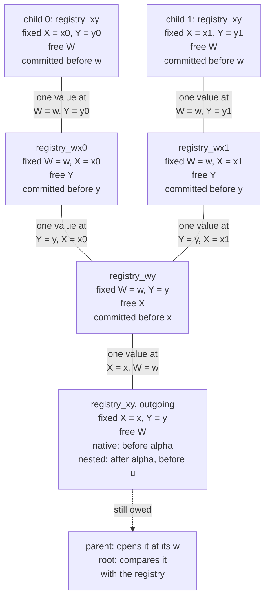

# Batched Opening {#batched-opening}

The fold leaves evaluation claims to check: that the folded $A$ and $B$ are the
stated combinations of the polynomials in the claims, that each child's own
batched opening holds, and that the registry restrictions are consistent. Each
side gathers its claims into one polynomial $p$ opened at one point.

## Batched Polynomial {#batch-structure}

A side has $Q$ **openings** $(\phi_h, \rho_h, \vartheta_h)$, each claiming
$\phi_h(\rho_h) = \vartheta_h$, and $J$ **batched polynomials**
$\psi_0, \dots, \psi_{J-1}$: the polynomials that the openings name, each
listed once, and one [more](#batch-randomizer) that no opening names. We write
$j(h)$ for the index of the batched polynomial that opening $h$ names, so that
$\phi_h = \psi_{j(h)}$. An opening holds exactly when
$\phi_h(X) - \vartheta_h$ is divisible by $X - \rho_h$. The prover combines
the $Q$ quotients into one polynomial $f$ with powers of a challenge $\alpha$,
and combines $f$ with the batched polynomials into one polynomial $p$ with
powers of a challenge $\beta$:

$$f(X) = \sum_{h=0}^{Q-1} \alpha^{Q-1-h} \, \frac{\phi_h(X) - \phi_h(\rho_h)}{X - \rho_h},$$

$$p(X) = \beta^{J} f(X) + \sum_{j=0}^{J-1} \beta^{J-1-j} \, \psi_j(X), \qquad P = \beta^{J} \cdot [f] + \sum_{j=0}^{J-1} \beta^{J-1-j} \cdot [\psi_j].$$

The quotients in $f$ are taken with the true values $\phi_h(\rho_h)$, so $f$ is
a polynomial whatever is claimed. The claimed values $\vartheta_h$ enter only
the value $v$ below.

The prover commits $f$ before $u$ is drawn and the evaluations
$\epsilon_j = \psi_j(u)$ before $\beta$ is fixed. The side's circuit, the native
[`compute_v`](internal_circuits.md#native-compute-v) or the nested
[`ComputeV`](internal_circuits.md#nested-compute-v), computes the value

$$v = \beta^{J} \sum_{h=0}^{Q-1} \alpha^{Q-1-h} \, \frac{\epsilon_{j(h)} - \vartheta_h}{u - \rho_h} + \sum_{j=0}^{J-1} \beta^{J-1-j} \, \epsilon_j.$$

If every opening holds and every $\epsilon_j$ is correct, then $v = p(u)$. The
claim $p(u) = v$ against $P$ is the side's new batched opening.

In the other direction, suppose that the new batched opening holds, where the
polynomial behind $[f]$ may be any that the prover chose, and that every
opening was fixed before $\alpha$: its polynomial $\phi_h$, its point $\rho_h$
and its claimed value $\vartheta_h$. Then every opening holds and every
$\epsilon_j$ is correct, except with probability at most

$$\frac{Q - 1}{|S_\alpha|} + \frac{4n - 1 + Q_\rho}{|S_u|} + \frac{J}{|S_\beta|},$$

where each challenge is uniform on its set and $Q_\rho$ is the number of
distinct points among the $\rho_h$.[^batch-bound] The three terms belong to
the challenges $\alpha$, $u$ and $\beta$.

One polynomial is not fixed before its side's $\alpha$. The nested side commits
its new registry restriction
[after $\alpha_q$](protocol.md#challenge-roles), and opens it at $w_q$, where
the two children's restrictions are opened as well. Write
$\widehat{m}_{q,xy}(W)$ for the polynomial that it commits, a
[candidate](#registry-candidates) for $m_q(W, x_q, y_q)$. If the candidate is
the registry's restriction, then its value at $w_q$ is determined by $w_q$,
$x_q$ and $y_q$, which precede $\alpha_q$, and the bound holds as stated. If it
is not, the three openings at $w_q$ can be false together while the batched
opening holds. The proof then carries a restriction that is not the registry's.
A parent opens that restriction at a $w_q$ of its own, where the same two cases
apply, and the [decider](decider.md) compares the root's with the registry.

What can be false in this second case is confined to the points at which the
candidate is opened, which are $w_q$ and the $\omega_{q,j}$. An opening at any
other point is covered by the bound. At a point that no other opening shares,
as each $\omega_{q,j}$ is unless a challenge coincides with it, a false opening
of the candidate has nothing to cancel against when $\alpha_q$ is nonzero. Such
an opening needs no term for $\alpha_q$ in the bound, and the terms for $u_q$
and $\beta_q$ still apply to it.

[^batch-bound]: Let $f$ stand for whatever polynomial is behind $[f]$. First,
    $p(u) - v$ is a polynomial in $\beta$ of degree at most $J$ whose
    coefficients are fixed before $\beta$: that of $\beta^{J-1-j}$ is
    $\psi_j(u) - \epsilon_j$, and that of $\beta^J$ is $f(u)$ less the first sum
    in the formula for $v$. If it vanishes at $\beta$ then, except with
    probability $J/|S_\beta|$, every $\epsilon_j$ is correct and $f(u)$ equals
    that sum. Second, group the openings by point, with
    $\text{num}_\rho(X) = \sum_{h : \rho_h = \rho} \alpha^{Q-1-h} (\phi_h(X) - \vartheta_h)$
    for each distinct point $\rho$. The equality for $f(u)$ says that $u$ is a
    root of
    $$f(X) \prod_{\rho} (X - \rho) - \sum_{\rho} \text{num}_\rho(X) \prod_{\rho' \ne \rho} (X - \rho'),$$
    a polynomial of degree at most $4n - 1 + Q_\rho$ that is fixed before $u$.
    Its
    value at a point $\rho$ is a nonzero multiple of $\text{num}_\rho(\rho)$,
    so it is nonzero unless every $\text{num}_\rho(\rho)$ is zero. Third,
    $\text{num}_\rho(\rho)$ is a polynomial in $\alpha$ of degree at most
    $Q - 1$ whose coefficients, the differences $\phi_h(\rho_h) - \vartheta_h$,
    are fixed before $\alpha$ when every opening is, and it is nonzero when an
    opening at $\rho$ is false. On the native side $S_\alpha$ and $S_u$ are the
    field, and $Q_\rho$ is at most $72$. On the nested side they have $2^{143}$
    elements, and $Q_\rho$ is at most $57$. $S_\beta$ has $2^{143}$ elements on
    both sides, since $\beta$ and $\beta_q$ are lifts of one endoscalar.

| | Native | Nested |
|---|---|---|
| $Q$ | 180 | 157 |
| $J$ | 121 | 107 |
| $\alpha$, $u$ | $\alpha$, $u$ | $\alpha_q$, $u_q$ |
| $\beta$ | $\text{lift}_p(\text{endo}(\text{pre\_beta}))$ | $\beta_q = \text{lift}_q(\text{endo}(\text{pre\_beta}))$ |
| claimed values $\vartheta_h$ in | `query` stage | `BridgeQuery` stage |
| evaluations $\epsilon_j$ in | `eval` stage | `BridgeEval` stage |
| $P$ computed by | the [nested walk](walks.md#nested-walk) | the [native walk](walks.md#native-walk) |

$f$ and $f_q$ are committed as they are: neither is a trace, and no coefficient
of either is drawn at random.

### Batch Randomizer {#batch-randomizer}

A proof stores $p$ in full. Without a term of its own, $p$ would be a fixed
combination of $f$ and the polynomials that the openings name. One batched
polynomial is therefore the **batch randomizer** $p_\star$, whose coefficients
the prover draws uniformly at random and which no opening names. It enters $p$
with a power of $\beta$ as its scalar, so $p$ is uniformly random when $\beta$
is nonzero. The nested side has its own, $p_{q,\star}$.

The batch treats $p_\star$ as it treats every other batched polynomial: its
commitment is fixed before $u$, with $[f]$, and its evaluation at $u$ is among
the $\epsilon_j$. The bound above counts it in $J$.

Like the [fold randomizers](claims.md#randomizer), the batch randomizer
conceals nothing from an observer who knows the other batched polynomials:
$f$ is a function of them, and subtracting them from $p$ leaves $p_\star$.

## Registry Chain {#registry-chain}

Each child brings a claim about a restriction of the
[registry polynomial](registry.md) at its own challenges,
$m(W, x^{(i)}, y^{(i)})$. The fuse needs the registry at fresh $x$ and $y$, and
gets there one variable at a time, through restrictions that it commits. The
code names each restriction after the two variables that it fixes.

| Name | Polynomial | Free Variable |
|---|---|---|
| `registry_wx0`, `registry_wx1` | $m(w, x^{(0)}, Y)$, $m(w, x^{(1)}, Y)$ | $Y$ |
| `registry_wy` | $m(w, X, y)$ | $X$ |
| `registry_xy` | $m(W, x, y)$, of degree less than the size of the domain | $W$ |

In the figure, $x0$ and $y0$ stand for the challenges $x^{(0)}$ and $y^{(0)}$
of child $0$. Two neighbors are polynomials in different variables, so they are
not compared as polynomials. They agree at one point, where both take a value
of $m$, and the batch states the agreement by giving two openings the same
claimed-value wire. The openings are numbered as in the
[native list](#native-openings).

| Shared By | Point | Common Value | Polynomials Related |
|---|---|---|---|
| 2 and 4, 3 and 5 | $W = w$, $Y = y^{(i)}$ | $m(w, x^{(i)}, y^{(i)})$ | the child's `registry_xy` and this fuse's `registry_wx` |
| 6 and 8, 7 and 9 | $Y = y$, $X = x^{(i)}$ | $m(w, x^{(i)}, y)$ | this fuse's `registry_wx` and `registry_wy` |
| 10 and 11 | $X = x$, $W = w$ | $m(w, x, y)$ | this fuse's `registry_wy` and `registry_xy` |

Each restriction is committed before the challenge at which it is next opened:
`registry_wx` before $y$ is drawn, and `registry_wy` before $x$. `registry_xy`
depends on $x$ and $y$, so it is committed after $w$, the point at which this
fuse opens it. The next fuse opens it at its own $w$, as openings $2$ and $3$
do here for the children.

The new restriction is then read at the domain points: opening $119 + j$ gives
$s_j(x, y)$ for each of the $55$ fixed indices, and opening $12$ gives
$s_{\text{id}}(x, y)$ for the fuse's own step circuit. The nested chain is the
same, with the nested registry.

### Candidates {#registry-candidates}

A fuse does not establish that a committed polynomial of the chain is the
registry's restriction. Where the difference matters, we write a committed
polynomial with a hat and call it a **candidate**: $\widehat{m}^{(i)}_{xy}(W)$
for a child's `registry_xy`, $\widehat{m}^{(i)}_{wx}(Y)$ for `registry_wx`,
$\widehat{m}_{wy}(X)$ for `registry_wy` and $\widehat{m}_{xy}(W)$ for the new
`registry_xy`. The honest prover commits the restrictions themselves. The
agreements of the table are equalities between values of candidates, such as
$\widehat{m}_{wy}(x) = \widehat{m}_{xy}(w)$, and what a proof still owes after
its fuse is the identity

$$\widehat{m}_{xy}(W) \iseq m(W, x, y).$$

If the identity holds and the openings of the batch hold, then the children's
candidates were the registry's restrictions as well, except with the
probability that one of $x$, $y$ and $w$ is a root of a nonzero polynomial of
degree less than $4n$: each of these challenges was drawn after the candidate
that it tests was committed.
[Rung 8](../ladder/rung_08.md) of the ladder follows a false candidate through
the chain in the other direction. A parent tests the identity at a $w$ of its
own, which leaves the same obligation for the parent's new candidate, and the
[decider](decider.md#decider-checks) compares the root's candidate with the
registry at a random point.

The nested side commits its new candidate
[later than the claimed values of its openings](#batch-structure), which the
argument for the batch treats as a case of its own.

## Values of the Folded Polynomials {#ax-bx}

No stage holds a claimed value for the openings of $A$ at $xz$ and of $B$ at
$x$, which are openings $17$ and $18$ of the [native list](#native-openings).
The `compute_v` circuit computes $A(xz)$ and $B(x)$ from the other opened
values, which binds the folded polynomials to the
[claim list](claims.md#native-claims).

For claim $k$, let $\text{ax}_k$ be its $a$ side with each polynomial replaced
by that polynomial's opened value at $xz$. A sum stays a sum and a Horner list
in $z$ stays a Horner list. The value $\text{bx}_k$ follows from the kind of the
claim, with $s_j(x, y)$ taken from `fixed_registry`, or from
`registry_xy_at_circuit_id` for the step circuit.

| Claim Kind | $\text{ax}_k$ | $\text{bx}_k$ |
|---|---|---|
| raw | $A^{(i)}(xz)$ | $B^{(i)}(x)$ |
| circuit at index $j$ | as above | $\text{ax}_k + s_j(x, y) + t(x, z)$ |
| bonding at index $j$ | as above | $s_j(x, y)$ |

The two values are

$$\text{ax} = \sum_{k} \text{wt}_k \, \text{ax}_k + \left( \text{wt}_\star + \text{wt}_{N-1, 0} \right) a_\star(xz), \qquad \text{bx} = \sum_{k} \text{wt}_k \, \text{bx}_k + \text{wt}_\star \, b_\star(x),$$

with the [fold weights](claims.md#randomizer) of the claims and of the fuse's
own randomizer, whose two values are those of openings $21$ and $22$. A circuit
claim's $b$ side at $x$ is $a(xz) + s_j(x, y) + t(x, z)$, so the same opened
values are used for both sides. The nested circuit does the same over the
nested claims, with $x_q$, $z_q$, $\mu_q$ and $\mu'_q$.

## Native Openings {#native-openings}

The $180$ native openings fall into five groups, by what they establish.

- Openings $0$ and $1$ are the children's own batched openings.
- Openings $2$ to $12$ are the [registry chain](#registry-chain) and the value
  of the registry at the fuse's own step circuit.
- Openings $13$ to $118$ concern $A$, $B$, the children's $A^{(i)}$ and
  $B^{(i)}$, the two polynomials of the step circuit's trace, the two fold
  randomizers and every rx polynomial of the children, at $xz$ or $x$. The
  circuit [recomputes](#ax-bx) the values of $A$ and $B$ from the others.
- Openings $119$ to $173$ read the registry at the fixed domain points.
- Openings $174$ to $179$ are the online openings of the step.

The claimed values in the last column are fields of the
[`query` stage](stage_contents.md#native-query) unless stated otherwise.

| Opening $h$ | Polynomial $\phi_h$ | Point $\rho_h$ | Claimed Value $\vartheta_h$ |
|---|---|---|---|
| 0, 1 | $p^{(0)}$, $p^{(1)}$ | $u^{(0)}$, $u^{(1)}$ | $v^{(0)}$, $v^{(1)}$ from `preamble` |
| 2, 3 | $m(W, x^{(0)}, y^{(0)})$, $m(W, x^{(1)}, y^{(1)})$ | $w$ | `child_registry_xy_at_current_w` |
| 4, 5 | $m(w, x^{(0)}, Y)$, $m(w, x^{(1)}, Y)$ | $y^{(0)}$, $y^{(1)}$ | the same wires as $2$, $3$ |
| 6, 7 | $m(w, x^{(0)}, Y)$, $m(w, x^{(1)}, Y)$ | $y$ | `current_registry_wy_at_child_x` |
| 8, 9 | $m(w, X, y)$ | $x^{(0)}$, $x^{(1)}$ | the same wires as $6$, $7$ |
| 10 | $m(w, X, y)$ | $x$ | `registry_wxy` |
| 11 | $m(W, x, y)$ | $w$ | the same wire as $10$ |
| 12 | $m(W, x, y)$ | $\omega_{\text{id}}$ | `registry_xy_at_circuit_id` |
| 13, 14 | $A^{(0)}$, $B^{(0)}$ | $xz$, $x$ | `left.a_poly_at_xz`, `left.b_poly_at_x` |
| 15, 16 | $A^{(1)}$, $B^{(1)}$ | $xz$, $x$ | `right.a_poly_at_xz`, `right.b_poly_at_x` |
| 17, 18 | $A$, $B$ | $xz$, $x$ | $\text{ax}$, $\text{bx}$, [computed in circuit](#ax-bx) |
| 19, 20 | $r[\texttt{Application}]$, $r[\texttt{ApplicationStage}]$ | $xz$ | `application_at_xz`, `application_stage_at_xz` |
| 21, 22 | $a_\star$, $b_\star$ | $xz$, $x$ | `randomizer_a_at_xz`, `randomizer_b_at_x` |
| $23 + t$, $t < 48$ | $r^{(0)}[\cdot]$ in [rx order](setup.md#rx-order) | $xz$ | `left.rx` |
| $71 + t$, $t < 48$ | $r^{(1)}[\cdot]$ in rx order | $xz$ | `right.rx` |
| $119 + j$, $j < 55$ | $m(W, x, y)$ | $\omega_j$ | `fixed_registry` |
| $174 + s$, $s < 6$ | the online slot polynomial $s$ | $\xi_s$ | $\eta_s$ from `preamble` |

### Native Batched Polynomials {#native-p}

| $j$ | Batched Polynomial $\psi_j$ |
|---|---|
| $52i + t$, $t < 48$ | $r^{(i)}[\cdot]$ in rx order |
| $52i + 48$, $52i + 49$ | $A^{(i)}$, $B^{(i)}$ |
| $52i + 50$ | $m(W, x^{(i)}, y^{(i)})$ |
| $52i + 51$ | $p^{(i)}$ |
| 104, 105 | $m(w, x^{(0)}, Y)$, $m(w, x^{(1)}, Y)$ |
| 106, 107 | $r[\texttt{Application}]$, $r[\texttt{ApplicationStage}]$ |
| 108 | $m(w, X, y)$ |
| 109, 110 | $A$, $B$ |
| 111 | $m(W, x, y)$ |
| 112, 113 | $a_\star$, $b_\star$ |
| 114 | $p_\star$ |
| 115 to 120 | $o^{(0)}_0, o^{(0)}_1, o^{(1)}_0, o^{(1)}_1, o_0, o_1$ |

## Nested Openings {#nested-openings}

The claimed values are fields of the
[`BridgeQuery` stage](stage_contents.md#bridge-query) unless stated otherwise.

| Opening $h$ | Polynomial $\phi_h$ | Point $\rho_h$ | Claimed Value $\vartheta_h$ |
|---|---|---|---|
| 0, 1 | $p_q^{(0)}$, $p_q^{(1)}$ | $u_q^{(0)}$, $u_q^{(1)}$ | $v_q^{(0)}$, $v_q^{(1)}$ from `BridgePreamble` |
| 2, 3 | $m_q(W, x_q^{(0)}, y_q^{(0)})$, $m_q(W, x_q^{(1)}, y_q^{(1)})$ | $w_q$ | `child_registry_xy_at_current_w` |
| 4, 5 | $m_q(w_q, x_q^{(0)}, Y)$, $m_q(w_q, x_q^{(1)}, Y)$ | $y_q^{(0)}$, $y_q^{(1)}$ | the same wires as $2$, $3$ |
| 6, 7 | $m_q(w_q, x_q^{(0)}, Y)$, $m_q(w_q, x_q^{(1)}, Y)$ | $y_q$ | `current_registry_wy_at_child_x` |
| 8, 9 | $m_q(w_q, X, y_q)$ | $x_q^{(0)}$, $x_q^{(1)}$ | the same wires as $6$, $7$ |
| 10 | $m_q(w_q, X, y_q)$ | $x_q$ | `registry_wxy` |
| 11 | $m_q(W, x_q, y_q)$ | $w_q$ | the same wire as $10$ |
| 12, 13 | $A_q^{(0)}$, $B_q^{(0)}$ | $x_q z_q$, $x_q$ | `left.a_poly_at_xz`, `left.b_poly_at_x` |
| 14, 15 | $A_q^{(1)}$, $B_q^{(1)}$ | $x_q z_q$, $x_q$ | `right.a_poly_at_xz`, `right.b_poly_at_x` |
| 16, 17 | $A_q$, $B_q$ | $x_q z_q$, $x_q$ | $\text{ax}_q$, $\text{bx}_q$, [computed in circuit](#ax-bx) |
| 18, 19 | $a_{q,\star}$, $b_{q,\star}$ | $x_q z_q$, $x_q$ | `randomizer_a_at_xz`, `randomizer_b_at_x` |
| $20 + t$, $t < 45$ | $r_q^{(0)}[\cdot]$ in rx order | $x_q z_q$ | `left.rx` |
| $65 + t$, $t < 45$ | $r_q^{(1)}[\cdot]$ in rx order | $x_q z_q$ | `right.rx` |
| $110 + j$, $j < 47$ | $m_q(W, x_q, y_q)$ | $\omega_{q,j}$ | `fixed_registry` |

The nested list has no opening at the index of a step circuit, because every
nested circuit has a fixed registry index. It also has no online openings.

### Nested Batched Polynomials {#nested-p}

| $j$ | Batched Polynomial $\psi_{q,j}$ |
|---|---|
| $49i + t$, $t < 45$ | $r_q^{(i)}[\cdot]$ in rx order |
| $49i + 45$, $49i + 46$ | $A_q^{(i)}$, $B_q^{(i)}$ |
| $49i + 47$ | $m_q(W, x_q^{(i)}, y_q^{(i)})$ |
| $49i + 48$ | $p_q^{(i)}$ |
| 98, 99 | $m_q(w_q, x_q^{(0)}, Y)$, $m_q(w_q, x_q^{(1)}, Y)$ |
| 100 | $m_q(w_q, X, y_q)$ |
| 101, 102 | $A_q$, $B_q$ |
| 103 | $m_q(W, x_q, y_q)$ |
| 104, 105 | $a_{q,\star}$, $b_{q,\star}$ |
| 106 | $p_{q,\star}$ |
