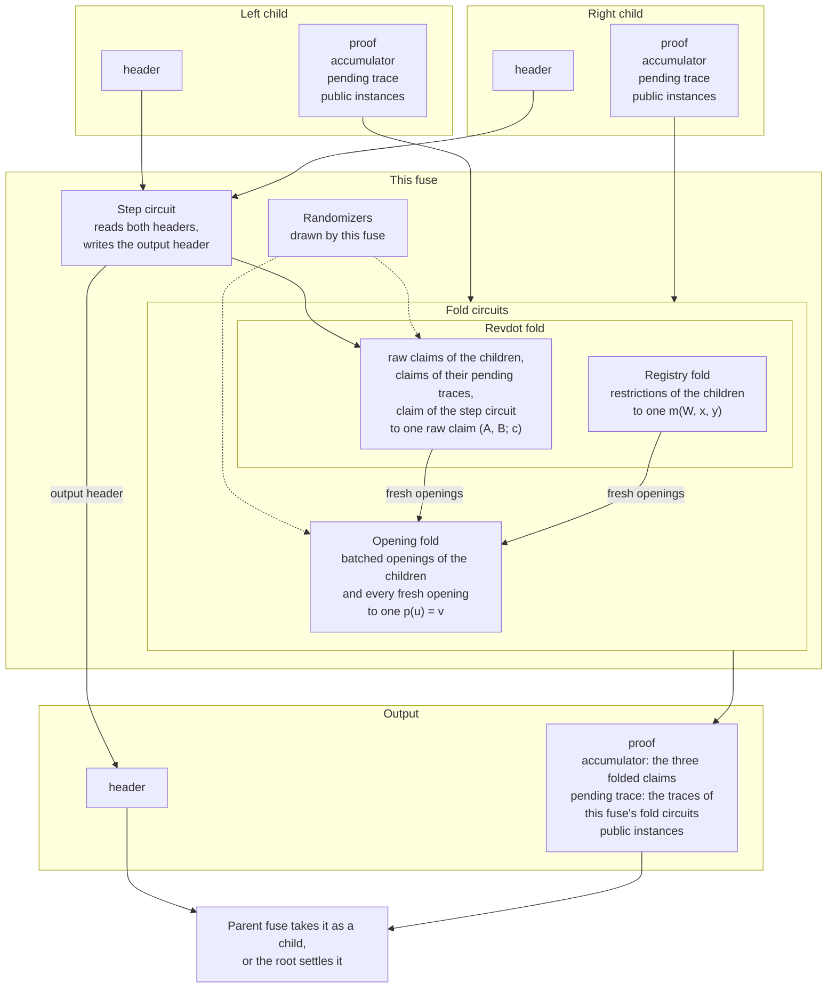

# Construction {#construction}

This section describes the accumulation scheme that `ragu_pcd` implements: the
contents of an uncompressed proof, the protocol of a fuse operation, the base
case and the decider. Every object is given a name and an order, so that each
check can be written as an equation.

The section is a reference for representations, orders and the contract of each
circuit. [The Refinement Ladder](../ladder/index.md) gives the reason for each
component, and the [Fuse PIOP](../iop.md) follows one fuse round by round as an
interactive protocol. Both link here for the exact statements.

The scheme is built from [arithmetic circuits](arithmetization.md) over one
field at a time. The [wiring polynomials](wiring.md) of the circuits over a
field are collected in a [registry](registry.md), and parts of their traces are
committed separately, in [stages](staging.md).

This page is an overview of one fuse, with figures. It shows the folds of a
fuse, the public instances that a child gives to its parent, and the stages by
round and by gate. The pages after it give the exact statements.

**Compression, rerandomization and profiles other than the standard one are out
of scope for this section.** A profile can add circuits, stages and
polynomials. It registers them at [setup](setup.md#finalization), and it cannot
add any during a fuse. The standard profile adds none.[^online]

[^online]: The two online polynomials that every proof stores for its output
    header are not a profile feature, and this section covers them.

## One Fuse at a Glance {#at-a-glance}

[Proof-carrying data](../../concepts/pcd.md) is a
[header](setup.md#headers) with a proof. The header is the data of the
application, and the proof is about the computation that produced the header.
A [step](setup.md#steps) has two input headers and one output header. A
**fuse** takes two proofs and a step and produces one proof. The two inputs of
a fuse are its **children**.

A fuse has circuits of two kinds.

- The [step circuit](setup.md#step-circuit) is the circuit of the application.
  It reads the two input headers and writes the output header.
- The [internal circuits](internal_circuits.md) are the same in every fuse.
  They check the fold, and this page calls them the **fold circuits**.

A fuse does not decide whether its children are valid. It reduces what the
children owe, and the claim of its own step circuit, to what the output proof
owes. The fold circuits check only that this reduction was done correctly. What
remains is settled once, for the root, by the [decider](decider.md) or by
[compression](../recursion/compression.md).



The figure shows one side of one fuse, and [both sides](#two-sides) advance in
the same fuse. A solid arrow carries what a proof stores, or a claim that the
fuse folds. A dotted arrow carries the fuse's
[randomizers](claims.md#randomizer), which exist only during the fuse.

## Accumulator and Pending Trace {#accumulator-pending-trace}

An uncompressed proof holds an accumulator, a pending trace and
[auxiliary data](proof.md#auxiliary).

The **accumulator** is what remains of every claim folded so far. On each side
it has three components. Each is a claim of one of the
[three jobs](../ladder/rung_02.md), and each job costs time proportional to
$4n$ if done directly.

| Component | Claim |
|---|---|
| revdot claim $(A, B; c)$ | $\revdot{A}{B} = c$ |
| registry restriction | the stored polynomial is $m(W, x, y)$, a restriction of the [registry polynomial](registry.md) |
| batched opening | $p(u) = v$, and $P$ is the commitment of $p$ |

The **pending trace** holds the polynomials of the fuse that produced the
proof: those of the fold circuits and of the stages that those circuits read,
$48$ on the native side and $45$ on the nested side. The trace of a fold
circuit contains the challenges of the fold that the circuit checks. It cannot
be committed before those challenges, so the claim about it joins the next
fold. A fuse does not check its own pending trace. A parent folds it into the
next accumulator, and the decider checks the pending trace of the root
directly.

The step's own circuit is not part of the pending trace. The step circuit runs
after $w$ is drawn, and its trace is committed before $y$ and $z$ and depends
on no later challenge. The fuse that runs a step therefore folds the claim
about it into its own accumulator, and keeps neither polynomial of that trace.

Each circuit has a public instance, and the target of its claim is computed
from that instance. The native fold circuits share the
[native unified instance](proof.md#native-unified), and the nested fold
circuits share the [nested unified instance](proof.md#nested-unified). The two
instances hold the challenges of the fuse, the values $c$ and $v$ of each side,
and commitments. The instance of the step circuit holds the three headers and
the online openings. The fuse that runs the step uses this instance and does
not store it. Only the output header and the registry index of the step circuit
go to a parent, in the instance of `hashes_1`.

Every proof stores two [online polynomials](setup.md#headers) for its output
header. A step may open each of six online polynomials at most once: the four
of its children and its own two. The opening fold proves these openings.

## Three Folds {#three-folds}

A fuse folds the claims of each kind separately. This page gives each fold a
name, and the table links the page that describes it.

| Fold | Input | Output | Described In |
|---|---|---|---|
| revdot fold | the raw claim of each child, the claims of each child's pending trace, the claim of the step circuit and the [bonding claims](staging.md#bonding) | one raw claim $(A, B; c)$ | [Claims and Fold](claims.md) |
| registry fold | the registry restriction of each child | one restriction $m(W, x, y)$ at new $x$ and $y$ | [Registry Chain](batch.md#registry-chain) |
| opening fold | the batched opening of each child, and each opening that the other two folds need | one batched opening of $p$ at $u$ | [Batched Opening](batch.md) |

The figure puts the registry fold inside the revdot fold, because the revdot
fold uses its output. Each circuit claim contains the wiring polynomial of its
circuit, and the values of the wiring polynomials are openings of the new
restriction. The revdot fold and the registry fold both need openings of
committed polynomials, and the opening fold batches all of them.

The revdot fold and the opening fold each take in randomizers of the fuse's
own, so that the polynomials $A$, $B$ and $p$ that the proof stores are
uniformly random.

## Two Sides {#two-sides}

The scheme runs over a [cycle](cycle.md) of two curves. The commitment of a
polynomial over the native field $\F_p$ is a point of the curve $\E_q$, whose
coordinates lie in the nested field $\F_q$. The commitment of a polynomial over
$\F_q$ is a point of the curve $\E_p$, whose coordinates lie in $\F_p$. Circuits
over one field can therefore do arithmetic on the other field's commitments.

There are two accumulators, one per field, and one fuse advances both. A fuse
does not alternate between curves: it folds the children's native claims and the
children's nested claims in the same [eight rounds](protocol.md#rounds), under
one transcript.

Each side does its own field arithmetic: its circuits check its fold and its
batched evaluation. The following cross between the sides.

- Native commitments are held in nested
  [bridge stages](stage_contents.md#nested-stages), and the transcript absorbs
  the commitment of each of those stages except
  [`BridgeHash`](stage_contents.md#bridge-hash).
- Challenges are drawn over $\F_p$ only. The nested side uses the lift of each
  challenge's [endoscalar](cycle.md#endoscalars), and the challenge stage holds
  those lifts.
- The commitment $P$ of the native batched polynomial is computed by the
  [nested walk](walks.md#nested-walk).
- The commitment $P_q$ of the nested batched polynomial is computed by the
  [native walk](walks.md#native-walk).
- A child's native instance is held in the parent's native `preamble` stage, and
  the child's nested instance in the parent's `BridgePreamble` stage. Each
  instance holds commitments of the other side's polynomials.
- A fuse is a [base case](base_case.md) when both of its input headers are
  `Dummy` headers. The native circuits read the headers. The nested circuits
  have no headers. They read a sign $\sigma$ from the challenge stage, which is
  $+1$ in the base case and $-1$ otherwise, and the native circuits bind
  $\sigma$ to the headers.

## The Folds in Detail {#folds-in-detail}

The figure shows the three folds of the first figure in detail, for the native
side. An arrow that enters a box from the left is an input, and the label above
the arrow gives its source. A line that starts with `out ==>` is a component of
the new accumulator. Each box lists the sub-statements of its fold and the fold
circuit that checks each of them.

```text
              +----------------------------------------------------------------+
              | REVDOT FOLD                                                    |
 each child   |                                                                |
 ------------>|  raw claim (A, B; c)                                           |
 ------------>|  pending trace: 37 circuit and 11 stage polynomials            |
 ------------>|  public instance: U, hdr_O, id                                 |
 the step     |                                                                |
 ------------>|  trace r[Application] + r[ApplicationStage]                    |
 ------------>|  public instance: k_app                                        |
 this fuse    |                                                                |
 ------------>|  fold randomizers a*, b*                                       |
              |                                                                |
              |  builds 95 claims (a, b; target) at y and z                    |
              |     2  the children's raw claims                               |
              |    74  the fold circuits of the children, 37 each              |
              |     1  the step circuit                                        |
              |    18  bonding polynomials: 16 over the children's             |
              |        polynomials, 2 over the step's                          |
              |  adds 2 claims about a*, b*                                    |
              |  reduces them all to one claim, in two layers, at mu, mu'      |
              |                                                                |
              |  sub-statement                                    checked by   |
              |  a child's targets are k(y) over its instance     hashes_1     |
              |  the step's target is k_app(y) over its instance  collapse     |
              |  c is the fold of the targets and the quotients   collapse     |
              |  A(xz), B(x) are the fold of the opened values    compute_v    |
              |                                                                |
              |  +----------------------------------------------------------+  |
              |  | REGISTRY FOLD                                            |  |
 each child   |  |                                                          |  |
 ---------------->  restriction m(W, x_i, y_i)                              |  |
              |  |                                                          |  |
              |  |  m(W, x_i, y_i)  the children's, opened at W = w         |  |
              |  |       |          equal at W = w, Y = y_i                 |  |
              |  |  m(w, x_i, Y)    committed before y                      |  |
              |  |       |          equal at Y = y, X = x_i                 |  |
              |  |  m(w, X, y)      committed before x                      |  |
              |  |       |          equal at X = x, W = w                   |  |
              |  |  m(W, x, y)      the new restriction                     |  |
              |  |                                                          |  |
              |  |  it has no circuit: each "equal" is two openings that    |  |
              |  |  share one claimed-value wire                            |  |
              |  |                                                          |  |
              |  |  the revdot fold reads s_j(x, y) = m(omega_j, x, y), the |  |
              |  |  wiring polynomial of circuit j, to compute B(x)         |  |
              |  |                                                          |  |
              |  |  out ==> m(W, x, y)                                      |  |
              |  +----------------------------------------------------------+  |
              |                                         | 66 openings          |
              |  out ==> (A, B; c)                      |                      |
              +---------|-------------------------------|----------------------+
                        | 106 openings                  |
                        v                               v
              +----------------------------------------------------------------+
              | OPENING FOLD                                                   |
 each child   |                                                                |
 ------------>|  batched opening p_i(u_i) = v_i                                |
 the step     |                                                                |
 ------------>|  6 online openings (xi_s, eta_s) that the step circuit claims  |
 this fuse    |                                                                |
 ------------>|  batch randomizer p*                                           |
              |                                                                |
              |  gathers 180 openings (polynomial, point, value)               |
              |     2  the children's batched openings                         |
              |   106  from the revdot fold                                    |
              |    66  from the registry fold                                  |
              |     6  the step's online openings                              |
              |  alpha combines them into one quotient f                       |
              |  beta combines f and the 121 polynomials into p                |
              |  u is the one point at which p is evaluated                    |
              |                                                                |
              |  sub-statement                                    checked by   |
              |  v is the batch of the claimed values and of      compute_v    |
              |  the evaluations at u                                          |
              |  P is the same combination of the commitments     nested walk  |
              |                                                                |
              |  out ==> p(u) = v against P                                    |
              +----------------------------------------------------------------+
```

No party checks these sub-statements during the fuse. Each is a constraint of
the fold circuit named beside it, and the fuse produces the traces of those
circuits. The registry fold leaves one more obligation, which no fold circuit
checks: the new restriction must be the
[registry's restriction](batch.md#registry-candidates). A parent tests it at a
$w$ of its own, and the decider compares the root's restriction with the
registry.

The nested side has the same three folds, with other counts and without a step
circuit.

| | Native | Nested |
|---|---|---|
| claims of the revdot fold | $95$: $2$ raw, $74$ of fold circuits, $1$ of the step circuit, $18$ bonding | $83$: $2$ raw, $66$ of fold circuits, $15$ bonding |
| openings of the opening fold | $180$: $2$ of the children, $106$ from the revdot fold, $66$ from the registry fold, $6$ online | $158$: $2$ of the children, $98$ from the revdot fold, $58$ from the registry fold |
| polynomials combined into $p$ | $121$ | $107$ |
| pending trace of the output | $37$ circuit and $11$ stage polynomials | $33$ circuit and $12$ stage polynomials |

The next table gives the fold circuits for each job. The
[checks](protocol.md#checks) of the protocol give the exact statements.

| Job | Native Fold Circuits | Nested Fold Circuits |
|---|---|---|
| the challenges are the transcript's | `hashes_1`, `hashes_2` | none: the nested circuits read the lifts from the challenge stage |
| the challenge stage holds the lifts of the transcript's challenges | `bind_challenges[0..=3]`, and the parent's `bind_beta` | |
| the targets are computed from the instances | `hashes_1`, `collapse` | `Collapse` |
| revdot fold | `collapse` | `Collapse` |
| registry fold and opening fold | `compute_v` | `ComputeV` |
| commitment of the other side's batched polynomial | `endoscaling_step[0..=26]`, `bind_endoscalar` | `EndoscalingStep(0..=30)`, `Collapse`, `ComputeV` |
| the inputs of each walk are the commitments fixed in earlier rounds | `bind_beta` | `Loading` |

## Instances Between Fuses {#instances}

A fuse makes the claim of a fold circuit, and its parent folds that claim. The
parent computes the target of the claim from the public instance of the
circuit. The figure shows where each instance is held and which circuit uses
it, for a child, the current fuse and a parent. In the figure, `U(i)` is the
native unified instance $U^{(i)}$ of child $i$, and `N(i)` is the nested
unified instance of child $i$.

```text
+------------------------------------------------------------------------------+
|                   CHILD FUSE i   (i = 0 left, i = 1 right)                   |
|                                                                              |
| Generates as output                                                          |
| -------------------                                                          |
| header    hdr_O(i)                                                           |
| proof     accumulator and pending trace, on each side                        |
| instances that its fold circuits expose                                      |
|   U(i)       native unified instance: 9 challenges, 9 bridge                 |
|              commitments, c, v, and the nested [A_q], [B_q], [m_q], P_q      |
|   hdr_O(i), id(i)   beside U(i), in the instance of hashes_1 only            |
|   N(i)       nested unified instance: c_q, v_q, x_q, y_q, u_q, and 16        |
|              native commitments, [A], [B], [m], P, O_0, O_1 among them       |
|                                                                              |
| This fuse does not check its own fold circuits. Their traces are             |
| pending. A parent computes the targets of their claims from these            |
| instances.                                                                   |
+------------------------------------------------------------------------------+
                                      |
                                      v
+------------------------------------------------------------------------------+
|                                  THIS FUSE                                   |
|                                                                              |
| Receives, and holds in a stage                                               |
| ------------------------------                                               |
| U(i), hdr_O(i), id(i)     native stage Preamble, fixed before y              |
| N(i)                      nested stage BridgePreamble, fixed before w        |
| native commitments        BridgePreamble                                     |
| nested commitments        PointsBinding and PointsPreamble                   |
|                                                                              |
| Responsibility toward child i                                    circuit     |
| -----------------------------                                                |
| targets of 10 native claims are k_uni(y), k_bridge(y),           hashes_1,   |
| k_cv(y) over U(i), hdr_O(i), id(i)                               collapse    |
| targets of 2 nested claims are k_q(y_q) over N(i)                Collapse    |
| targets of the raw claims are c(i) and c_q(i)                    collapse,   |
|                                                                  Collapse    |
| p_i opens to v(i) at u(i); the registry fold starts              compute_v,  |
| from x(i), y(i); the same on the nested side                     ComputeV    |
| commitments named in U(i) are the points of                      bind_beta   |
| PointsBinding, which the native walk folds                                   |
| commitments named in N(i) are inputs of the nested walk          Loading     |
|                                                                              |
| Responsibility toward its own step                               circuit     |
| ----------------------------------                                           |
| the step's instance k_app is made and used in this fuse:                     |
|   zeta = w, six openings, bridge hash, hdr_O(0), hdr_O(1), hdr_O             |
| the target of the step's claim is k_app(y)                       collapse    |
| hdr_O(i) is one wire of Preamble, in k_app and in k_bridge(i)                |
| an opening is one wire of Preamble, in k_app and in the opening fold         |
|                                                                              |
| Generates as output                                                          |
| -------------------                                                          |
| header hdr_O; proof; instances U, hdr_O, id, N of its own fold circuits      |
+------------------------------------------------------------------------------+
                   |                                      |
                   v                                      v
+-------------------------------------+  +-------------------------------------+
|             PARENT FUSE             |  |                 ROOT                |
|                                     |  |                                     |
| Does the same, with this fuse       |  | There is no parent. The decider     |
| as one of its two children.         |  | computes U and N from the proof and |
|                                     |  | checks the pending trace.           |
|                                     |  +-------------------------------------+
```

Each header is checked once by the fuse that produced it and once by the fuse
that consumes it. The [proof page](proof.md#native-unified) lists the slots of
both instances, and the [claim lists](claims.md#native-targets) define the
targets.

## Stages in Time and Space {#stages-time-space}

A [stage](staging.md#stages) is a block of consecutive gates whose wires are
committed apart from the circuits that read them. A fuse commits each stage in
one round, and a stage has the same gates in every circuit that reserves it.
The figures below show the stages by round and by gate.

### Time {#stages-time}

Time runs from top to bottom. A dashed line is a challenge, and the stages
above the line are fixed before that challenge is drawn. A solid line joins the
stages of one chain. The native stages form a tree with three chains, and the
nested stages form one chain. The first column holds the two polynomials of the
step circuit. The names are those of the
[polynomial orders](setup.md#rx-order).

```text
NATIVE, over F_p                                               NESTED, over F_q
step              error        query         points            one chain

                                             PointsBinding     BridgeHash [1]
                      +-----------------------------+                 |
ApplicationStage      |                      PointsPreamble    BridgePreamble
- - - - - - - - - - - | - - - - - -    w      - - - | - - - - - - - - | - - - -
Application       Preamble                   PointsRegistryWx  BridgeSPrime
                      +----------+                  |                 |
- - - - - - - - - - - | - - - -  |    y, z    - - - | - - - - - - - - | - - - -
                  InnerError [2] |                  |          BridgeInnerError
- - - - - - - - - - - | - - - -  |     mu     - - - | - - - - - - - - | - - - -
                  OuterError [2] |                  |          BridgeOuterError
- - - - - - - - - - - - - - - -  |    mu'     - - - | - - - - - - - - | - - - -
                                 |           PointsAb          BridgeAB
- - - - - - - - - - - - - - - -  |     x      - - - | - - - - - - - - | - - - -
                               Query                |          BridgeQuery
- - - - - - - - - - - - - - - -  |   alpha    - - - | - - - - - - - - | - - - -
                                 |           PointsF           BridgeF
- - - - - - - - - - - - - - - -  |     u      - - - | - - - - - - - - | - - - -
                               Eval                 |          BridgeEval
- - - - - - - - - - - - - - - - - - pre_beta  - - - | - - - - - - - - | - - - -
                                             PointsWalk        EndoscalarStage
                                                               PointsStage [3]
                                                               ChallengeStage

[1] committed in round 1; the transcript does not absorb its commitment
[2] in gate order, OuterError precedes InnerError
[3] in gate order, EndoscalarStage, BridgeHash and PointsStage precede
    BridgePreamble
```

Some committed polynomials are not stages, and the figure omits them. For the
native side, the table gives what each round fixes and the use of its
challenge. The [rounds](protocol.md#rounds) of the protocol give the objects of
both sides, and [Stage Contents](stage_contents.md) gives the wires of each
stage.

| Challenge | Fixed Before It | Use |
|---|---|---|
| $w$ | every commitment of the children; the step's online polynomials and staged values | the point at which the registry is restricted; the step's $\zeta$ |
| $y$, $z$ | the step circuit's polynomial; the children's instances and the step's own header and openings, in `Preamble`; $m(w, x^{(i)}, Y)$; the fold randomizers | combine the constraints of every claim |
| $\mu$ | the first-layer quotients; $m(w, X, y)$ | first-layer fold |
| $\mu'$ | the second-layer quotients | second-layer fold |
| $x$ | $A$ and $B$ | the point at which $A$, $B$ and the polynomials of the claims are opened |
| $\alpha$ | every claimed value; $m(W, x, y)$ | combines the openings into $f$ |
| $u$ | $f$ and the batch randomizer | the single point at which every batched polynomial is evaluated |
| $\text{pre\_beta}$ | the evaluations at $u$ | combines the batched polynomials into $p$ |
| none | $p$, the two walks, the challenge stage and the traces of the fold circuits | |

### Space {#stages-space}

The gates of a stage begin where the gates of its parent stage end. A circuit
reserves the gates of one chain, as far as its last stage, and its own
polynomial begins at the next gate. The trace of a circuit is the sum of its
own polynomial and the polynomials of the stages that it loads. The figure
shows the trace of the native `collapse`, whose last stage is `InnerError`.
Here $h = \lceil (3H + 95) / 2 \rceil$ is the number of gates of the `Preamble`
stage.

```text
gates    0        1..28       29..28+h    29+h..48+h   49+h..101+h    102+h..
      +------+-------------+-----------+-------------+-------------+-----------+
stage |SYSTEM|PointsBinding|  Preamble |  OuterError |  InnerError | own gates |
      +------+-------------+-----------+-------------+-------------+-----------+
holds           (reserved)  r[Preamble] r[OuterError] r[InnerError] r[Collapse]
```

`collapse` reserves the gates of `PointsBinding` and does not load that stage.
The figure of [Stage Contents](stage_contents.md#native-stages) gives the gates
of all three native chains. The table gives the last stage of each circuit.

| Side | Last Stage | Circuits |
|---|---|---|
| native | `ApplicationStage` | the step circuit |
| native | `Preamble` | `bind_beta` |
| native | `OuterError` | `hashes_1`, `hashes_2` |
| native | `InnerError` | `collapse` |
| native | `Eval` | `compute_v`, `bind_challenges[0..=3]` |
| native | `PointsWalk` | `bind_endoscalar`, `endoscaling_step[0..=26]` |
| nested | `PointsStage` | `EndoscalingStep(0..=30)` |
| nested | `BridgeEval` | `Loading` |
| nested | `ChallengeStage` | `Collapse`, `ComputeV` |

A circuit can load only stages that it reserves. For example, `collapse` cannot
load `Query`, which is on another chain.

## Outline of a Fuse {#one-fuse}

A fuse takes two proofs and a step and produces one proof.

1. It runs the step and gathers the claims: each child's raw claim, one claim
   for every circuit of the child's pending trace, and one claim for every
   mask, which covers both children's polynomials. The native side adds the
   claim of the step circuit that the fuse just ran, with its two masks. The
   nested side has one more claim that covers both children, for the
   [loading relation](internal_circuits.md#loading) of its walk. There are $95$
   native and $83$ nested claims.
2. It [folds](claims.md#fold) each list into a new raw claim, in two layers.
   The fold takes in two claims about a [randomizer](claims.md#randomizer) of
   the fuse's own, so that the new raw claim is about uniformly random
   polynomials.
3. It gathers the evaluations needed to check the fold, to check the children's
   own batched openings and to keep the registry restriction consistent, and
   [batches](batch.md) them into one opening per side, with a
   [randomizer](batch.md#batch-randomizer) of its own.
4. It computes the commitment of each batched polynomial by a [walk](walks.md)
   on the other side.
5. It runs the [circuits](internal_circuits.md) that check items 2 to 4 and the
   transcript. The polynomials of those circuits are the new pending trace.
