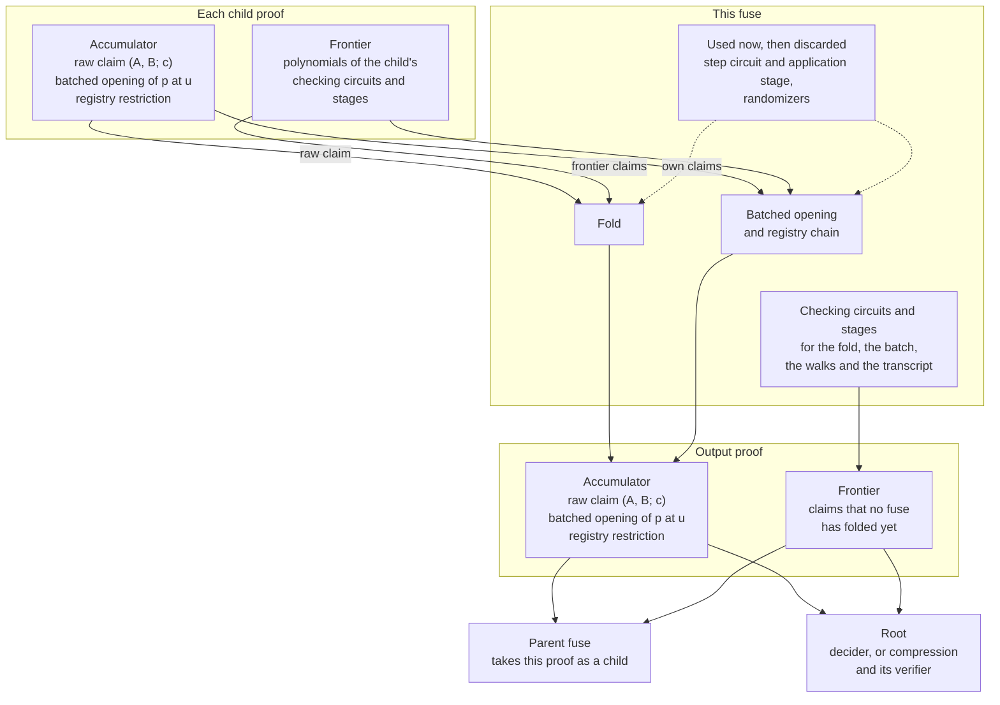

# Construction {#construction}

This section describes the accumulation scheme that `ragu_pcd` implements: the
contents of an uncompressed proof, the protocol of a fuse operation, the base
case and the decider. Every object is given a name and an order, so that each
check can be written as an equation.

The section is a reference for representations, orders and the contract of each
circuit. [The Refinement Ladder](../ladder/index.md) gives the reason for each
component, and the [Fuse PIOP](../iop.md) follows one fuse round by round as an
interactive protocol. Both link here for the exact statements.

The scheme is built from [arithmetic circuits](arithmetization.md) over one
field at a time. The [wiring polynomials](wiring.md) of the circuits over a
field are collected in a [registry](registry.md), and parts of their traces are
committed separately, in [stages](staging.md).

**Compression, rerandomization and profiles other than the standard one are out
of scope for this section.** A profile can add circuits, stages and polynomials
at fixed hooks, and the standard profile leaves every hook empty.[^online]

[^online]: The two online polynomials that every header carries are not a
    profile feature, and this section covers them.

## Two Sides {#two-sides}

The scheme runs over a [cycle](cycle.md) of two curves. The commitment of a
polynomial over the native field $\F_p$ is a point of the curve $\E_q$, whose
coordinates lie in the nested field $\F_q$. The commitment of a polynomial over
$\F_q$ is a point of the curve $\E_p$, whose coordinates lie in $\F_p$. Circuits
over one field can therefore do arithmetic on the other field's commitments.

There are two accumulators, one per field, and one fuse advances both. A fuse
does not alternate between curves: it folds the children's native claims and the
children's nested claims in the same [eight rounds](protocol.md#rounds), under
one transcript.

Each side does its own field arithmetic: its circuits check its fold and its
batched evaluation. The following cross between the sides.

- Native commitments are held in nested
  [bridge stages](stage_contents.md#nested-stages), and the transcript absorbs
  the commitment of each of those stages except
  [`BridgeHash`](stage_contents.md#bridge-hash).
- Challenges are drawn over $\F_p$ only. The nested side uses the lift of each
  challenge's [endoscalar](cycle.md#endoscalars), and the challenge stage holds
  those lifts.
- The commitment $P$ of the native batched polynomial is computed by the
  [nested walk](walks.md#nested-walk).
- The commitment $P_q$ of the nested batched polynomial is computed by the
  [native walk](walks.md#native-walk).
- A child's native instance is held in the parent's native `preamble` stage, and
  the child's nested instance in the parent's `BridgePreamble` stage. Each
  instance holds commitments of the other side's polynomials.
- The base-case verdict is computed natively from the headers and carried to the
  nested side as a sign in the challenge stage.

## Accumulator and Frontier {#accumulator-frontier}

An uncompressed proof holds an accumulator, a frontier and
[auxiliary data](proof.md#auxiliary).

The **accumulator** is what remains of every claim folded so far. On each side
it is a revdot claim $(A, B; c)$, a batched opening of a polynomial $p$ at a
point $u$, and a restriction $m(W, x, y)$ of the registry polynomial.

The **frontier** holds the polynomials of the fuse that produced the proof:
those of the circuits that verified the fold and of the stages that those
circuits read, $48$ on the native side and $45$ on the nested side. A fuse does
not check its own frontier. A parent folds it into the next accumulator, and the
decider checks the frontier of the root directly.

The step's own circuit is not part of the frontier. The step circuit runs
after $w$ is drawn, and its trace is committed before $y$ and $z$ and depends
on no later challenge. The fuse that runs a step therefore folds the claim
about it into its own accumulator, and keeps neither polynomial of that trace.

The figure shows one side of one fuse, and both sides advance in the same fuse.
A solid arrow carries what a proof stores. A dotted arrow carries the fuse's
own polynomials, which exist only during the fuse: the two polynomials of the
step circuit's trace, which the native side alone has, and the fuse's
[randomizers](claims.md#randomizer). The parent of a proof does not verify what
it takes in. It folds the raw claim and the claims of the frontier and opens
$p$ and the restriction, which leaves an accumulator and a frontier of its own.
What remains is settled once, for the root, by the [decider](decider.md) or by
[compression](../recursion/compression.md).

## Outline of a Fuse {#one-fuse}

A fuse takes two proofs and a step and produces one proof.

1. It runs the step and gathers the claims: each child's raw claim, one claim
   for every circuit of the child's frontier, and one claim for every mask,
   which covers both children's polynomials. The native side adds the claim of
   the step circuit that the fuse just ran, with its two masks. The nested side
   has one more claim that covers both children, for the
   [loading relation](internal_circuits.md#loading) of its walk. There are $95$
   native and $83$ nested claims.
2. It [folds](claims.md#fold) each list into a new raw claim, in two layers.
   The fold takes in two claims about a [randomizer](claims.md#randomizer) of
   the fuse's own, so that the new raw claim is about uniformly random
   polynomials.
3. It gathers the evaluations needed to check the fold, to check the children's
   own batched openings and to keep the registry restriction consistent, and
   [batches](batch.md) them into one opening per side, with a
   [randomizer](batch.md#batch-randomizer) of its own.
4. It computes the commitment of each batched polynomial by a [walk](walks.md)
   on the other side.
5. It runs the [circuits](internal_circuits.md) that check items 2 to 4 and the
   transcript. The polynomials of those circuits are the new frontier.
