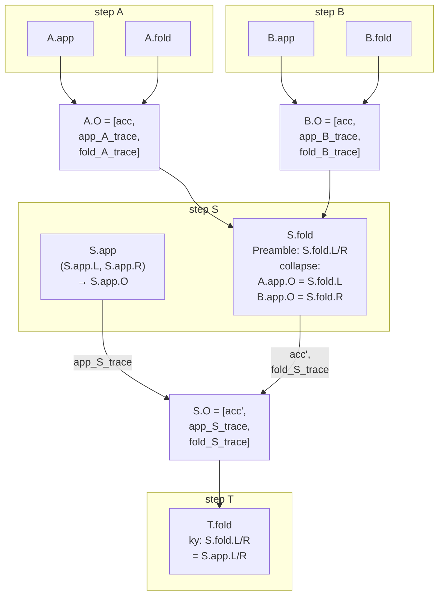

# Online Polynomial Oracle

## Motivation {#motivation}

An application circuit (a PCD step) commits some **online polynomials** $f_1,\ldots,f_k$
(e.g. $\mathsf{acc^{tg}}$ before and after merging more tachygrams),
samples a challenge $\zeta$, then makes **online evaluation claims** $f_i(x_i)=y_i$,
and finally enforces an algebraic relation among the $y_i$ in circuit.
These opening claims could be evaluations at the challenge point $f_3(\zeta)$ (e.g. point-checking tachygram accumulator update);
or at arbitrary points (e.g. non-membership test $f_\mathsf{QrBucket}(\nf)$).

We use the term "online" to differentiate from being fixed at registry finalization time.
The correctness of online polynomial openings is not enforced in circuit, but fused into the Ragu's folding mechanism.

All usages of the online poly oracle in Tachyon's [proof tree](https://tachyon.z.cash/book/revisit.html#prooftree) can be categorized as:

- T1: algebraic relation among _public_ online polynomials: $L(X)\cdot R(X) = O(X)$
  - here commitments of $L(X), R(X), O(X)$ are associated with the public headers of PCD proofs
- T2: algebraic relation among public _and private_ online polynomial: $L(X)\cdot \prod_i (X-\tg_i) = O(X)$
  - here $tg_i$ are private witness, thus $\prod_i (X - \tg_i)$ is a private online poly
- T3: random challenge sampling after committing online polynomials, public or private
  - in service of T1 and T2 as their relation is probabilistically point-checked at a random challenge
- T4: arbitrary evaluation on committed online polynomials, public or private
- T5: hashing online polynomial commitment: $\anchor' = H(\anchor \| e \| \acc^\tg)$ where $\anchor, e \in\F_p$ under an algebraic hash $H$, but $\acc^\tg\in\E_q$ with $x,y$-coordinate in $\F_q$

## Mental Model: Capabilities of Online Poly Oracle {#cap}

For Tachyon developers, this is your mental model of what Ragu's online polynomial oracle provides/allows:

A **header** is application state passed between steps, such as a state
root or item count. The Rust `Header` trait defines how that state is
encoded as `Fp` elements. Ragu adds padding and the header's suffix to
produce `HEADER_SIZE` field elements.

A circuit's **public instance** is the tuple of values its circuit claim
is bound to. Ragu encodes that tuple as an instance polynomial $k(Y)$ and
uses $k(y)$ as the circuit claim's target. The application circuit's instance
contains the left, right and output header fields, together with $\zeta$,
the six opening pairs and the bridge digest. Header fields are one part of
that instance.

`Pcd` pairs the header's data with a `Proof`. The proof stores two `Eq`
polynomial commitments for the step's output, exposed by
`Pcd::commitments()`. These points are carried in the nested `Preamble` and
exported through the public instance shared by nested `collapse` and
`compute_v`. That **nested unified instance** contains accumulator values,
challenge lifts and proof commitments: it is a statement for Ragu's
internal circuits.

- C1: each proof carries $2$ public polynomial commitment slots associated with its output header
  - `Eq` is alias for `HostCurve` type and $\E_q$ in math
  - in a `Step`, we refer to the $6$ total public online poly commitments as `[L0, L1, R0, R1, O0, O1]`
  - a header lists the kinds of polynomial its proofs carry, one unit type per slot or `Padding`, as `Header::OnlinePolyCommit`; a step reads, prepares and opens a polynomial by its kind, so a slot the header leaves to padding cannot be addressed at all
  - Ragu proves that an opening is of the committed polynomial, not which polynomial was committed: what `Step::prepare` returns is prover data, so an output slot whose opening the step's circuit leaves unconstrained holds a polynomial of the prover's choosing. A slot the step does not open is padding: Ragu opens it at $\zeta$ and holds the value to one after the step's circuit; a slot opened and left unconstrained is a hint, as $\cm_g, \cm_h$ are [below](#changes)
  - compression carries the two output commitments. Aggregator decompression preserves the header and binds its output slots to those commitments. The aggregator supplies the matching coefficients for later oracle queries.
  - the slots hold public values, and Ragu does not hide them: their commitments are deterministic, rerandomization leaves them unchanged, and compression and decompression carry them as they are. A private polynomial belongs in the application stage (C2), not in a slot
- C2: a two-phase application circuit: an application stage, committed before $\zeta$, holds the staged values a check at $\zeta$ reads but no header carries, such as the roots $\tg_i$ of a private polynomial $\prod_i (X - \tg_i)$; the circuit, synthesized after $\zeta$, evaluates such a polynomial in-circuit from the staged values and relates it to the public slots' openings. Such a polynomial has no commitment slot; profile-internal circuits commit online polynomials through C6 below
- C3: a random challenge $\zeta$ is sampled after all public and private online polynomials are committed; $\zeta$ becomes available when synthesizing the final stage of app circuit
  - public poly commitments are carried in proofs and associated with their output headers
  - staged values, and so any private polynomial built from them, live in the application stage, whose commitment is absorbed in the FS transcript during `fuse()`
  - consequently, a check at $\zeta$ is sound when it evaluates a residual polynomial, such as $O(X) - L(X)\cdot(X - t)$, whose coefficients were fixed before $\zeta$, whose degree is bounded, and which is nonzero whenever the intended identity is false: a false identity then passes only if $\zeta$ is a root of the residual.
  Fixed before $\zeta$ are the committed polynomials (the rank bounds their degree), an opening at a point itself fixed before $\zeta$, the left/right header fields, the application stage's values and constants.
  $\zeta$ and the openings at it evaluate the residual, but a value the final stage computes from them is not a fixed coefficient or root: computing $t = \zeta - O(\zeta)/L(\zeta)$ in the circuit is no safer than witnessing it.
  Any other value the final stage witnesses, including the output header's fields, is likewise chosen _after_ $\zeta$. Witness $t$ in the application stage instead.
  An in-circuit hash output whose preimage is witnessed after $\zeta$, or a value from a small set (e.g. a bit) chosen after $\zeta$, is not fixed either, and each needs its own argument: the first rests on the hash's preimage resistance, and the second multiplies the soundness error by up to the set's size.
- C4: the second/final app stage can "claim" the following values and constrain any relation for them during circuit synthesis
  1. the random evaluation point $\zeta$
  2. $6$ polynomial queries on public online polynomials $\{(x_i, y_i = f_i(x_i))\}_{i\in [0, 5]}$
  3. a special binding hash $H^{bridge}(\cm_{O_1}) \in\F_p^2$ value<br>

  Correctness of all poly queries is folded into Ragu's running accumulator (i.e. PCD proof).
  Ragu binds $\zeta$ to its Fiat-Shamir challenge and the bridge digest to `O1`.
  The digest is neither required to be canonical nor fixed before $\zeta$; applications that use it in anchors must recompute advancement natively and accept only canonical-chain anchors.
  - importantly, we **only allow one opening per public online polynomial**; a private polynomial is evaluated in-circuit from its staged roots or coefficients, as many times as the circuit budget permits
  - all declared queries follow the canonical order, targeting $L_0, L_1, R_0, R_1, O_0, O_1$ respectively
  - public instance $k(Y)$ of the app circuit changes from `[L/R/O header fields]` of size `3*HEADER_SIZE` to: `[zeta, x_0, y_0, ..., x_5, y_5, h_O1, L/R/O header fields]`, where `h_O1` is the two coordinates of $H^{bridge}(\cm_{O_1})$
  - the special hash only commits the step's own `O1` slot, so if the app circuit wants to compute
  $\anchor' = H(\anchor \| e \| \acc^\tg)$ then $\acc^\tg$ must occupy the output polynomial slot `O1`
- C5: a profile may give each step one online $\F_q$ polynomial $f_q$, committed as an $\E_p$ point, for Ragu's nested internal circuits to open (see [v5](#v5))
  - it is private to the step: committed before $w$ and opened once, at $\zeta_q = \mathsf{lift}(w)$, by the step's own nested `compute_v`; no header carries it, and C3's rule applies with $\zeta_q$ in place of $\zeta$
  - application circuits cannot open it; it exists for the `Aggregator` profile's decompression, which commits the nested IPA's $s(X)$ there. A profile's prover supplies the polynomial, a placeholder by default
  - Ragu proves the opening is of the committed polynomial; which polynomial it is, a profile's extension circuits constrain, through the commitment and the opening the step exports to its parent for the slots the profile's bindings name (see [v5](#v5))
- C6: a profile may give its internal circuits online polynomial batches over both $\F_p$ and $\F_q$ (see [V6](#v6))
  - the profile fixes distinct polynomial slots, their commitment phases and the opening list; each polynomial may be opened at several points
  - consumers read authenticated staged inputs, opening wires and opposite-field commitment points; the public application API is unchanged
  - source-registry restrictions have an additional identity obligation: a setup-bound mesh carries both children's obligations and reduces all new identities to one outgoing restriction per field, closed at terminal verification

## Tachyon Stamp Handoff {#stamp-handoff}

In Tachyon's intended wallet-to-aggregator flow, a
`CompressedPcd<Pasta, Stamp>` pairs the Stamp's header data with its
compressed proof.

| Location | Contents |
| --- | --- |
| Stamp header data | Anchor and tachygram-set bridge hash |
| Compressed proof's online commitment slots | Action-set commitment in `O0` and tachygram-set commitment in `O1` |

The wallet can compress the Stamp directly. The aggregator reconstructs the
two set polynomials from the covered action digests and tachygrams in the
transaction data. Each polynomial has the encoded members of its set as
roots. The aggregator passes their coefficients in slot order to
`Application::decompress_with_polynomials`. `StampLift` opens the two
polynomials to carry the sets forward at a new anchor. `StampMerge` opens
both inputs' polynomials and their products. After the lifts and merges,
the aggregator compresses the final proof.

The decompression circuits verify the wallet proof and equate the new
Stamp's two commitment points with the verified wallet points. The
usual output queries fold claims about the supplied polynomials into the
polynomial commitment scheme (PCS) accumulator. Terminal verification
checks the accumulated claims against the carried commitments.

These sets are public like the header fields, so Tachyon uses deterministic,
unblinded commitments as compact representations of the polynomials. A
Tachyon verifier can reconstruct the polynomials from transaction data and
compare the recomputed commitments with the Stamp's certified commitments.

Application steps query the header-associated slots through `Oracles`. The
aggregator's internal circuits use separate profile slots for the IPA helpers
and wallet registry restrictions. For what a compressed aggregator proof
exposes, see [Decompression privacy](recursion/decompression.md#privacy).

## Changes to Tachyon Proof Tree {#changes}

The [capability list](#cap) above is a delicate balance between protocol complexity, cost, and feature-richness for the application circuit.
While it suffices for the majority of Tachyon's [current steps](https://github.com/tachyon-zcash/tachyon/tree/7e502548db33845dbaacdc0efe905d1a3c45e626), a small segment of the proof trees need to be adjusted.

- QR routing network, affecting `QrIntakeSplit`, `QrSideDescend`
  - two problems: 
    - during `QrIntakeSplit`, we have to query the NQR set $q_0(X)$ both at random challenge $\zeta$ and at discriminant $-R_j$, the only step in the entire proof tree where we query more than one point on a committed online poly. Querying at challenge is to ensure "decomposition" relation, querying at discriminant offset is to ensure "zero-value QR assignment".
    - during `QrSideDescend`, the prover needs to commit two private online polynomials $g(X), h(X)$, see [protocol here](https://tachyon.z.cash/book/revisit.html#partition).
    The left input proof with header `QrIntakeSides` already occupies 2 public online-poly slots, and the output proof with header `QrIntake` already occupies 1. Our app's first stage can only witness simple closed-form online polynomials in coefficient or roots form, but not directly a private commitment. Putting $\cm_g, \cm_h$ in the output proof would exceed the $2$-per-proof capacity
  - solve both problems using one trick: a proof with a new header `QrDescendWitness` and $\cm_g, \cm_h$ in its two public polynomial commitment slots
    - add two seed steps to generate `QrDescendWitness` for QR and NQR sides: these seed steps take `QrIntakeSides` as input and output `QrDescendWitness`, with no constraints on $g, h$ (they are hints, committed before `QrSideDescend`'s $\zeta$). Importantly, $q_0(-R_j)$ check is relocated from `QrIntakeSplit` to the seed step for NQR side here.
    - the NQR seed's input must be the `QrIntakeSides` that `QrSideDescend` descends, and header fields alone do not bind commitments. So `QrIntakeSplit` places $q_0$ in `O1` and writes $H^{bridge}(\cm_{q_0})$ into a `QrIntakeSides` field; the NQR seed copies it (and $R_j$) into `QrDescendWitness`, and `QrSideDescend` checks they match its left input's. Equal digests mean the same $q_0$.
    - current `QrSideDescend<Left=QrIntakeSides, Right=(), Output=QrIntake>`, change to `QrSideDescend<Left=QrIntakeSides, Right=QrDescendWitness, Output=QrIntake>` and query all 6 online polynomials within the step, perfectly fitting in our capacity
- Anchor chain lineage, affecting `AnchorSpanSeed`, `QrStampIntakeSeed`, `SummarySeed`, `SummaryAdvance`, `SpendableInit`
  - define $H(\ldots \in\F_p^\ast, \acc^\tg) := \mathsf{Poseidon}(\ldots, H^{bridge}(\acc^\tg))$ both natively in anchor chain definition and in-circuit constraints
- QR bucket in an Evidence Tree, affecting `EvidenceTreeOpen`, `EvidenceTreeLeafPair`
  - evidence tree's leaf encoding is another 8-element Poseidon hash including a $\acc^\tg$ preimage, thus use $H^{bridge}(\acc^\tg)$ accordingly

## Earlier Model of Ragu's Internals {#ragu}

```admonish warning title="Design history"
This section and the variants [V1](#v1) to [V4](#v4) record how the design
was reached. The figure below and its tuples describe Ragu at the
[commit the design builds on](#design), in which a step's parent folds its
application trace. They are not the implemented protocol. The
[capability list](#cap) above is the current interface, and the current
lifecycle of an application claim is in the
[figure of one fuse](construction/index.md#accumulator-frontier), the
[claim list](construction/claims.md#native-claims) and the
[Fuse PIOP](iop.md).
```

This model starts from Ragu as of the [commit the design builds on](#design),
in which a step's parent folds its application trace. Ragu has since adopted
the variant at the end of this section: the step folds its own application
trace and stage. Its native `Preamble` holds the six opening pairs, its
`collapse` computes the application's $k(y)$ over those wires, its
`compute_v` reads the same wires for the batch, and the parent folds those
circuits' claims from the step's frontier. The [Fuse PIOP](iop.md) gives the
implemented rule.

The tuples of this section, such as `[app.L, app.R, app.O]`, list header
fields only. They are projections of the public instances and not the
instances themselves: the application's instance today also holds $\zeta$, the
six opening pairs and the bridge digest, as [C4](#cap) lists, and the instance
of `hashes_1` is the $k_{\text{bridge}}$ of
[Construction](construction/proof.md#native-unified), which holds the
challenges and the bridge commitments of the unified instance.



Current fuse step `S` produces traces for two relations:

- `S.app`:  the application circuit
- `S.fold`: the folding circuit that takes the outputs of two children step `A` and `B`

Every step outputs an updated accumulator and two pending traces to be folded in the next step (a.k.a. parent step).
Thus `S.fold` circuit takes in `A.O = [acc, app_A_trace, fold_A_trace]` and `B.O = [acc, app_B_trace, fold_B_trace]`, folds all the claims in those 6 components into a new `acc'`.
The `acc` carries three types of obligations: the revdot accumulator ($\revdot{\v{a}}{\v{b}}=c$), the PCS opening accumulator ($P(u)=v$), and the registry consistency restrictions ($m(W, x, y)$).

The last step of a proof tree has no parent.
Its accumulator and pending traces are closed by the terminal verifier instead: `Application::compress` reduces the root proof's revdot claims and accumulator to one IPA opening per curve, and `Application::verify_compressed` recomputes each claim's `ky` from the root's public data and checks those openings (see [Compression](recursion/compression.md)).
The root's `app` and `fold` traces are thereby held to the same public instances a parent would hold them to.

A satisfying trace for the `S.fold` circuit `fold_S_trace` (a.k.a. the `rx` in polynomial form) is included in `S` step's output to be further folded/recursed in the next step `T`.
Actually, the folding circuit is not a monolithic circuit but a collective of multi-stage circuits (a.k.a. internal circuits) each constraining a sub-relation of the overall folding relation.
Thus, there is one `rx` (and respective `k(y)` public instance) per internal circuits (native or nested) to collectively prove the `S.fold` relation.

For PCD soundness, we must enforce

- `A.app.O = S.fold.L = S.app.L`
- `B.app.O = S.fold.R = S.app.R`

namely the left/right children of `S.fold` and `S.app` matches.
We refer to this as **header-carry check**.

The first half `A.app.O = S.fold.L` is enforced through `A.app`'s public instance, one step early.
`S.fold.L` is a wire in `S`'s `Preamble` stage; `S.fold`'s `collapse` computes `A.app`'s `ky` from that wire and checks it against the value the fold used for `app_A_trace`'s revdot claim, so the fold only closes if the wire equals the `A.app.O` the trace actually used.
Staging then propagates the copy: every internal circuit of `S.fold` that loads the preamble stage sees the same value.

The second half `S.fold.L = S.app.L`, at a glance, is a **cross-circuit copy constraint** since `fold` and `app` are two separate circuits.
Ragu implements it by including the fields to be cross-checked in the public instance `k(Y)` of both circuits,
so that when `app_S_trace` and `fold_S_trace` are verified/folded in parent step `T.fold`, the same values are supplied to those instance slots towards the computation of their `ky`. 
Effectively, by bridging through public instance, headers are copy-constrained in step `T`.

Concretely, the public instance of `hashes_1` internal circuit from the `S.fold` side is `[unified_S, fold.L, fold.R, 0, 1]`; while the public instance of `S.app` is `[app.L, app.R, app.O]`.
Then in `T.fold`, when we fold the revdot claims, we ensure the `ky` computation for `S.hashes_1` and `S.app` use the same value in the slot of `fold.L/R` and `app.L/R`.

Ragu now takes the direction of directly folding `S.app` in `S.fold`, as [proposed here](https://github.com/tachyon-zcash/ragu/issues/943) (you can view the cost reduction in the [draft PR](https://github.com/tachyon-zcash/ragu/pull/946)).
In this variant, `S.fold` witnesses `app_S_rx` through its bridged commitment before drawing the challenges `y,z`.

Interestingly, the second half `S.fold.L/R = S.app.L/R` becomes easy: `S.fold` now computes `S.app`'s `ky` itself, from the `L/R` wires in its own `Preamble` stage, so the match is made inside `S` and nothing needs to be exported for it.

In contrast, matching output `A/B.app.O = S.fold.L/R` becomes the cross-circuit copy-constraint.
Because `fold` and `app`'s trace are prepared in the same step, the verification/folding circuit for `app`'s output is only in the next step.
This requires the public instance of `hashes_1` to be `[unified_S, fold.O, id_S, 0, 1]` (the parent also loses the child's `circuit_id`, which the `Aggregator`'s statement `ky` reads, so it is exported too); that of `S.app` stays as `[app.L, app.R, app.O]`.
`S.fold` already holds `S.app.O` to its own `Preamble` wires, which `hashes_1` exports as `fold.O`; then, in step `T.fold`, the `ky` of `S`'s `hashes_1` takes `T`'s preamble copy of `S`'s output header, so `T.fold.L = S.fold.O = S.app.O`.
Note: the cost of header-carry check decreased as we only need to carry the output header in the public instance (a.k.a. `unified_bridge_ky`) instead of both left and right headers.

We pedantically explain this variant here because it's highly relevant in our decision to fold polynomial queries within the same step rather than deferring it.

## How Ragu's Online Poly Oracle Works {#design}

We incrementally revise Ragu to build up its capabilities for all [feature requests](#cap) of online polynomial oracles.
Each variant builds on top of the previous one, v1 builds on [today's Ragu](https://github.com/tachyon-zcash/ragu/tree/3219e0865e8bff1f9d817bfe3850d9e94b64338c), effectively on the Ragu [mental model above](#ragu).
The variants are kept in the order in which they were designed, and a
"before" diagram shows a state that no longer exists.
What a step can rely on is the [capability list](#cap), and the stage contents
and counts of the implemented protocol are in
[Construction](construction/stage_contents.md).

A relevant Ragu knowledge we keep referring to is its challenge scheduling among native and nested stages of its folding circuits.

```
     ERROR          QUERY          POINTS            NESTED

                                PointsBinding
       ┌──────────────────────────────┤
   Preamble                    PointsPreamble       Preamble
       ├──────────────┐               │                 │
       │              │               │                 │
─ ─ ─ ─ ─ ─ ─ ─ ─ ─ ─ ─ ─ ─ ─   w  ─ ─ ─ ─ ─ ─ ─ ─ ─ ─ ─ ─ ─ ─ ─ ─
       │              │       PointsRegistryWx       SPrime
─ ─ ─ ─ ─ ─ ─ ─ ─ ─ ─ ─ ─ ─ ─  y, z  ─ ─ ─ ─ ─ ─ ─ ─ ─ ─ ─ ─ ─ ─ ─
  InnerError*         │               │            InnerError
─ ─ ─ ─ ─ ─ ─ ─ ─ ─ ─ ─ ─ ─ ─  μ, ν  ─ ─ ─ ─ ─ ─ ─ ─ ─ ─ ─ ─ ─ ─ ─
  OuterError*         │               │            OuterError
─ ─ ─ ─ ─ ─ ─ ─ ─ ─ ─ ─ ─ ─   μ', ν'  ─ ─ ─ ─ ─ ─ ─ ─ ─ ─ ─ ─ ─ ─
                      │           PointsAb             Ab
─ ─ ─ ─ ─ ─ ─ ─ ─ ─ ─ ─ ─ ─ ─   x  ─ ─ ─ ─ ─ ─ ─ ─ ─ ─ ─ ─ ─ ─ ─ ─
                    Query             │               Query
─ ─ ─ ─ ─ ─ ─ ─ ─ ─ ─ ─ ─ ─ ─   α  ─ ─ ─ ─ ─ ─ ─ ─ ─ ─ ─ ─ ─ ─ ─ ─
                      │            PointsF              F
─ ─ ─ ─ ─ ─ ─ ─ ─ ─ ─ ─ ─ ─ ─   u  ─ ─ ─ ─ ─ ─ ─ ─ ─ ─ ─ ─ ─ ─ ─ ─
                    Eval              │               Eval
─ ─ ─ ─ ─ ─ ─ ─ ─ ─ ─ ─ ─ ─   pre_β  ─ ─ ─ ─ ─ ─ ─ ─ ─ ─ ─ ─ ─ ─ ─
                                 PointsWalk        Endoscalar*
                                                     Points*
                                                   Challenges

Native Internal Circuits:
┌────────────┬──────────────────────────────────────┐
│ Last stage │               Checkers               │
├────────────┼──────────────────────────────────────┤
│ Preamble   │ bind_beta                            │
├────────────┼──────────────────────────────────────┤
│ OuterError │ hashes_1, hashes_2                   │
├────────────┼──────────────────────────────────────┤
│ InnerError │ collapse                             │
├────────────┼──────────────────────────────────────┤
│ Eval       │ compute_v, bind_challenges           │
├────────────┼──────────────────────────────────────┤
│ PointsWalk │ bind_endoscalar, endoscaling_step    │
└────────────┴──────────────────────────────────────┘

Nested Internal Circuits:
┌────────────┬─────────────────────────────┐
│ Last stage │          Circuits           │
├────────────┼─────────────────────────────┤
│ Points     │ endoscaling_steps           │
├────────────┼─────────────────────────────┤
│ Challenges │ collapse, compute_v         │
└────────────┴─────────────────────────────┘
```

### V1: witness public poly, piggyback existing Fiat-Shamir challenge {#v1}

- Goal: piggyback an application-level Polynomial IOP flow into Ragu's existing machinery.
  - allows proofs to carry polynomial commitments associated with their output headers
  - commits them to the FS transcript
  - then draws a verifier challenge accessible from the application circuit
- Solution: 2-phase, singleton/non-stage application circuit, piggybacking on nested `Preamble` and challenge $w$.

To witness a proof's polynomial in a circuit, we cannot use all its coefficients since that would take up the entire circuit budget.
Instead, we witness its commitment, a `HostCurve`/$\E_q$ point with coordinates in the non-native field.
Luckily, Ragu already have a mechanism called **bridge commitment** to witness a batch of `HostCurve` points natively on a nested stage and commits the nested stage trace into a so-called bridge commitment of `NestedCurve`/$\E_p$ type.

In the first phase, we witness the `[L0, L1, R0, R1, O0, O1]` 6 poly commitments from the input and output proofs in the nested `Preamble` stage trace.
Absorbing `bridge_preamble_commitment` and squeezing challenge $w$ remains unchanged.
We set $\zeta = w$, maximally piggybacking the existing staging pipeline and introducing no change to the transcript.

The second phase has $\zeta$ available as an input to synthesize the circuit logic as usual.
We compute the full trace `app_rx` and its commitment, which the step folds itself (see [below](#ragu)): the `s_prime` bridge carries the commitment, so the trace is fixed before $y$.

The main challenges are
1) ensuring $\zeta$ used by the app circuit is correct given the externalized challenge squeezing;
2) extending ["header-carry check"](#ragu) to the proofs' associated poly commitments.

For (1), we update the public instance $k(Y)$ to include $\zeta$ used to synthesize `app_rx`.
During the `application_ky()` computation in the step's own `collapse` circuit, we Horner over `[zeta, L/R/O header fields]` where the `zeta` slot is filled with the step's own `unified.w` challenge value, effectively copy-constraining the correct $\zeta$ used in `app_rx` and derived from FS transcript.

For (2), we generalize the same "cross-circuit copy-constraint via public instance" (i.e. `unified_bridge_ky`) idea to the nested side where our points are witnessed.
Specifically, the nested unified instance, which both nested instance circuits (`collapse` and `compute_v`) Horner over, gains the exported commitments: `[unified_S, L0, L1, R0, R1, O0, O1, 1]`. The nested `collapse` circuit is the one that holds the exported wires to the `Preamble` stage's; the other circuit reads the same instance.
The parent needs all 6 points: it uses `S.app`'s `L/R/O` commitments (and, before [v4](#v4), opens them), and `S.O` becomes its own `L` or `R`.
There are two parts within the header-carry check, mirroring those of the field headers.
The first half `A.O = S.L` is enforced within `S`, one step early: `S`'s nested `Preamble` stashes `A`'s and `B`'s exported points next to its own `L0, L1, R0, R1` wires, `S`'s nested `collapse` computes `A`'s and `B`'s collapse `ky` from the stash and enforces `L0, L1, R0, R1` equal to the stashed `A.O0, A.O1, B.O0, B.O1`, a 4-point equality.
The second half `S.fold.L = S.app.L` holds when we fold revdot claims of these nested traces in the parent step `T`: the `ky` computation in `S.nested.collapse` takes `S`'s exported `[L0, L1, R0, R1, O0, O1]` from `T`'s stash, the same points `T` uses as `S.app`'s commitments.

### V2: bridge commitment for one public poly {#v2}

- Goal: design a binding hash function that takes in `CurvePoint`, outputs `Fp/CircuitField` $H^{bridge}(P\in\E_q) \in\F_p^2$ with verifiable trace
- Solution: add a dedicated nested stage for this point, and use its bridge commitment as its hash digest, its correctness is automatically folded within Ragu

```
Before:

     ERROR          QUERY          POINTS            NESTED

   Preamble                    PointsPreamble       Preamble (witness L0,L1,R0,R1,O0,O1)
       ├──────────────┐               │                 │
       │              │               │                 │
─ ─ ─ ─ ─ ─ ─ ─ ─ ─ ─ ─ ─ ─ ─   w  ─ ─ ─ ─ ─ ─ ─ ─ ─ ─ ─ ─ ─ ─ ─ ─

After:

   Preamble                    PointsPreamble       BridgeHash (copy of O1, not absorbed)
       ├──────────────┐               │                 │
       │              │               │             Preamble (witness L0,L1,R0,R1,O0,O1)
       │              │               │                 │
─ ─ ─ ─ ─ ─ ─ ─ ─ ─ ─ ─ ─ ─ ─   w  ─ ─ ─ ─ ─ ─ ─ ─ ─ ─ ─ ─ ─ ─ ─ ─
```

This gives us a digest `bridge_hash_commitment`, exposed to the application circuit by `Oracles::bridge_hash()`, whose coordinates are native on the `Fp` side and can be used to constrain a hash chain that takes polynomial commitments as preimages.
Importantly, we need to synchronize our outside-the-circuit code to use this non-standard hash function:
computes the trace `bridge_hash_rx` as a stage polynomial $\in\F_q[X]$, then computes its commitment as a $\E_p$/`NestedCurve` point, and uses its two coordinates as the hash digest.
The prover constructs the `BridgeHash` stage with a zero alpha (most stages take a random alpha), with only $x$ and $y$ of the point as nonzero coefficients.
The recomputed digest is then the fixed linear combination $x \cdot G_i + y \cdot G_j$ of two generators.
`BridgeHash` registers the ordinary stage mask, which checks the stage's support but does not by itself require this zero-alpha encoding.
`BridgeHash` comes directly after the endoscalar stage and before the points stage.
The digest depends on the stage's position.
The endoscalar stage has a fixed size (the 143-bit endoscalar encoding), thus the position does not move when the walk or `Preamble` grows.
Binding follows from the binding of the commitment: two points with the same digest are two openings of one commitment.

`O1` stays in the nested `Preamble`, and `BridgeHash` holds a copy; the nested `collapse` circuit enforces the two to be equal.
The honest prover constructs the digest before $\zeta$; `w` absorbs `O1` through the `Preamble`, and the digest itself is not absorbed.
The ordinary mask permits other encodings of the same `O1`, so an accepted digest need not equal the native recomputation and can be chosen after $\zeta$.
It cannot be treated as a fixed input to a check at $\zeta$ without an additional binding to a value fixed beforehand.
(Absorbing the digest would cost `hashes_1` one more Poseidon permutation, beyond its gate budget.)
The native `Preamble` holds the resulting digest, and `BridgeSPrime` binds its commitment before the step's $y$.
The step's `collapse` circuit enforces that this copy equals the digest in its unified instance, so the step's own application claim uses a point fixed before $y$.
The digest joins the `unified` instance next to `bridge_preamble_commitment`, and the parent binds it to the `BridgeHash` stage it folds, as it binds the other bridge commitments.
The app circuit claims the digest the same way it claims $\zeta$: its public instance gains an `h_O1` slot, which the step's own `collapse` fills from its `unified` value.

This malleability does not weaken the anchor chain, because a prover never chooses which anchors are canonical.
Validators build the canonical chain themselves: they take the $\acc^\tg$ point the proof binds, compute $H^{bridge}(\acc^\tg)$ with `Application::bridge_hash()`, which fixes the canonical zero-alpha encoding of $\acc^\tg$ in the `O1` position, and advance $\anchor' = H(\anchor \| e \| H^{bridge}(\acc^\tg))$.
A prover who uses another encoding still produces a valid proof, but its anchor is not in the canonical history.
So a prover has to use the canonical encoding to produce a `Stamp.anchor` that appears in the canonical history.

### V3: stage a private polynomial's roots in the application stage {#v3}

- Goal: additionally commits online polynomial constructed from private witness before $\zeta$ (e.g. $\prod_i (X - \tg_i)$ where $\tg_i$ are not in headers but circuit witness)
- Solution: 2-phase application circuit with an application stage of a single, maximally permissible size

Give the application circuit a stage committed before $\zeta$.
The diagrams label this stage `AppStage`; the application trace synthesized by `Step::witness` is labeled `Application`.

- stage the roots (or coefficients) of the private polynomial: the step stages them in `Step::prepare`, and Ragu commits them in the application stage
- commit the stage trace and append to the nested `Preamble` stage
- absorb bridge preamble stage commitment into transcript
- draw challenge $\zeta=w$ effectively committing to our private polynomial.
- export the application stage's commitment through the nested instance, like `O0, O1`, so that the parent folds the very stage that $\zeta$ absorbed; otherwise `S` could absorb one stage and hand the parent another, whose values it chose after $\zeta$.

Subsequently, we can enforce any evaluations on this private polynomial in the second/final stage.
In fact, we can enforce as many as the circuit budget allows.

```
Before:

     ERROR                           NESTED

   Preamble                         BridgeHash (copy of O1, not absorbed)
       │                                │
       │                            Preamble (witness L0,L1,R0,R1,O0,O1)
       │                                │
─ ─ ─ ─ ─ ─ ─ ─ ─ ─ ─ ─ ─ ─   w  ─ ─ ─ ─ ─ ─ ─ ─ ─ ─ ─ ─ ─ ─

After:

     ERROR           APP             NESTED

   Preamble      AppStage           BridgeHash (copy of O1, not absorbed)
       │              │                 │
       │              │             Preamble (witness L0,L1,R0,R1,O0,O1, app_stage_comm)
       │              │                 │
─ ─ ─ ─ ─ ─ ─ ─ ─ ─ ─ ─ ─ ─   w  ─ ─ ─ ─ ─ ─ ─ ─ ─ ─ ─ ─ ─ ─
```

Like any staged circuit, this needs masks in the registry sized by the stage.
In theory, we don't know the degree of our private polynomial, thus the stage size is only known at registry-time.
To avoid overcrowding the registry, we enforce a universal, max size at `registry.finalize()`-time (the largest `Step::NUM_STAGED` registered), and only register two new masks.
In practice, Tachyon's current proof tree only needs degree-$1$ private polynomials: only a single-element stage is needed.

The stage is not a type-level stage of the step circuit: every step circuit reserves $\lceil K/2 \rceil$ gates after the SYSTEM gate for the largest staged count $K$, the committed stage polynomial supplies those wires, and the two masks hold the stage to its block and the step's own trace to zero there.
The step binds its staged values to the first wires of the block; its trace is folded in the parent as before, together with the stage, until [v4](#v4) moves both folds into `S` itself and drops the stage's export.
The extra revdot claims are few, and they fit into the buffer of the native `inner_error`, `outer_error`, and `compute_v` stage.

### V4: fusing poly queries at current step {#v4}

- Goal: allow the app circuit to make evaluation claims on committed online polys
- Solution: include $(x_i, y_i = f_i(x_i))$ claims in app's $k(Y)$, fuse these claims in the native `Query` and `Eval` stages at the current step

Recall in [v1](#v1), the app circuit can "claim" some challenge received, use it to synthesize the trace which gets copy-constrained in the next folding step.
Similarly, the second app stage can claim some evaluations of the online polynomials.
The validity of these evaluation claims is verified separately as the validity of the circuit trace `app_rx` which takes $(x_i, y_i)$ as input.
The app trace and its stage are folded by the step itself, the variant at the end of the [mental model](#ragu), whereas the evaluation claims piggyback on the native `Query/Eval` stages to be folded into the accumulator during `compute_v` circuit.
To connect the claims across these two validity checks, we need to further extend the public instance $k(Y)$ to Horner over:

```
[zeta, x_0, y_0, ..., x_5, y_5, h_O1, L/R/O header fields]
```

Here we make the simplification to only allow _one query per public online polynomial_.
We deliberately forgo the more powerful feature of multiple queries on the same committed polynomial.
Solutions for them either involve specifying a $(idx_i, x_i, y_i)$ where $idx_i$ selects the correct polynomial, and we need to enforce a "selector multiplier" in the `compute_v` circuit;
or a wasteful max-$q$ queries per poly with a system parameter $q$.
As we explained [before](#changes), this capability is sufficient for Tachyon's proof tree post minor adjustment.

The only decision left is whether we should fold these evaluation claims in the parent step or in the current step, where `app_rx` is folded?
Recalling our [earlier discussion](#ragu) of "folding `S.app` in `S.fold`" concludes that folding `app_rx` in the same step leads to saving.
Analogously, we decide to fold poly query claims in the same step.

Both folds happen in `S`, so the pairs need no cross-circuit copy constraint: `S`'s native `Preamble` stage holds them, committed after the step's circuit ran and before $y$ (the `s_prime` bridge carries its commitment).
`S`'s `collapse` computes `S.app`'s `ky` over those wires, and `S`'s `compute_v` reads the same wires and folds each pair into $f(u)$ as it does every other opening.
The two revdot claims therefore close only if the pairs `S.app` claimed are the pairs `S`'s batch opened.

Concretely, this reduces the cost of our header-carry check.
Instead of exporting `L/R`'s and `O`'s poly commitments, now we only need to export `O`'s poly commitments, cutting the nested instance by 4 points, leading to fewer copy-constraints in the parent step's folding.
The application stage's commitment is not exported either: `S` folds the stage's claims itself and walks the commitment with its own application trace.
The 4-point equality in `S` disappears too: `S` opens the stashed `A.O, B.O` directly as its `L, R` slots, so `S` has no separate `L, R` wires to compare.
The application's instance carries none of the six online commitments, so none need matching there: the nested walk takes the six points in slot order, the stashed `A.O0, A.O1, B.O0, B.O1` and then `S`'s own `O0, O1`, and the opening of slot $i$ is of the polynomial behind that point.

```
Before:

     ERROR           APP             NESTED

   Preamble      AppStage           BridgeHash (copy of O1, not absorbed)
       │              │                 │
       │              │             Preamble (witness L0,L1,R0,R1,O0,O1, app_stage_comm)
       │              │                 │
─ ─ ─ ─ ─ ─ ─ ─ ─ ─ ─ ─ ─ ─   w  ─ ─ ─ ─ ─ ─ ─ ─ ─ ─ ─ ─ ─ ─

After:

     ERROR           APP           QUERY        NESTED

                 AppStage                   BridgeHash (copy of O1, not absorbed)
                      │                           │
                      │                    Preamble (witness L0,L1,R0,R1,O0,O1, app_stage_comm)
                      │                           │
─ ─ ─ ─ ─ ─ ─ ─ ─ ─ ─ ─ ─ ─ ─ ─   w  ─ ─ ─ ─ ─ ─ ─ ─ ─ ─ ─ ─ ─ ─ ─ ─
                      │                           │
                 Application                      │
               (claims x_i, y_i)                  │
                                                  │
   Preamble (+ x_i, y_i)                          │
       │                                          │
─ ─ ─ ─ ─ ─ ─ ─ ─ ─ ─ ─ ─ ─ ─ ─  y, z  ─ ─ ─ ─ ─ ─ ─ ─ ─ ─ ─ ─ ─ ─ ─
                                  ⋮
─ ─ ─ ─ ─ ─ ─ ─ ─ ─ ─ ─ ─ ─ ─ ─   x  ─ ─ ─ ─ ─ ─ ─ ─ ─ ─ ─ ─ ─ ─ ─ ─
                             Query
─ ─ ─ ─ ─ ─ ─ ─ ─ ─ ─ ─ ─ ─ ─ ─   u  ─ ─ ─ ─ ─ ─ ─ ─ ─ ─ ─ ─ ─ ─ ─ ─
                             Eval (+ f_i(u))
```

`Application` is the native trace synthesized by `Step::witness`. `S` folds it and the application stage itself, together with its opening claims. The parent folds `S`'s accumulator, the claims of `S`'s internal circuits from its frontier and the mask claims over `S`'s polynomials, but not `Application`.

### V5: an online $\F_q$ polynomial for the nested `compute_v` {#v5}

- Goal: let a nested circuit open an online polynomial over its own field $\F_q$, as the application circuit opens its $\F_p$ slots
- Solution: mirror [v1](#v1) and [v4](#v4) across the cycle: commit $f_q$ natively before $w$, and open it in the nested `Query` and `Eval` stages, where the nested `compute_v` both claims and folds the opening

The client is the aggregator's decompression.
Verifying an $\E_p$ IPA in circuit leaves a point $G' = \langle \v{s}, \v{G} \rangle$, where $s(X) = \prod_{i=0}^{k-1} (1 + u_{k-1-i} X^{2^i})$ is known from the existing IPA round challenges $u_0, \ldots, u_{k-1}$, listed in transcript order.
Instead of computing that MSM, the prover commits $s(X)$ as $f_q$, and a nested circuit checks $s(\zeta_q)$ against the closed form in $O(\log n)$ multiplications.
$G'$ has coordinates in $\F_p$, so it is committed on the native side; $s$ is over $\F_q$, so it is evaluated on the nested side.

V5 adds no IPA challenges and makes no change to the IPA transcript.
Its random point $\zeta_q$ tests whether the polynomial committed by $G'$ is the expected $s(X)$: V5 proves $f_q(\zeta_q) = y_q$, and decompression must bind $\cm_{f_q} = G'$ and check $y_q = s(\zeta_q)$.
The last check still uses the original IPA round challenges to compute the expected value; a valid opening of $G'$ alone does not establish that it is the correct folded generator.
Those challenges must be fixed before $\zeta_q$ as $f_q$ is, which the decompression step's staged transcript digest ensures (see [C3's rule](#v5-soundness) below).

Swapping the fields swaps every role of the $\F_p$ slots:

| | $\F_p$ slots (v1, v4) | $\F_q$ slot (v5) |
|---|---|---|
| commitment | $\E_q$ point, in the nested `Preamble` | $\E_p$ point, in the native `PointsPreamble` |
| deadline | $w$ | $w$ |
| challenge | $\zeta = w$ | $\zeta_q = \mathsf{lift}(w)$, already in the nested challenge stage |
| claimant | application circuit | nested `compute_v` |
| opening folded by | native `Query`, `Eval`, `compute_v` | nested `Query`, `Eval`, `compute_v` |
| commitment folded by | nested walk into $P$ | native walk into $P_n$ |
| slots per step | 6, `[L0, L1, R0, R1, O0, O1]` | `ONLINE_FQ_POLYS` slots, at most 1 |

The difference that matters is the claimant.
In v4 the circuit that uses an opening (the application) and the circuit that folds it (`compute_v`) are different circuits, so the pair $(x_i, y_i)$ crosses between them through `S`'s native `Preamble` stage: `S`'s `collapse` computes the application's $k(y)$ over the pair's wires and `S`'s `compute_v` reads the same wires, and the parent later folds both circuits' claims from `S`'s frontier.
Here the claimant is `compute_v` itself, which reads $y_q$ from the `Query` stage it folds and takes the point $\zeta_q$ from its challenge stage.
The pair never leaves the step's stages, so no instance changes, no $k(y)$ is added, and `MultiStageCircuit` needs no oracle input.
The commitment needs no copy either: the native walk folds $\cm_{f_q}$ into $P_n$, the point the nested batch's opening is checked against, which is how the two sides already agree on every point the step commits.
And since no header carries $f_q$, there is no header-carry check.

```
     NATIVE                      NESTED

  PointsPreamble             Preamble (+ native_points_preamble)
  (+ cm_fq)                        │
       │                           │
─ ─ ─ ─ ─ ─ ─ ─ ─ ─ ─ ─ ─ ─ ─ ─ ─  w  ─ ─ ─ ─ ─ ─ ─ ─ ─ ─ ─ ─ ─ ─
─ ─ ─ ─ ─ ─ ─ ─ ─ ─ ─ ─ ─ ─ ─ ─ ─  x  ─ ─ ─ ─ ─ ─ ─ ─ ─ ─ ─ ─ ─ ─
                             Query (+ y_q)
─ ─ ─ ─ ─ ─ ─ ─ ─ ─ ─ ─ ─ ─ ─ ─ ─  u  ─ ─ ─ ─ ─ ─ ─ ─ ─ ─ ─ ─ ─ ─
                             Eval (+ f_q(u_n))
─ ─ ─ ─ ─ ─ ─ ─ ─ ─ ─ ─ ─ ─ ─ ─  pre_β  ─ ─ ─ ─ ─ ─ ─ ─ ─ ─ ─ ─
  PointsWalk                 Challenges (zeta_q = lift(w))
  (cm_fq into P_n)           compute_v: folds (zeta_q, y_q)
```

A profile sets the compatibility count with `Profile::ONLINE_FQ_POLYS`, zero by default and at most `NUM_ONLINE_FQ_POLYS = 1`, so Standard does not change.
V6 shares its batch algebra while retaining this stage placement.
The `Aggregator` profile sets it to one and commits the nested IPA's $s(X)$ there, for the proof its decompression circuits run over in the step.
A profile's prover supplies the polynomial (`Profile::online_fq_polynomials`), a fixed placeholder by default, and `compute_v` folds $y_q$ without constraining it.

#### Details and soundness notes {#v5-soundness}

- **Placement.**
  $\cm_{f_q}$ goes in `PointsPreamble` because the native walk reads its inputs from the stage they were committed in; `PointsPreamble`'s commitment is absorbed before $w$.
  It is committed with a zero alpha, so that it can equal a point such as $G'$ that a circuit computes from public data.
- **The point.**
  No stage holds the opening point: `compute_v` folds $y_q$ at $\zeta_q$, which it takes from the challenge stage.
  A prover that opens $f_q$ at another point builds a quotient that does not match that fold, so the batch fails.
  If decompression opens at another point, both the prover and `compute_v` must derive it, or a stage must hold it and `compute_v` must constrain it.
- **The value.**
  A claimant must read $y_q$ from the `Query` stage rather than witness its own, since only the stage's $y_q$ is folded.
  Any nested internal circuit that loads the `Query` and challenge stages, as `collapse` and `compute_v` do, could be the claimant: the step's nested circuits share its stage commitments.
  A circuit that cannot load them needs v4's binding through its instance.
  An application circuit is one, and so is a nested extension circuit, whose claim takes only its own polynomial and its extension's stages.
  A nested extension has that binding for the slots its profile's binding circuit names (`Binding::openings`): `compute_v` appends $(\zeta_q, y_q)$ to its instance, the parent holds the pair once in its bridge `Preamble` and computes both `compute_v`'s $k(y)$ and the extension's binding circuit's from it, so the opening that circuit exposes is the one `compute_v` folded.
  A profile that names no slot exports nothing and keeps the unified instance for `compute_v`.
- **$\zeta_q$ is not uniform over $\F_q$.**
  It is the lift of a $k$-bit endoscalar, so a nonzero residual of degree $d$ vanishes at it with probability at most $d/2^k$, not $d/q$.
  Every nested challenge is such a lift, so this matches the nested batch's own error.
- **C3's rule.**
  Fixed before $\zeta_q$ are $\cm_{f_q}$, the circuit's constants, and whatever the native pre-$w$ stages hold.
  Decompression's check reads the IPA's round challenges $u_i$, which are not witnessed before $w$: its nested circuits hold $y_q$ to $s(\zeta_q)$ over the challenges its native circuits' transcript squeezed from the decompressed proof.
  This is C3's hash case, and the $u_i$ alone would not be fixed: a prover could choose the IPA's round messages after $\zeta_q$ and search for challenges whose $s$ meets $y_q$ there.
  The decompression step therefore stages the transcript's last squeeze, taken after every round message of both IPAs, in its application stage, which is committed before $w$; its native circuits hold the staged value to the squeeze they compute.
  The $u_i$ are then fixed before $\zeta_q$ unless the prover finds a collision or a preimage in the transcript's sponge, and with $f_q$ fixed too, a committed polynomial other than $s$ passes only if $\zeta_q$ is a root of $f_q - s$.
  A step that decompresses nothing stages no digest, and nothing rests on its check.
  The IPA round challenges are the compression's, which lifts every challenge it squeezes: a squeeze's canonical integer is preserved across the fields within the common 254-bit range for Pasta, its low 143 bits are read as an endoscalar, and that endoscalar's lift into the IPA's scalar field is the challenge, as $\zeta_q$ is the lift of $w$.
  $s(X)$ is over those lifts.
  The nested circuits already hold the $\F_q$ challenges, bound through the lifts stage the native side recomputes, so no further conversion is needed.
- **A hint unless constrained.**
  Ragu proves that $y_q$ is an opening of the committed $f_q$, not which polynomial was committed; in a profile whose extension does not constrain $y_q$, a prover may commit any polynomial.
  Every path uses finite points, so its placeholder must not be zero; V6's batches reject the zero polynomial, whose commitment is the identity.
- **A native consumer of $\cm_{f_q}$.**
  Decompression's native half uses $\cm_{f_q}$ as $G'$, but only the walk's circuits load `PointsPreamble`.
  For the slots a profile's native binding circuit names (`Binding::online`), `bind_endoscalar`, which loads that stage, appends $\cm_{f_q}$ to its instance; the parent holds the point once in its `PointsBinding` stage and computes both `bind_endoscalar`'s $k(y)$ and the binding circuit's from it, so the $G'$ that circuit exposes is the point the step committed before $w$ and its walk folded.
  The unified instance does not change, so a profile that names no slot keeps its circuits and proofs.
  V6 provides bound access to its own slots' points through its early input stage, tied to the walk's common point metadata.
- **Not a header slot.**
  Letting the parent reopen $f_q$ as an `L` or `R` slot would cost two more native walk points per step, two more stash equalities, and the children's $\F_q$ polynomials in every proof, for a use the aggregator does not have.

### V6: online batches and source-registry identities {#v6}

V6 gives a profile's internal circuits a polynomial oracle on both fields: several committed polynomials, several openings of each polynomial, and authenticated access to the opening wires and commitment points. It also authenticates polynomials claimed to be restrictions of a registry captured at setup.
The client is the aggregator's [decompression](recursion/decompression.md), whose chunk circuits read the wallet registry's evaluations from it. The application's six slots remain unchanged.

A few registry restrictions answer many public evaluation requests: the decompression reads every evaluation of the wallet registry its verifier takes as an opening of one of nine restrictions per field.

The key distinction is between **opening a polynomial** and **identifying that polynomial**. The online batch proves its openings. A consumer must establish the identity it needs: for example, check the IPA polynomial's product formula, or use the source-registry mesh below.

#### One commitment, many openings {#v6-batch}

`Profile::NATIVE_ONLINE` and `NESTED_ONLINE` each declare a fixed `Layout`:

- A list of distinct polynomial slots, ordered by their commitment phase.
- An opening list naming a polynomial index, a point and a claimed-value index.
- Fixed counts of early inputs, witness points and claimed values.

Points can be enclosing challenges, constants, circuit-domain points, early input wires or later query wires. Reusing a value index makes two openings share one claimed-value wire; reusing a polynomial index does not duplicate its commitment. The layout is checked at setup, rather than selected by the witness.

Each active field has an independent `InputStage → QueryStage → EvalStage` chain and a folding helper. Consumers load the same input/query wires as the helper, with their declared stage masks. A value copied between unrelated stage chains needs an explicit equality or common-instance binding. Opposite-field pre-$w$ commitments are read as checked points constrained to the staged coordinates, which are bound to the points used by the walk.

For $M$ openings $(j_i,q_i,v_i)$ of $N$ polynomials $g_j$, the helper constrains

$$
F_{\rm on}(u)=\sum_{i<M}\alpha^{M-1-i}
\frac{g_{j_i}(u)-v_i}{u-q_i},\qquad
E_{\rm on}(u)=\sum_{j<N}\beta^{N-1-j}g_j(u).
$$

It exports these two sums through the common instance. The core circuit shifts the existing quotient fold by $\alpha^M$, and the existing commitment/evaluation fold by $\beta^N$, before appending the respective sums. Thus another opening adds a quotient term, while each polynomial contributes just one evaluation at $u$ and one commitment. Denominator inverses constrain $u\ne q_i$; collisions cannot be skipped.
Here $\beta$ is the effective endoscalar used by the walk, not its raw transcript input. The helper's challenges and sums are bound by both recursive and terminal claim targets.

V5's `ONLINE_FQ_POLYS` remains a compatibility placement for pre-$w$ polynomials opened at the lifted $w$. It uses the shared opening descriptors, quotient construction and circuit fold, and keeps its one-slot limit. Its existing stages and placeholder behavior are retained. New consumers use `NESTED_ONLINE`; a compatibility slot and a new online slot are separate entries and are each counted once.

#### Commitments at four deadlines {#v6-soundness}

Profile preparation hooks receive only the enclosing challenges available at their phase. On the nested side those are the prescribed fuse endoscalar lifts.

| Deadline | Prepared data | Native-polynomial point copy | Nested-polynomial point copy |
|---|---|---|---|
| Before $w$ | Early inputs and initial polynomials | Nested `Preamble` | Native `PointsPreamble` |
| Before $y$ | First auxiliaries | Nested `SPrime` | Native `PointsRegistryWx` |
| Before $x$ | Second auxiliaries | Nested `Ab` | Native `PointsAb` |
| Before $\alpha$ | Final auxiliaries; query points and values | Nested `Query` | Native `Query`, then `PointsF` |

The last nested copy is bound to the early native query copy, so its later appearance in `PointsF` cannot move its commitment past $\alpha$. All phase copies are bound to the actual walk points. The quotient is fixed before $u$; `EvalStage` fixes the evaluations before `pre_beta`.

C3 applies to every random identity test. In particular, a decompression consumer must commit the restriction coordinates before outer $w$, then constrain transcript replay to those early wires, as the aggregator's chunks hold the input stage's coordinates to the values they derive from the compressed proof. A separately witnessed late copy does not establish that binding. Inner compression's challenges are the endoscalar lifts of its own transcript's squeezes, as the outer fuse's are of its own, and the two must remain distinct. Using an online commitment as the IPA's folded generator requires the same ordered generator basis as that IPA.

Like the application's slots, V6's batches take only finite points. A supplied zero polynomial is rejected, since its commitment is the identity, and setup rejects a source registry whose restrictions vanish at the bootstrap proof's challenges. In the compression transcript, each native online commitment coordinate, nested mesh claim, and nested fold value in the scalar field is absorbed as fixed-width, little-endian 128-bit limbs of its canonical encoding, so these values can be zero. A profile with zero online capacity adds none of these stages or helpers; Standard retains its existing shape and encoding.

#### Authenticate many restrictions with one outgoing obligation {#v6-registry}

Let $m$ be a source registry captured by `ApplicationBuilder::with_source_registries`. The source handle retains the actual registry, fixes its tag in the helper circuit, checks its rank against the enclosing rank, and selects the backend that prepares its restrictions. Both terminal verifiers evaluate the source using the enclosing application's verifier backend. It is separate from mutable prover context and from the enclosing application's own registry.

For pending identities $R_j(W)=m(W,a_j,b_j)$, fix $[R_j]$ and $(a_j,b_j)$ before $w$. Then prepare the following restrictions at successive deadlines:

```text
R_j(W) = m(W, a_j, b_j)     fixed before w
             │ w
T_a(Y) = m(w, a, Y)         fixed before y
             │ y
U(X) = m(w, X, y)           fixed before x
             │ x
R_out(W) = m(W, x, y)       fixed before alpha
```

The same opening batch proves both ends of every intersection, using shared value wires:

$$
R_j(w)=T_{a_j}(b_j),\qquad T_a(y)=U(a),\qquad U(x)=R_{\rm out}(w).
$$

**Read the argument backwards.** A correct $R_{\rm out}$ tests $U$ at fresh $x$; a correct $U$ tests each $T_a$ at fresh $y$; correct $T_a$ test all input restrictions at fresh $w$. A false bounded-degree identity survives only through a root of a residual or a failure of the opening/binding argument. Error bounds use the actual challenge supports, including the nested lifts, and account for all active tests.

`NATIVE_MESH` and `NESTED_MESH` declare these slots and shared edges. Helpers can be shared where restrictions name the same coordinate wire; coincident witness values do not change the layout. Each mesh always includes **both children's** outgoing restrictions. Their coordinates are bound to the actual child instances, and their commitments to the actual child outgoing points. Ordinary steps carry these obligations too; no witness activation flag can discard them.

The prover retains one outgoing polynomial per active field. Parent preparation preserves those child polynomials instead of replacing them with recomputed source restrictions. Synthetic base children use valid setup-defined restrictions. The number of source identities carried onward stays constant even when the step introduces many new restrictions.

#### Close the root without a parent {#v6-terminal}

Compression absorbs the root's mesh coordinates, edge values and online commitments before drawing its fresh challenges. The helper and core claim targets use that same metadata. It appends both opening claims for every mesh edge, reusing distinct polynomial indices, and checks

$$
R_{\rm out}(\tau)=m(\tau,x,y)
$$

at a fresh compression challenge $\tau$. The verifier computes the right-hand side directly: one additional source-registry evaluation per active field. It verifies the left-hand opening and the mesh intersections through the PCS. This closes the root's obligation as well as its committed wires; there is no assumed next parent.

During compression the prover reconstructs the public source restrictions needed for these openings, and checks the retained outgoing cache against its committed point before proof reuse. Reconstruction during compression does not replace child witnesses during fusion. Terminal messages are sized by the number of distinct mesh polynomials, not by the number of edge openings.

#### Capacity and cost {#v6-cost}

The API permits setup-fixed layouts within the enclosing rank and circuit budgets. Each count follows from a field's declaration: $r$ restrictions (the two inherited and those introduced), $h$ helpers $T_a$, and $p$ polynomials outside the mesh opened $q$ times in total. The source-mesh fixture has $r=11$, $h=7$, $p=1$ and $q=2$ **per field**:

| Item | Count | Fixture |
|---|---|---:|
| Pre-$w$ slots: restrictions and polynomials outside the mesh | $r+p$ | 12 |
| Later auxiliaries: the $T_a$, $U$ and $R_{\rm out}$ | $h+2$ | 9 |
| Mesh polynomials / edges | $r+h+2$ / $r+h+1$ | 20 / 19 |
| Distinct online polynomial slots / opening claims | $r+h+2+p$ / $2(r+h+1)+q$ | 21 / 40 |
| Extra terminal claims: both ends of each edge, plus outgoing check | $2(r+h+1)+1$ | 39 |
| Retained source polynomials | $1$ | 1 |

This is an oracle-capacity fixture at rank 14, header size 2 and four endoscalings per walk step. It is not a measured decompression circuit. The unrelated polynomial is opened twice; future consumers must add their own checks and required queries. More openings need not add commitments, but more commitments lengthen both coupled walks, and stages reserve gates in every circuit that loads them.

The `source_oracle_cost_census` test in `crates/ragu_pcd/tests/source_mesh_costs.rs` checks that every fixed circuit, helper and walk step fits the rank, and asserts the fixture counts above against the declaration. Run `just test source_oracle_cost_census --nocapture` to print the census: shape, circuit sizes and encoded proof sizes. It includes Standard at ranks 13 and 14, with the same walk settings as the fixture, so configuration cost can be distinguished from oracle cost.

Source-mesh preparation adds prover work that the census does not time. Each fuse computes one full restriction of the source registry per mesh slot it does not inherit: $m(W,a_j,b_j)$ per introduced restriction before $w$, $m(w,a,Y)$ per helper before $y$, $m(w,X,y)$ for $U$ before $x$, and $m(W,x,y)$ for $R_{\rm out}$ before $\alpha$. Inherited slots reuse the children's retained polynomials. Preparation therefore grows with the number of introduced restrictions and helpers, not with the depth of the proof tree, and each proof retains one full-rank outgoing polynomial per active field for its parent.

#### Remaining work {#v6-remaining}

The `Aggregator` profile declares its registry queries as a source mesh of nine introduced restrictions and seven helpers per field (`decompress::online`), and its chunk circuits are the batch's consumers. The nested IPA uses V5's slot for its folded generator. The host IPA uses a slot in the native batch. The profile is unaudited. Compression-format optimization is separate work.
