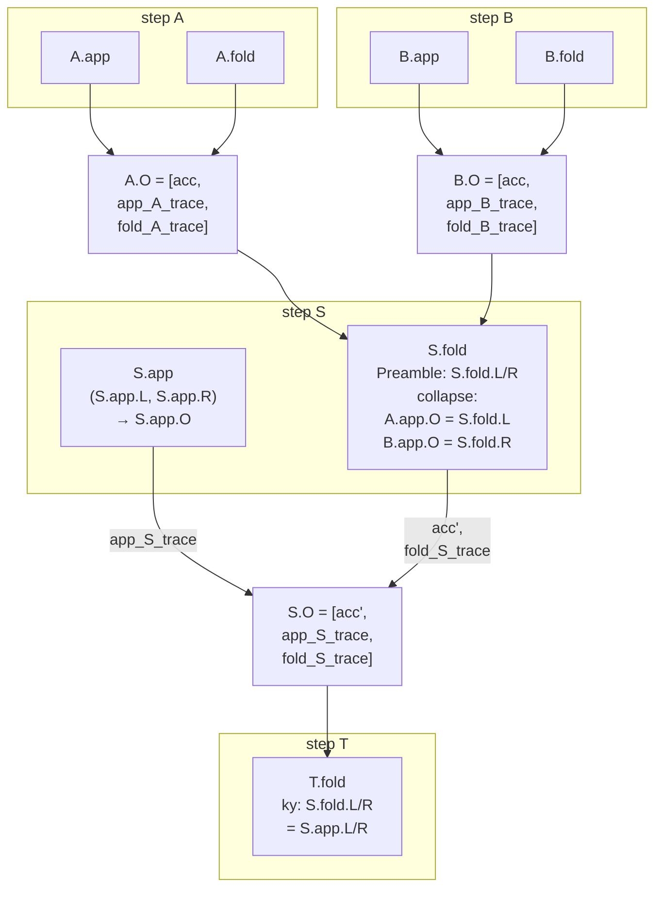

# Online Polynomial Oracle

## Motivation {#motivation}

An application circuit (a PCD step) commits some **online polynomials** $f_1,\ldots,f_k$
(e.g. $\mathsf{acc^{tg}}$ before and after merging more tachygrams),
samples a challenge $\zeta$, then makes **online evaluation claims** $f_i(x_i)=y_i$,
and finally enforces an algebraic relation among the $y_i$ in circuit.
These opening claims could be evaluations at the challenge point $f_3(\zeta)$ (e.g. point-checking tachygram accumulator update);
or at arbitrary points (e.g. non-membership test $f_\mathsf{QrBucket}(\nf)$).

We use the term "online" to differentiate from being fixed at registry finalization time.
The correctness of online polynomial openings is not enforced in circuit, but fused into the Ragu's folding mechanism.

All usages of the online poly oracle in Tachyon's [proof tree](https://tachyon.z.cash/book/revisit.html#prooftree) can be categorized as:

- T1: algebraic relation among _public_ online polynomials: $L(X)\cdot R(X) = O(X)$
  - here commitments of $L(X), R(X), O(X)$ are associated with the public headers of PCD proofs
- T2: algebraic relation among public _and private_ online polynomial: $L(X)\cdot \prod_i (X-\tg_i) = O(X)$
  - here $tg_i$ are private witness, thus $\prod_i (X - \tg_i)$ is a private online poly
- T3: random challenge sampling after committing online polynomials, public or private
  - in service of T1 and T2 as their relation is probabilistically point-checked at a random challenge
- T4: arbitrary evaluation on committed online polynomials, public or private
- T5: hashing online polynomial commitment: $\anchor' = H(\anchor \| e \| \acc^\tg)$ where $\anchor, e \in\F_p$ under an algebraic hash $H$, but $\acc^\tg\in\E_q$ with $x,y$-coordinate in $\F_q$

## Mental Model: Capabilities of Online Poly Oracle {#cap}

For Tachyon developers, this is your mental model of what Ragu's online polynomial oracle provides/allows:

A **header** is application state passed between steps, such as a state
root or item count. The Rust `Header` trait defines how that state is
encoded as `Fp` elements. Ragu adds padding and the header's suffix to
produce `HEADER_SIZE` field elements.

A circuit's **public instance** is the tuple of values its circuit claim
is bound to. Ragu encodes that tuple as an instance polynomial $k(Y)$ and
uses $k(y)$ as the circuit claim's target. The application circuit's instance
contains the left, right and output header fields, together with $\zeta$,
the six opening pairs and the bridge digest. Header fields are one part of
that instance.

`Pcd` pairs the header's data with a `Proof`. The proof stores two `Eq`
polynomial commitments for the step's output, exposed by
`Pcd::commitments()`. These points are carried in the nested `Preamble` and
exported through the public instance shared by nested `collapse` and
`compute_v`. That **nested unified instance** contains accumulator values,
challenge lifts and proof commitments: it is a statement for Ragu's
internal circuits.

- C1: each proof carries $2$ public polynomial commitment slots associated with its output header
  - `Eq` is alias for `HostCurve` type and $\E_q$ in math
  - in a `Step`, we refer to the $6$ total public online poly commitments as `[L0, L1, R0, R1, O0, O1]`
- C2: a two-phase application circuit: an application stage, committed before $\zeta$, holds the staged values a check at $\zeta$ reads but no header carries, such as the roots $\tg_i$ of a private polynomial $\prod_i (X - \tg_i)$; the circuit, synthesized after $\zeta$, evaluates such a polynomial in-circuit from the staged values and relates it to the public slots' openings. A private polynomial has no commitment slot and no oracle
- C3: a random challenge $\zeta$ is sampled after all public and private online polynomials are committed; $\zeta$ becomes available when synthesizing the final stage of app circuit
  - public poly commitments are carried in proofs and associated with their output headers
  - staged values, and so any private polynomial built from them, live in the application stage, whose commitment is absorbed in the FS transcript during `fuse()`
  - consequently, a check at $\zeta$ may only read values fixed before $\zeta$: openings $y_i = f_i(x_i)$ at $x_i = \zeta$ or at an $x_i$ itself fixed before $\zeta$, the left/right header fields, the first-stage values, `h_O1`, and anything the final stage computes from them; or an in-circuit hash output, or a value from a small set (e.g. a bit).
  Any other value the final stage witnesses, including the output header's fields, is chosen _after_ $\zeta$: a check $O(\zeta) = L(\zeta)\cdot(\zeta - t)$ with such a $t$ is forgeable by solving $t = \zeta - O(\zeta)/L(\zeta)$. Witness $t$ in the first stage instead.
- C4: the second/final app stage can "claim" the following values and constrain any relation for them during circuit synthesis
  1. the random evaluation point $\zeta$
  2. $6$ polynomial queries on public online polynomials $\{(x_i, y_i = f_i(x_i))\}_{i\in [0, 5]}$
  3. a special binding hash $H^{bridge}(\cm_{O_1}) \in\F_p^2$ value<br>

  Correctness of all poly queries is folded into Ragu's running accumulator (i.e. PCD proof).
  Integrity of the challenge $\zeta$ and the $H^{bridge}(\cm_{O_1})$ is guaranteed by Ragu.
  - importantly, we **only allow one opening per public online polynomial**; a private polynomial is evaluated in-circuit from its staged roots or coefficients, as many times as the circuit budget permits
  - all declared queries follow the canonical order, targeting $L_0, L_1, R_0, R_1, O_0, O_1$ respectively
  - public instance $k(Y)$ of the app circuit changes from `[L/R/O header fields]` of size `3*HEADER_SIZE` to: `[zeta, x_0, y_0, ..., x_5, y_5, h_O1, L/R/O header fields]`, where `h_O1` is the two coordinates of $H^{bridge}(\cm_{O_1})$
  - the special hash only commits the step's own `O1` slot, so if the app circuit wants to compute
  $\anchor' = H(\anchor \| e \| \acc^\tg)$ then $\acc^\tg$ must occupy the output polynomial slot `O1`

## Changes to Tachyon Proof Tree {#changes}

The [capability list](#cap) above is a delicate balance between protocol complexity, cost, and feature-richness for the application circuit.
While it suffices for the majority of Tachyon's [current steps](https://github.com/tachyon-zcash/tachyon/tree/7e502548db33845dbaacdc0efe905d1a3c45e626), a small segment of the proof trees need to be adjusted.

- QR routing network, affecting `QrIntakeSplit`, `QrSideDescend`
  - two problems: 
    - during `QrIntakeSplit`, we have to query the NQR set $q_0(X)$ both at random challenge $\zeta$ and at discriminant $-R_j$, the only step in the entire proof tree where we query more than one point on a committed online poly. Querying at challenge is to ensure "decomposition" relation, querying at discriminant offset is to ensure "zero-value QR assignment".
    - during `QrSideDescend`, the prover needs to commit two private online polynomials $g(X), h(X)$, see [protocol here](https://tachyon.z.cash/book/revisit.html#partition).
    The left input proof with header `QrIntakeSides` already occupies 2 public online-poly slots, and the output proof with header `QrIntake` already occupies 1. Our app's first stage can only witness simple closed-form online polynomials in coefficient or roots form, but not directly a private commitment. Putting $\cm_g, \cm_h$ in the output proof would exceed the $2$-per-proof capacity
  - solve both problems using one trick: a proof with a new header `QrDescendWitness` and $\cm_g, \cm_h$ in its two public polynomial commitment slots
    - add two seed steps to generate `QrDescendWitness` for QR and NQR sides: these seed steps take `QrIntakeSides` as input and output `QrDescendWitness`, with no constraints on $g, h$ (they are hints, committed before `QrSideDescend`'s $\zeta$). Importantly, $q_0(-R_j)$ check is relocated from `QrIntakeSplit` to the seed step for NQR side here.
    - the NQR seed's input must be the `QrIntakeSides` that `QrSideDescend` descends, and header fields alone do not bind commitments. So `QrIntakeSplit` places $q_0$ in `O1` and writes $H^{bridge}(\cm_{q_0})$ into a `QrIntakeSides` field; the NQR seed copies it (and $R_j$) into `QrDescendWitness`, and `QrSideDescend` checks they match its left input's. Equal digests mean the same $q_0$.
    - current `QrSideDescend<Left=QrIntakeSides, Right=(), Output=QrIntake>`, change to `QrSideDescend<Left=QrIntakeSides, Right=QrDescendWitness, Output=QrIntake>` and query all 6 online polynomials within the step, perfectly fitting in our capacity
- Anchor chain lineage, affecting `AnchorSpanSeed`, `QrStampIntakeSeed`, `SummarySeed`, `SummaryAdvance`, `SpendableInit`
  - define $H(\ldots \in\F_p^\ast, \acc^\tg) := \mathsf{Poseidon}(\ldots, H^{bridge}(\acc^\tg))$ both natively in anchor chain definition and in-circuit constraints
- QR bucket in an Evidence Tree, affecting `EvidenceTreeOpen`, `EvidenceTreeLeafPair`
  - evidence tree's leaf encoding is another 8-element Poseidon hash including a $\acc^\tg$ preimage, thus use $H^{bridge}(\acc^\tg)$ accordingly

## Mental Model: Ragu's Internal {#ragu}



Current fuse step `S` produces traces for two relations:

- `S.app`:  the application circuit
- `S.fold`: the folding circuit that takes the outputs of two children step `A` and `B`

Every step outputs an updated accumulator and two pending traces to be folded in the next step (a.k.a. parent step).
Thus `S.fold` circuit takes in `A.O = [acc, app_A_trace, fold_A_trace]` and `B.O = [acc, app_B_trace, fold_B_trace]`, folds all the claims in those 6 components into a new `acc'`.
The `acc` carries three types of obligations: the revdot accumulator ($\revdot{\v{a}}{\v{b}}=c$), the PCS opening accumulator ($P(u)=v$), and the registry consistency restrictions ($m(W, x, y)$).

A satisfying trace for the `S.fold` circuit `fold_S_trace` (a.k.a. the `rx` in polynomial form) is included in `S` step's output to be further folded/recursed in the next step `T`.
Actually, the folding circuit is not a monolithic circuit but a collective of multi-stage circuits (a.k.a. internal circuits) each constraining a sub-relation of the overall folding relation.
Thus, there is one `rx` (and respective `k(y)` public instance) per internal circuits (native or nested) to collectively prove the `S.fold` relation.

For PCD soundness, we must enforce

- `A.app.O = S.fold.L = S.app.L`
- `B.app.O = S.fold.R = S.app.R`

namely the left/right children of `S.fold` and `S.app` matches.
We refer to this as **header-carry check**.

The first half `A.app.O = S.fold.L` is enforced through `A.app`'s public instance, one step early.
`S.fold.L` is a wire in `S`'s `Preamble` stage; `S.fold`'s `collapse` computes `A.app`'s `ky` from that wire and checks it against the value the fold used for `app_A_trace`'s revdot claim, so the fold only closes if the wire equals the `A.app.O` the trace actually used.
Staging then propagates the copy: every internal circuit of `S.fold` that loads the preamble stage sees the same value.

The second half `S.fold.L = S.app.L`, at a glance, is a **cross-circuit copy constraint** since `fold` and `app` are two separate circuits.
Ragu implements it by including the fields to be cross-checked in the public instance `k(Y)` of both circuits,
so that when `app_S_trace` and `fold_S_trace` are verified/folded in parent step `T.fold`, the same values are supplied to those instance slots towards the computation of their `ky`. 
Effectively, by bridging through public instance, headers are copy-constrained in step `T`.

Concretely, the public instance of `hashes_1` internal circuit from the `S.fold` side is `[unified_S, fold.L, fold.R, 0, 1]`; while the public instance of `S.app` is `[app.L, app.R, app.O]`.
Then in `T.fold`, when we fold the revdot claims, we ensure the `ky` computation for `S.hashes_1` and `S.app` use the same value in the slot of `fold.L/R` and `app.L/R`.

An interesting direction Ragu might consider is directly folding `S.app` in `S.fold`, as [proposed here](https://github.com/tachyon-zcash/ragu/issues/943) (you can view the cost reduction in the [draft PR](https://github.com/tachyon-zcash/ragu/pull/946)).
In this variant, we will witness the `app_S_rx` through its bridged commitment before drawing challenge `y,z` inside the `S.fold` circuit.

Interestingly, the second half `S.fold.L/R = S.app.L/R` becomes easy: `S.fold` now computes `S.app`'s `ky` itself, from the `L/R` wires in its own `Preamble` stage, so the match is made inside `S` and nothing needs to be exported for it.

In contrast, matching output `A/B.app.O = S.fold.L/R` becomes the cross-circuit copy-constraint.
Because `fold` and `app`'s trace are prepared in the same step, the verification/folding circuit for `app`'s output is only in the next step.
This requires the public instance of `hashes_1` to be `[unified_S, fold.O, id_S, 0, 1]` (the parent also loses the child's `circuit_id`, which the `Aggregator`'s statement `ky` reads, so it is exported too); that of `S.app` stays as `[app.L, app.R, app.O]`.
Then, in step `T.fold`, again during `ky` computation, we ensure the slot `hashes_1.fold.O` and `S_app.O` uses the same value.
Note: the cost of header-carry check decreased as we only need to carry the output header in the public instance (a.k.a. `unified_bridge_ky`) instead of both left and right headers.

We pedantically explain this variant here because it's highly relevant in our decision to fold polynomial queries within the same step rather than deferring it.

## How Ragu's Online Poly Oracle Works {#design}

We incrementally revise Ragu to build up its capabilities for all [feature requests](#cap) of online polynomial oracles.
Each variant builds on top of the previous one, v1 builds on [today's Ragu](https://github.com/tachyon-zcash/ragu/tree/3219e0865e8bff1f9d817bfe3850d9e94b64338c), effectively on the Ragu [mental model above](#ragu).

A relevant Ragu knowledge we keep referring to is its challenge scheduling among native and nested stages of its folding circuits.

```
     ERROR          QUERY          POINTS            NESTED

                                PointsBinding
       ┌──────────────────────────────┤
   Preamble                    PointsChildren       Preamble
       ├──────────────┐               │                 │
       │              │               │                 │
─ ─ ─ ─ ─ ─ ─ ─ ─ ─ ─ ─ ─ ─ ─   w  ─ ─ ─ ─ ─ ─ ─ ─ ─ ─ ─ ─ ─ ─ ─ ─
       │              │       PointsRegistryWx       SPrime
─ ─ ─ ─ ─ ─ ─ ─ ─ ─ ─ ─ ─ ─ ─  y, z  ─ ─ ─ ─ ─ ─ ─ ─ ─ ─ ─ ─ ─ ─ ─
  InnerError*         │               │            InnerError
─ ─ ─ ─ ─ ─ ─ ─ ─ ─ ─ ─ ─ ─ ─  μ, ν  ─ ─ ─ ─ ─ ─ ─ ─ ─ ─ ─ ─ ─ ─ ─
  OuterError*         │               │            OuterError
─ ─ ─ ─ ─ ─ ─ ─ ─ ─ ─ ─ ─ ─   μ', ν'  ─ ─ ─ ─ ─ ─ ─ ─ ─ ─ ─ ─ ─ ─
                      │           PointsAb             Ab
─ ─ ─ ─ ─ ─ ─ ─ ─ ─ ─ ─ ─ ─ ─   x  ─ ─ ─ ─ ─ ─ ─ ─ ─ ─ ─ ─ ─ ─ ─ ─
                    Query             │               Query
─ ─ ─ ─ ─ ─ ─ ─ ─ ─ ─ ─ ─ ─ ─   α  ─ ─ ─ ─ ─ ─ ─ ─ ─ ─ ─ ─ ─ ─ ─ ─
                      │            PointsF              F
─ ─ ─ ─ ─ ─ ─ ─ ─ ─ ─ ─ ─ ─ ─   u  ─ ─ ─ ─ ─ ─ ─ ─ ─ ─ ─ ─ ─ ─ ─ ─
                    Eval              │               Eval
─ ─ ─ ─ ─ ─ ─ ─ ─ ─ ─ ─ ─ ─   pre_β  ─ ─ ─ ─ ─ ─ ─ ─ ─ ─ ─ ─ ─ ─ ─
                                 PointsWalk        Endoscalar*
                                                     Points*
                                                   Challenges

Native Internal Circuits:
┌────────────┬──────────────────────────────────────┐
│ Last stage │               Checkers               │
├────────────┼──────────────────────────────────────┤
│ Preamble   │ bind_beta                            │
├────────────┼──────────────────────────────────────┤
│ OuterError │ hashes_1, hashes_2                   │
├────────────┼──────────────────────────────────────┤
│ InnerError │ collapse                             │
├────────────┼──────────────────────────────────────┤
│ Eval       │ compute_v, bind_challenges           │
├────────────┼──────────────────────────────────────┤
│ PointsWalk │ bind_endoscalar, endoscaling_step    │
└────────────┴──────────────────────────────────────┘

Nested Internal Circuits:
┌────────────┬─────────────────────────────┐
│ Last stage │          Circuits           │
├────────────┼─────────────────────────────┤
│ Points     │ endoscaling_steps           │
├────────────┼─────────────────────────────┤
│ Eval       │ loading                     │
├────────────┼─────────────────────────────┤
│ Challenges │ collapse, compute_v         │
└────────────┴─────────────────────────────┘
```

### V1: witness public poly, piggyback existing Fiat-Shamir challenge {#v1}

- Goal: piggyback an application-level Polynomial IOP flow into Ragu's existing machinery.
  - allows proofs to carry polynomial commitments associated with their output headers
  - commits them to the FS transcript
  - then draws a verifier challenge accessible from the application circuit
- Solution: 2-phase, singleton/non-stage application circuit, piggybacking on nested `Preamble` and challenge $w$.

To witness a proof's polynomial in a circuit, we cannot use all its coefficients since that would take up the entire circuit budget.
Instead, we witness its commitment, a `HostCurve`/$\E_q$ point with coordinates in the non-native field.
Luckily, Ragu already have a mechanism called **bridge commitment** to witness a batch of `HostCurve` points natively on a nested stage and commits the nested stage trace into a so-called bridge commitment of `NestedCurve`/$\E_p$ type.

In the first phase, we witness the `[L0, L1, R0, R1, O0, O1]` 6 poly commitments from the input and output proofs in the nested `Preamble` stage trace.
Absorbing `bridge_preamble_commitment` and squeezing challenge $w$ remains unchanged.
We set $\zeta = w$, maximally piggybacking the existing staging pipeline and introducing no change to the transcript.

The second phase has $\zeta$ available as an input to synthesize the circuit logic as usual.
We compute the full trace `app_rx` and its commitment to be folded in the next step.

The main challenges are
1) ensuring $\zeta$ used by the app circuit is correct given the externalized challenge squeezing;
2) extending ["header-carry check"](#ragu) to the proofs' associated poly commitments.

For (1), we update the public instance $k(Y)$ to include $\zeta$ used to synthesize `app_rx`.
During the `application_ky()` computation in the parent step's folding circuit, we Horner over `[zeta, L/R/O headers]` where `zeta` slot is filled with the `unified.w` challenge value witnessed in the native `Preamble` stage, effectively copy-constraining the correct $\zeta$ used in `app_rx` and derived from FS transcript.

For (2), we generalize the same "cross-circuit copy-constraint via public instance" (i.e. `unified_bridge_ky`) idea to the nested side where our points are witnessed.
Specifically, the nested unified instance, which both nested instance circuits (`collapse` and `compute_v`) Horner over, gains the exported commitments: `[unified_S, L0, L1, R0, R1, O0, O1, 1]`. The nested `collapse` circuit is the one that holds the exported wires to the `Preamble` stage's; the other circuit reads the same instance.
The parent needs all 6 points: it uses `S.app`'s `L/R/O` commitments (and, before [v4](#v4), opens them), and `S.O` becomes its own `L` or `R`.
There are two parts within the header-carry check, mirroring those of the field headers.
The first half `A.O = S.L` is enforced within `S`, one step early: `S`'s nested `Preamble` stashes `A`'s and `B`'s exported points next to its own `L0, L1, R0, R1` wires, `S`'s nested `collapse` computes `A`'s and `B`'s collapse `ky` from the stash and enforces `L0, L1, R0, R1` equal to the stashed `A.O0, A.O1, B.O0, B.O1`, a 4-point equality.
The second half `S.fold.L = S.app.L` holds when we fold revdot claims of these nested traces in the parent step `T`: the `ky` computation in `S.nested.collapse` takes `S`'s exported `[L0, L1, R0, R1, O0, O1]` from `T`'s stash, the same points `T` uses as `S.app`'s commitments.

### V2: bridge commitment for one public poly {#v2}

- Goal: design a binding hash function that takes in `CurvePoint`, outputs `Fp/CircuitField` $H^{bridge}(P\in\E_q) \in\F_p^2$ with verifiable trace
- Solution: add a dedicated nested stage for this point, and use its bridge commitment as its hash digest, its correctness is automatically folded within Ragu

```
Before:

     ERROR          QUERY          POINTS            NESTED

   Preamble                    PointsChildren       Preamble (witness L0,L1,R0,R1,O0,O1)
       ├──────────────┐               │                 │
       │              │               │                 │
─ ─ ─ ─ ─ ─ ─ ─ ─ ─ ─ ─ ─ ─ ─   w  ─ ─ ─ ─ ─ ─ ─ ─ ─ ─ ─ ─ ─ ─ ─ ─

After:

   Preamble                    PointsChildren       BridgeHash (copy of O1, not absorbed)
       ├──────────────┐               │                 │
       │              │               │             Preamble (witness L0,L1,R0,R1,O0,O1)
       │              │               │                 │
─ ─ ─ ─ ─ ─ ─ ─ ─ ─ ─ ─ ─ ─ ─   w  ─ ─ ─ ─ ─ ─ ─ ─ ─ ─ ─ ─ ─ ─ ─ ─
```

This gives us a digest `bridge_hash_commitment`, exposed to the application circuit by `Oracles::bridge_hash()`, whose coordinates are native on the `Fp` side and can be used to constrain a hash chain that takes polynomial commitments as preimages.
Importantly, we need to synchronize our outside-the-circuit code to use this non-standard hash function:
computes the trace `bridge_hash_rx` as a stage polynomial $\in\F_q[X]$, then computes its commitment as a $\E_p$/`NestedCurve` point, and uses its two coordinates as the hash digest.
The prover constructs the `BridgeHash` stage unblinded (every other stage takes a random blinding), with only $x$ and $y$ of the point as nonzero coefficients.
The recomputed digest is then the fixed linear combination $x \cdot G_i + y \cdot G_j$ of two generators.
`BridgeHash` registers the ordinary stage mask, which checks the stage's support but does not by itself require this unblinded encoding.
`BridgeHash` comes directly after the endoscalar stage and before the points stage.
The digest depends on the stage's position.
The endoscalar stage has a fixed size (the 143-bit endoscalar encoding), thus the position does not move when the walk or `Preamble` grows.
Binding follows from the binding of the commitment: two points with the same digest are two openings of one commitment.

`O1` stays in the nested `Preamble`, and `BridgeHash` holds a copy; the nested `collapse` circuit enforces the two to be equal.
The prover constructs the digest before $\zeta$; `w` absorbs `O1` through the `Preamble`, and the digest itself is not absorbed.
(Absorbing the digest would cost `hashes_1` one more Poseidon permutation, beyond its gate budget.)
The digest joins the `unified` instance next to `bridge_preamble_commitment`, and the parent binds it to the `BridgeHash` stage it folds, as it binds the other bridge commitments.
The app circuit claims the digest the same way it claims $\zeta$: its public instance gains an `h_O1` slot, which the parent's `application_ky()` fills from the child's `unified` value.

### V3: stage a private polynomial's roots in the application stage {#v3}

- Goal: additionally commits online polynomial constructed from private witness before $\zeta$ (e.g. $\prod_i (X - \tg_i)$ where $\tg_i$ are not in headers but circuit witness)
- Solution: 2-phase application circuit with an application stage of a single, maximally permissible size

Give the application circuit a stage committed before $\zeta$.
The diagrams label this stage `AppStage`; the application trace synthesized by `Step::witness` is labeled `Application`.

- stage the roots (or coefficients) of the private polynomial: the step returns them from `Step::staged`, and Ragu commits them in the application stage
- commit the stage trace and append to the nested `Preamble` stage
- absorb bridge preamble stage commitment into transcript
- draw challenge $\zeta=w$ effectively committing to our private polynomial.
- export the application stage's commitment through the nested instance, like `O0, O1`, so that the parent folds the very stage that $\zeta$ absorbed; otherwise `S` could absorb one stage and hand the parent another, whose values it chose after $\zeta$.

Subsequently, we can enforce any evaluations on this private polynomial in the second/final stage.
In fact, we can enforce as many as the circuit budget allows.

```
Before:

     ERROR                           NESTED

   Preamble                         BridgeHash (copy of O1, not absorbed)
       │                                │
       │                            Preamble (witness L0,L1,R0,R1,O0,O1)
       │                                │
─ ─ ─ ─ ─ ─ ─ ─ ─ ─ ─ ─ ─ ─   w  ─ ─ ─ ─ ─ ─ ─ ─ ─ ─ ─ ─ ─ ─

After:

     ERROR           APP             NESTED

   Preamble      AppStage           BridgeHash (copy of O1, not absorbed)
       │              │                 │
       │              │             Preamble (witness L0,L1,R0,R1,O0,O1, app_stage_comm)
       │              │                 │
─ ─ ─ ─ ─ ─ ─ ─ ─ ─ ─ ─ ─ ─   w  ─ ─ ─ ─ ─ ─ ─ ─ ─ ─ ─ ─ ─ ─
```

Like any staged circuit, this needs bonding polynomials in the registry sized by the stage.
In theory, we don't know the degree of our private polynomial, thus the stage size is only known at registry-time.
To avoid overcrowding the registry, we enforce a universal, max size at `registry.finalize()`-time (the largest `Step::NUM_STAGED` registered), and only register two new bonding polynomials.
In practice, Tachyon's current proof tree only needs degree-$1$ private polynomials: only a single-element stage is needed.

The stage is not a type-level stage of the step circuit: every step circuit reserves $\lceil K/2 \rceil$ gates after the SYSTEM gate for the largest staged count $K$, the committed stage polynomial supplies those wires, and the two bonding polynomials hold the stage to its block and the step's own trace to zero there.
The step binds its staged values to the first wires of the block; its trace is folded in the parent as before, together with the stage.
The extra revdot claims are few, and they fit into the buffer of the native `inner_error`, `outer_error`, and `compute_v` stage.

### V4: fusing poly queries at current step {#v4}

- Goal: allow the app circuit to make evaluation claims on committed online polys
- Solution: include $(x_i, y_i = f_i(x_i))$ claims in app's $k(Y)$, fuse these claims in the native `Query` and `Eval` stages at the current step

Recall in [v1](#v1), the app circuit can "claim" some challenge received, use it to synthesize the trace which gets copy-constrained in the next folding step.
Similarly, the second app stage can claim some evaluations of the online polynomials.
The validity of these evaluation claims is verified separately as the validity of the circuit trace `app_rx` which takes $(x_i, y_i)$ as input.
The validity of the app trace is exactly as [the last variant](#v3): folded at the parent step, whereas the evaluation claims piggyback on the native `Query/Eval` stages to be folded into the accumulator during `compute_v` circuit.
To connect the claims across these two validity checks, we need to further extend the public instance $k(Y)$ to Horner over:

```
[zeta, x_0, y_0, ..., x_5, y_5, h_O1, L/R/O header fields]
```

Here we make the simplification to only allow _one query per public online polynomial_.
We deliberately forgo the more powerful feature of multiple queries on the same committed polynomial.
Solutions for them either involve specifying a $(idx_i, x_i, y_i)$ where $idx_i$ selects the correct polynomial, and we need to enforce a "selector multiplier" in the `compute_v` circuit;
or a wasteful max-$q$ queries per poly with a system parameter $q$.
As we explained [before](#changes), this capability is sufficient for Tachyon's proof tree post minor adjustment.

The only decision left is whether we should fold these evaluation claims in the parent step as is with `app_rx`, or in the current step?
Recalling our [earlier discussion](#ragu) of "folding `S.app` in `S.fold`" concludes that folding `app_rx` in the same step leads to saving.
Analogously, we decide to fold poly query claims in the same step.

Concretely, this reduces the cost of our header-carry check.
Instead of exporting `L/R`'s and `O`'s poly commitments, now we only need to export `O`'s poly commitments (and the application stage's), cutting the nested instance by 4 points, leading to fewer copy-constraints in the parent step's folding.
The 4-point equality in `S` disappears too: `S` opens the stashed `A.O, B.O` directly as its `L, R` slots, so `S` has no separate `L, R` wires to compare.

```
Before:

     ERROR           APP             NESTED

   Preamble      AppStage           BridgeHash (copy of O1, not absorbed)
       │              │                 │
       │              │             Preamble (witness L0,L1,R0,R1,O0,O1, app_stage_comm)
       │              │                 │
─ ─ ─ ─ ─ ─ ─ ─ ─ ─ ─ ─ ─ ─   w  ─ ─ ─ ─ ─ ─ ─ ─ ─ ─ ─ ─ ─ ─

After:

     ERROR           APP           QUERY        NESTED

   Preamble      AppStage                   BridgeHash (copy of O1, not absorbed)
       │              │                           │
       │              │                    Preamble (witness L0,L1,R0,R1,O0,O1, app_stage_comm)
       │              │                           │
─ ─ ─ ─ ─ ─ ─ ─ ─ ─ ─ ─ ─ ─ ─ ─   w  ─ ─ ─ ─ ─ ─ ─ ─ ─ ─ ─ ─ ─ ─ ─ ─
       │              │                           │
       │         Application                      │
       │       (claims x_i, y_i)                  │
       │                                          │
─ ─ ─ ─ ─ ─ ─ ─ ─ ─ ─ ─ ─ ─ ─ ─   x  ─ ─ ─ ─ ─ ─ ─ ─ ─ ─ ─ ─ ─ ─ ─ ─
                             Query (+ x_i, y_i)
─ ─ ─ ─ ─ ─ ─ ─ ─ ─ ─ ─ ─ ─ ─ ─   u  ─ ─ ─ ─ ─ ─ ─ ─ ─ ─ ─ ─ ─ ─ ─ ─
                             Eval (+ f_i(u))
```

`Application` is the native trace synthesized by `Step::witness` and folded in the parent, as in [v3](#v3); only its opening claims are folded here.
