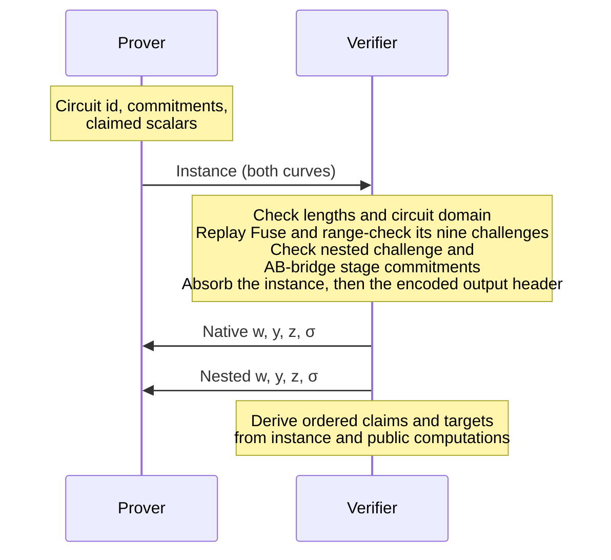
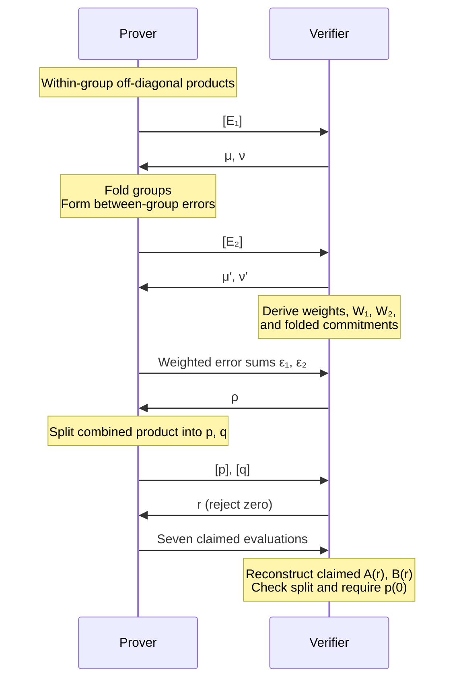
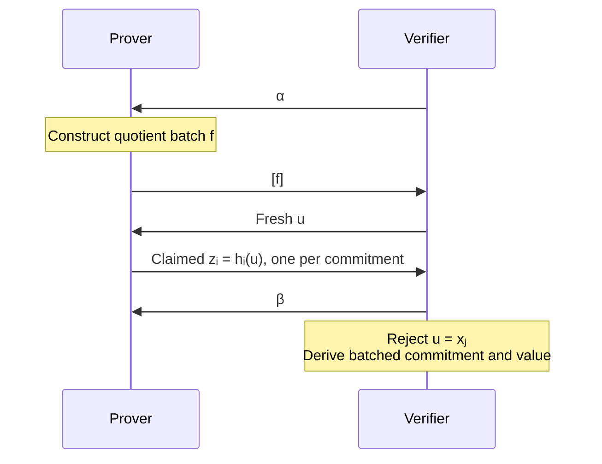

# Compression

Compression proves the output header of a [Fuse proof](../iop.md) without
sending its witness polynomials. This chapter gives the prover's messages
and the verifier's checks, ending in one inner-product argument (IPA) per
curve. It is how the [obligations](../iop.md#iop-contract) that the root of a
proof tree still owes are discharged in production: the root's accumulator on
each curve and the claims of its frontier.

## Preliminaries {#compression-preliminaries}

- At rank $k$, a polynomial has at most $D=2^k$ coefficients, the $4n$ of
  [Construction](../construction/cycle.md#notation). On each curve
  $[h]=\sum_{i=0}^{D-1}h_iG_i$ and
  $\operatorname{revdot}(a,b)=\sum_{i=0}^{D-1}a_i b_{D-1-i}$.
  The IPA uses $G_0,\ldots,G_{D-1},U$ with no known nontrivial discrete-log
  relations.
- The host curve commits to polynomials over $\F_p$ and the nested curve
  to polynomials over $\F_q$. The
  [transcript](../construction/cycle.md#transcript) runs over $\F_p$.
  It absorbs host scalars and nested points directly,
  writing each point's affine $x$ then $y$. It collects host point
  coordinates and nested scalars in runs. Before the next direct write or
  squeeze it absorbs one nested commitment to the run, with its free
  coefficients zero and the run stage's generators at aggregator rank. At
  wallet rank these generators lie beyond $G_{D-1}$, and the Standard
  parameters supply them for the first `pasta::STAGE_REACH` gates after the
  system gate. At aggregator rank they lie within the table.
- In the interactive protocol the verifier supplies each **Challenge**.
  Ragu uses Fiat–Shamir with the tag `ragu-ipa-v1`. It requires each
  squeeze to be below $2^{254}$ and lifts its low 143 bits into
  the active curve's scalar field. The same bits scale points on that curve
  by [endoscaling](../construction/cycle.md#endoscalars). The separate
  [Fuse transcript](../construction/protocol.md#rounds) uses `ragu-pcd-v1`.
  Its first eight native challenges are the raw squeezes. Their nested
  counterparts and both curves' $\beta$ are lifts.
- Two protocols meet in this chapter, and a subscript tells them apart. A
  value of the Fuse that produced $\pi$ carries a subscript $F$: its
  challenges $w_F,y_F,z_F,x_F,u_F$, its accumulator polynomials
  $A_F,B_F,p_F$ with the values $c_F,v_F$ and the commitment $P_F$, its
  registry [candidate](../construction/batch.md#registry-candidates)
  $\widehat m_F(W)$ for $m(W,x_F,y_F)$, and its base-case sign $\sigma_F$. The
  challenges $x^{(i)},y^{(i)}$ are those of the Fuse's child $i$. A symbol
  without the subscript belongs to the compression. The subscript $q$ marks
  the nested curve in either protocol, as in $A_{F,q}$.
- A Fuse draws each challenge once, and its nested challenge is the lift of
  the same squeeze as the native one. The compression draws the challenges of
  each curve from squeezes of their own, so its nested $y$ is unrelated to
  its native $y$.

## Protocol in Detail {#compression-protocol}

Both parties use the application's two registries, rank and IPA parameters.
The prover $\mathcal P$ has the uncompressed proof $\pi$ and its output
header data. The verifier $\mathcal V$ encodes the output header data
supplied with the compressed proof.
For an aggregator proof, the verifier also uses the wallet registries fixed
at setup to check the outgoing source restrictions.

Before compressing, $\mathcal P$ checks the shape and circuit index of $\pi$,
replays Fuse, rejects $\text{pre\_beta}\ge 2^{254}$ and compares all nine
challenges with those stored in $\pi$.

For the step's two online polynomials for polynomial oracle access, it checks
$[\tau o_0+o_1]=\tau O_0+O_1$ against the cached commitments using a fresh
unpredictable scalar $\tau$. A fixed inconsistent pair passes for at most one
$\tau$. This checks the polynomials for reuse of $\pi$ as a child. The
compressed verifier uses $O_0,O_1$ directly. For an aggregator proof,
$\mathcal P$ also checks each retained source restriction against its outgoing
slot commitment.

### Phase 1. Bind the instance and derive the claims {#1-instance--revdot-claims}

$\mathcal P$ sends the instance. $\mathcal V$ checks the shape and circuit
index, replays Fuse and checks `ChallengeStage` and `BridgeAB`. It then
absorbs the instance fields and the encoded output header in this order.

1. For an aggregator proof, the native mesh coordinates in input-wire
   order, one shared value per edge in edge order, then the helper's
   quotient sum and evaluation sum.
2. The circuit's domain point. If the profile has a statement circuit,
   append the left input's first-slot opening point. In the decompression
   step this point is the staged compression transcript digest. The verifier
   derives the decompression flag from the circuit index.
3. In one run, $[A_F],[B_F]$, the native proof commitments in
   [rx order](../construction/setup.md#rx-order), $[\widehat m_F]$, $P_F$ and
   the step's two commitments $O_0,O_1$.
4. The native scalars $c_F,v_F$, the left child's $x^{(0)},y^{(0)}$, the right
   child's $x^{(1)},y^{(1)}$, then $A_F(u_F),B_F(u_F)$.
5. For an aggregator proof, the coordinates of the profile's nested online
   commitments.
6. The nested commitments $[A_{F,q}],[B_{F,q}]$, the nested proof commitments
   in rx order, the nested registry candidate's commitment, $P_{F,q}$,
   `nested_challenges_partial` and the step's exported $\F_q$ commitments.
7. In one run, `bridge_alpha`, $c_{F,q},v_{F,q}$, the two children's nested
   $x,y$ pairs in left-to-right order, $A_{F,q}(u_{F,q}), B_{F,q}(u_{F,q})$,
   then the exported $\F_q$ openings, point then value.
8. For an aggregator proof, the coordinates of the profile's native online
   commitments, then the nested mesh values and helper sums in the order
   of item 1. Each coordinate or scalar enters as little-endian 128-bit limbs.
9. The encoded output header.

**Challenge.** Squeeze $w,y,z,\sigma$ for the host curve, then a separate
$w,y,z,\sigma$ for the nested curve. On each side $w$ opens the registry
candidate, $y,z$ determine the revdot claims and $\sigma$ weights the
selected stage wires. These are fresh challenges of the compression, and none
of them is $w_F$, $y_F$, $z_F$ or $\sigma_F$.

#### Selected stage wires

For each stage polynomial $Q$, $\mathcal V$ adds one claim
$\operatorname{revdot}(Q-E,M)=0$. If wire $j$ has degree $d_j$ and expected
value $e_j$, then $E=\sum_j e_j X^{d_j}$ and
$M=\sum_j \sigma^j X^{D-1-d_j}$. The weights restart at $j=0$ for each
stage. The lists give the selected wires in order. Every value in them is a
value of the Fuse, at the Fuse's challenges.

- `Preamble` holds $x^{(0)},y^{(0)},x^{(1)},y^{(1)}$.
- `Query` holds $m(\omega_j,x_F,y_F)$ in registry index order (internal
  circuits, then masks), $m(w_F,x_F,y_F)$, then
  $m(\omega_{\rm id},x_F,y_F)$ at the proof's own circuit. The last four
  wires are $m(w_F,x^{(0)},y^{(0)}),m(w_F,x^{(0)},y_F)$ followed by
  $m(w_F,x^{(1)},y^{(1)}),m(w_F,x^{(1)},y_F)$.
- `Eval` holds $m(w_F,x^{(0)},u_F)$, $m(w_F,x^{(1)},u_F)$, $m(w_F,u_F,y_F)$,
  $A_F(u_F)$, $B_F(u_F)$ and $m(u_F,x_F,y_F)$.
- `PointsAb` holds the coordinates of $[A_{F,q}]$, then $[B_{F,q}]$, each $x$
  then $y$. `PointsF` holds the coordinates of the nested registry
  candidate's commitment.
- `BridgePreamble` holds the children's nested $x,y$ in the same order.
  `BridgeQuery` follows `Query` over the nested registry, going directly
  from the value at $w_{F,q}$ to the four child values. `BridgeEval` follows
  `Eval` over the nested field with $A_{F,q}(u_{F,q}),B_{F,q}(u_{F,q})$.

In the Standard layout, `Query` has $37+18=55$ fixed registry entries and
`BridgeQuery` has $33+14=47$. The next wire, the value at $w_F$, takes weight
$\sigma^{55}$ or $\sigma^{47}$, respectively.

On each curve, list the raw accumulator, circuit, mask and selected-wire
claims in that order. The raw target is $c_F$ or $c_{F,q}$ from the instance.
The verifier computes each circuit target at that curve's fresh $y$ from
the instance and encoded output header, as in the
[decider](../construction/decider.md#single-proof).
`hashes_1` binds that header and the circuit index. Mask and
selected-wire targets are zero.

The step has already folded its application claim and two mask claims, and
its randomizer claims with them. The Standard layout gives $1+37+16+5=59$
native claims and $1+33+14+3=51$ nested claims.
Complete the fold, opening batch and IPA on the **host curve** before
repeating them on the **nested curve**, on the same transcript.

### Phase 2. Fold and split the revdot claims {#2-revdot-claims--polynomial-opening-claims}

This fold is not the [fold of a Fuse](../construction/claims.md#fold),
although both reduce a list of revdot claims in two layers.

| | Fuse Fold | Compression Fold |
|---|---|---|
| weights | Lagrange weights at one challenge, the same on both sides of a claim | powers of $\mu$ on the $a$ sides and powers of $\nu$ on the $b$ sides |
| challenges | $\mu_F$, then $\mu'_F$ | the pair $\mu,\nu$, then the pair $\mu',\nu'$ |
| correction data | quotient coefficients, held in stages | the off-diagonal revdot products, committed as $E_1$ and $E_2$ |
| group size | $8$ native and $9$ nested, with one slot of each group for the Fuse's randomizer | $7$ on both curves, the last group possibly shorter |
| claims of its own | the randomizer claim and the half-claim | none |
| result | the raw claim of the next accumulator | openings for the batch and the IPA |

The folded $A$ and $B$ below are the compression's own. The Fuse's $A_F$ and
$B_F$ are the two sides of the raw claim, which is one of the claims that
this phase folds.

1. Divide the claims $\operatorname{revdot}(a_i,b_i)=k_i$ into consecutive
   groups of seven on either curve. The last group may be shorter.
   $\mathcal P$ sends $[E_1]$. Its low coefficients are the off-diagonal
   products $\operatorname{revdot}(a_i,b_j)$ within each group, in group
   order and then row order. **Challenge.** Squeeze $\mu,\nu$.
2. Fold the $a$ and $b$ polynomials in each group under powers of $\mu$ and
   $\nu$, respectively. $\mathcal P$ sends $[E_2]$ containing the
   off-diagonal products between these group folds, by row.
   **Challenge.** Squeeze $\mu',\nu'$.
3. For claim $i$ in group $g$ and slot $s$, both zero-based, set
   $\lambda_i=(\mu')^g\mu^s$ and $\eta_i=(\nu')^g\nu^s$. Fold to
   $A=\sum_i\lambda_i a_i$ and $B=\sum_i\eta_i b_i$.

   For an error at degree $d$ in $E_\ell$, place its weight at $D-1-d$ in
   $W_\ell$. Within a group the weight for slots $s\ne t$ is
   $(\mu'\nu')^g\mu^s\nu^t$. Between groups $g\ne h$ it is
   $(\mu')^g(\nu')^h$. Both error lists must fit in $D$ coefficients.
   Zero-fill unused coefficients.
   $\mathcal P$ sends $\varepsilon_1,\varepsilon_2$, the claimed values of
   $\operatorname{revdot}(E_\ell,W_\ell)$. **Challenge.** Squeeze $\rho$.
4. Split the coefficients of $AB+\rho E_1W_1+\rho^2E_2W_2$. Read the
   lowest $D$ in reverse order for $p$ and the remaining $D-1$ in
   ascending order for $q$. $\mathcal P$ sends $[p],[q]$.
   **Challenge.** Squeeze $r$ and reject $r=0$.
5. $\mathcal V$ derives $[A_c]$ from the committed parts of the $a_i$
   under $\lambda_i$, $[T]$ from the circuit traces under $\eta_i$, and
   $[B_c]$ from the raw accumulator's $b_i$ under $\eta_i$.
   $\mathcal P$ sends, in order,
   $$
   A_c(r),\quad T(rz),\quad B_c(r),\quad E_1(r),\quad
   E_2(r),\quad p(r^{-1}),\quad q(r).
   $$

### Phase 3. Batch the openings {#3-opening-claims--one-batched-opening}

The batch is that of a [Fuse](../construction/batch.md#batch-structure) with
other letters. Let $h_{i_j}(x_j)=y_j$ denote opening claim $j$ against
commitment entry $i_j$: the claim $j$, its entry $i_j$, its point $x_j$ and
its value $y_j$ are the $h$, $j(h)$, $\rho_h$ and $\vartheta_h$ of that page.
The points $x_j$ and values $y_j$ are unrelated to the challenges $x_F$ and
$y$. The first eleven **entries** are $A_c,T,B_c,E_1,E_2,p,q$, the Fuse's
registry candidate $\widehat m_F$, and $p_F,A_F,B_F$. Each has one **claim**
except $p$, which has two.

1. The seven evaluations above, then $p(0)$ against the same entry as
   $p(r^{-1})$. The verifier derives $p(0)$ in the split check below.
2. The candidate $\widehat m_F$ at the fresh $w$, with the value
   $m(w,x_F,y_F)$ that the verifier computes from the registry. This tests
   the identity $\widehat m_F(W)=m(W,x_F,y_F)$ that the root's Fuse
   [left owed](../construction/batch.md#registry-candidates). Then
   $p_F,A_F,B_F$ at $u_F$ with values $v_F,A_F(u_F),B_F(u_F)$ from the
   instance.

For an aggregator proof, append the mesh's
online polynomials for polynomial oracle access in slot order. Append both
ends of each [mesh intersection](../poly-oracle.md#v6-terminal) in edge
order. They claim the same instance value at their respective points
($w_F,x_F,y_F$ or an instance coordinate). Append the outgoing restriction
last, at the fresh $w$, with value $m_{\rm source}(w,x_F,y_F)$ computed
from the source registry. On the nested curve the Fuse points are lifts.

1. Both parties reject conflicting values for the same entry at the same
   point. **Challenge.** Squeeze $\alpha$ after the seven evaluations.
2. For $N>0$ claims over $n>0$ entries, $\mathcal P$ sends $[f]$ for
   $$
   f(X)=\sum_{j=0}^{N-1}\alpha^{N-1-j}
     \frac{h_{i_j}(X)-h_{i_j}(x_j)}{X-x_j}.
   $$
   The numerator uses the polynomial's actual value. **Challenge.** Squeeze
   a fresh $u$.
3. $\mathcal P$ sends $z_i=h_i(u)$, one value per entry in order.
   **Challenge.** Squeeze $\beta$. Horner-fold $f,h_0,\ldots,h_{n-1}$ at
   $\beta$ to obtain $H$, with $f$ weighted by $\beta^n$. The verifier
   derives $[H]$ and the claimed $v=H(u)$ in the batch check.

### IPA rounds. Open the batched polynomial {#compression-ipa}

1. $\mathcal P$ sends $[\tilde h]$ for a random polynomial of degree below
   $D$ with $\tilde h(u)=0$.
   **Challenge.** Squeeze $\xi,z_{\rm IPA}$.
2. Start with the coefficients $\v p$ of $H-H(u)+\xi\tilde h$, the powers
   $\v b=(1,u,\ldots,u^{D-1})$ and the generators $\v G$. In each of $k$
   rounds $\mathcal P$ splits all three vectors in half and sends
   $$
   \begin{aligned}
   L_j &= \langle\v p_{\rm hi},\v G_{\rm lo}\rangle
       + z_{\rm IPA}\langle\v p_{\rm hi},\v b_{\rm lo}\rangle U,\\
   R_j &= \langle\v p_{\rm lo},\v G_{\rm hi}\rangle
       + z_{\rm IPA}\langle\v p_{\rm lo},\v b_{\rm hi}\rangle U.
   \end{aligned}
   $$
   **Challenge.** Squeeze $u_j$ and reject $u_j=0$. This fresh squeeze may
   equal the batch point $u$.
3. Fold $\v p$ to $\v p_{\rm lo}+u_j^{-1}\v p_{\rm hi}$, $\v b$ to
   $\v b_{\rm lo}+u_j\v b_{\rm hi}$, and $\v G$ to
   $\v G_{\rm lo}+u_j\v G_{\rm hi}$. Use the folded vectors for the next
   round. These are the Halo 2 IPA folds with unblinded commitments.

### Final message {#compression-final}

$\mathcal P$ sends $c$, the remaining coefficient of $\v p$. The host $c$
enters the transcript before the nested reduction starts. The verifier
checks the nested $c$ in the final IPA equation. Its run stays unabsorbed
because the transcript ends there.

Of the $10+k$ run commitments the transcript absorbs, two cover the
instance. The host reduction, batch and IPA contribute $5+k$ and their
nested counterparts contribute three.

### Verifier checks {#compression-verifier}

1. **Instance and transcripts.** Check the instance and message lengths
   against the profile and rank, and the circuit index against the native
   registry domain. Replay and range-check the nine Fuse squeezes. Rebuild
   `ChallengeStage` with its free coefficients zero, the nested lifts and
   the sign $\sigma_F$, which is $+1$ for `Bootstrap` and $-1$ otherwise.
   Fuse derives this sign from its
   [input headers](../construction/base_case.md). Rebuild `BridgeAB`
   from the host $[A_F],[B_F]$,
   the `PointsAb` commitment, any native online commitments at that stage,
   and $\texttt{bridge\_alpha}^2$. Match both commitments to the instance.
   Reject an identity point on either transcript, including the commitment
   to an absorbed run.
2. **Split, on each curve.** Weight the public parts of $a_i,b_i$ by
   $\lambda_i,\eta_i$. A raw claim contributes $(0,0)$. A circuit at
   registry point $\omega_j$ contributes $(0,m(\omega_j,r,y)+t(r,z))$,
   where $t$ is the
   [gate correction](../construction/arithmetization.md#combinedcheck).
   A mask claim contributes $(0,m(\omega_j,r,y))$ and a selected-wire
   claim contributes $(-E(r),M(r))$. The weighted sums give
   $$
   A(r)=A_c(r)+A_{\rm pub}(r),\qquad
   B(r)=B_c(r)+T(rz)+B_{\rm pub}(r).
   $$
   These values must satisfy
   $$
   A(r)B(r)+\rho E_1(r)W_1(r)+\rho^2E_2(r)W_2(r)
   = r^{D-1}p(r^{-1})+r^Dq(r).
   $$
   With $K=\sum_i\lambda_i\eta_i k_i+\varepsilon_1+\varepsilon_2$, require
   $p(0)=K+\rho\varepsilon_1+\rho^2\varepsilon_2$ in the opening batch.
3. **Batch, on each curve.** Require one $z_i$ per entry and
   $u\ne x_j$ for every claim. Derive
   $$
   \begin{aligned}
   [H]&=\beta^n[f]+\sum_{i=0}^{n-1}\beta^{n-1-i}[h_i],\\
   v&=\beta^n\sum_{j=0}^{N-1}\alpha^{N-1-j}\frac{z_{i_j}-y_j}{u-x_j}
      +\sum_{i=0}^{n-1}\beta^{n-1-i}z_i.
   \end{aligned}
   $$
4. **IPA, on each curve.** Require $k>0$ and exactly $k$ round pairs. Compute
   $s(X)=\prod_{i=0}^{k-1}(1+u_{k-1-i}X^{2^i})$, $G'=[s]$ and $b=s(u)$.
   Check
   $$
   [H]-vG_0+\xi[\tilde h]+\sum_{j=0}^{k-1}(u_j^{-1}L_j+u_jR_j)
   =cG'+c\,b\,z_{\rm IPA}U.
   $$

For a fixed false polynomial identity of degree at most $2D$, a fresh lift
uniform over $2^{143}$ values hits a root with probability at most
$2D/2^{143}$. The split multiplies polynomials of degree below $D$.
An honest identity has zero residual.

### Output {#compression-output}

`Application::compress` returns the instance and each curve's reduction,
batch and IPA messages alongside the original output header data.
`Application::verify_compressed` accepts when both curves pass.

In the code, the compression is the `compress` module of `ragu_pcd`, which is
private to the crate. Its `instance` module has the instance, the order of
absorption and the selected-wire claims, `revdot::claims` and `revdot::fold`
have phase 2, `batch` has phase 3 and `runs` has the run commitments. The IPA
is the crate's public `ipa` module.
