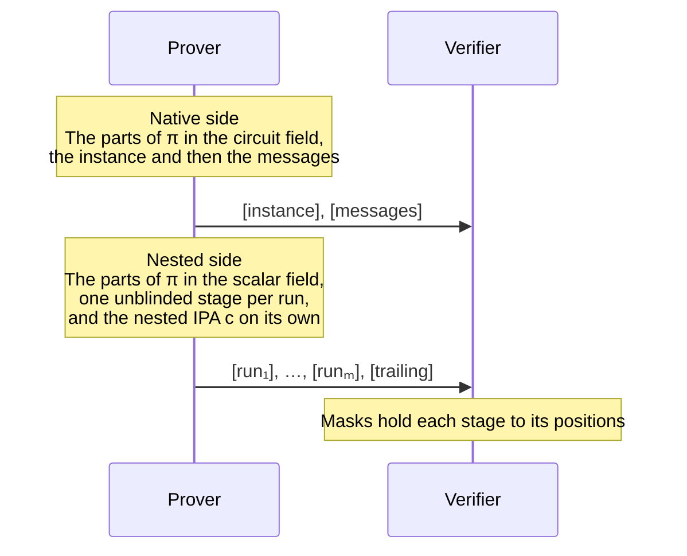
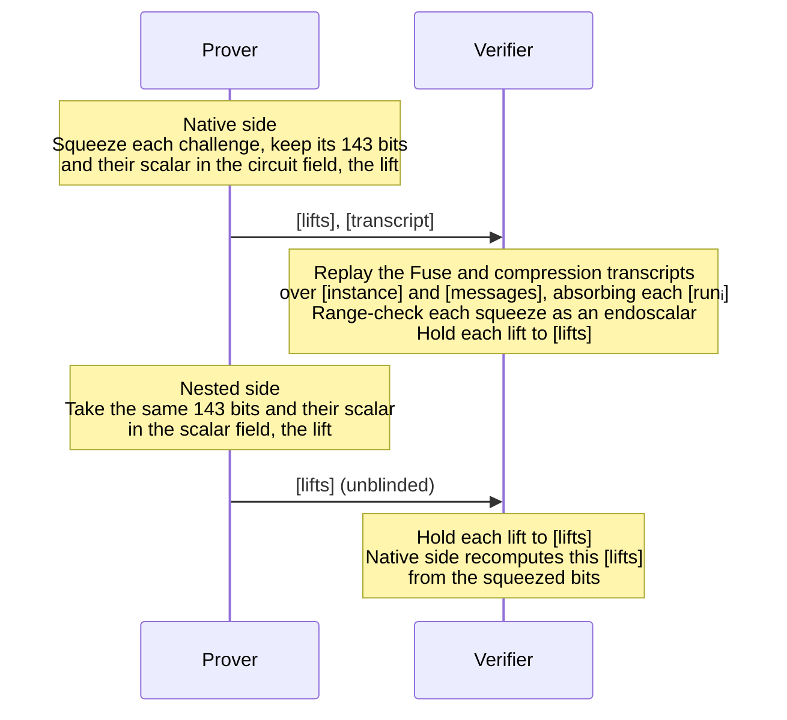
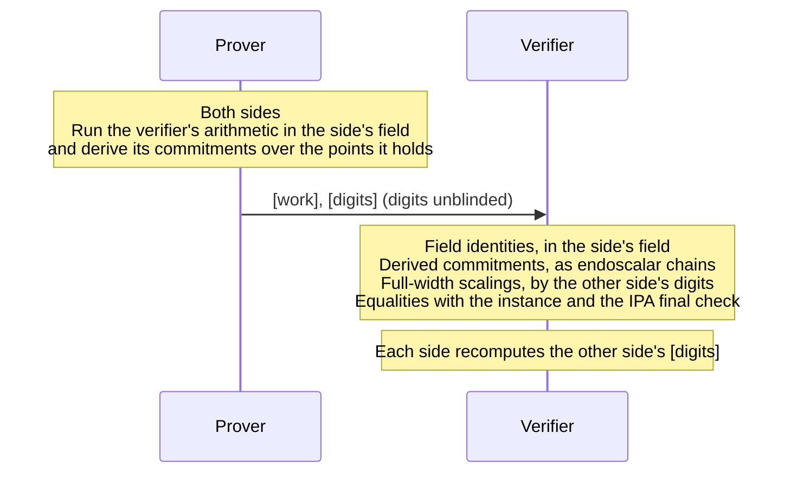
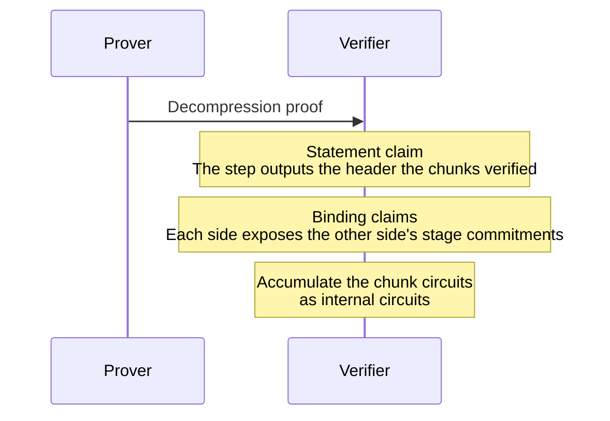

# Decompression

Decompression turns a [compressed proof](compression.md) back into an
accumulator the fuse can take as a child: the decompressing step re-runs
`Application::verify_compressed` inside the circuits of a new proof over the
same cycle, so the compressed proof's statement becomes that proof's output
header. Below is the interactive form of the aggregator profile's
decompression circuits. P holds a compressed proof $\pi$ of the wallet
application; V is the verifier of the proof P produces, which the fuse
accumulates like any proof. V's checks are the chunk circuits' constraints,
which the accumulation enforces, and three claims the proof's consumer
checks at the fuse's $k(y)$.

Decompression samples no challenge of its own. Every challenge it uses is
the compression's, re-derived from the transcript on one side and taken as
bits on the other; the fuse that consumes the proof supplies the randomness
its claims are checked under.

**Shared inputs:** the wallet application's registry and header types, its
rank $K$ and the aggregator rank $R > K$, and generators of both curves at
rank $R$, of which the wallet's tables are a prefix.

On each side of the cycle, the checks are cut into chunks that pack into
chunk circuits at rank $R$. A chunk loads the stages it needs, reads earlier
chunks' results from a work stage and leaves its own there; a stage is one
commitment every chunk loads, so later chunks read what earlier ones wrote.

## 1. Compressed proof → stages

P lays $\pi$ out as stage polynomials, each value at the position the chunks
read it from, and sends their commitments; the values stay with P as the
witness every chunk loads. [instance] and [messages] are host-curve
commitments to circuit-field polynomials; $[\mathrm{run}_1], \ldots, [\mathrm{run}_m]$ and [trailing]
are nested-curve commitments to scalar-field polynomials, a run being a
stretch of scalar-field values that compression committed as one point
before a challenge.

**Output:** every value of $\pi$ as a stage wire, on the side whose field
holds it.

## 2. Transcript → challenges

The native side replays the transcript as `verify_compressed` does, Fuse's
over the instance's bridge commitments and then the compression's over the
messages, with each $[\mathrm{run}_i]$ absorbed where compression absorbed it. Every
challenge is squeezed as an endoscalar, 143 bits that either field reads as
a scalar, its *lift*. The lift into the circuit field goes to this side's
[lifts] for its field checks; [transcript] carries the sponge state between
transcript chunks.

The nested side has no transcript. Every challenge it uses, the nested
curve's, the host curve's and Fuse's $x$, $y$ and $u$, enters as 143 witness
bits, lifted into the scalar field and held to its [lifts], so every chunk
reads the same bits. The native side recomputes that commitment by
endoscaling its generators by the bits it squeezed, and phase 4 holds the two
together, which ties the nested side's bits to the transcript.

**Output:** both curves' challenges on both sides.

## 3. Challenges → the verifier's checks

On each side, [work] is the scratch stage, one slot per intermediate result,
written by the chunk that computes it and read by the chunks that use it;
[digits] holds the signed digits of the scalars of this side's field that the
other side scales points by, committed unblinded so that side can recompute
it.

Each side then makes its share of the checks of
[compression](compression.md) phases 1–3 and the IPA, with phase 2's
challenges as the weights throughout: as lifts they weight the field
arithmetic, as bits they endoscale the points by the same challenges, so the
two agree. The field arithmetic recomputes the targets, the fold, the split,
the batch and the IPA's scalars, with inverses as advised witnesses; the
point arithmetic derives the fold's commitments, batches them into $[H]$ and
folds $[H]$ through the IPA's rounds to a final multi-scalar multiplication
that must equal the identity. The native side also recomputes Fuse's
challenge and AB-bridge stages and holds them to the instance's commitments.
Two inputs are still taken from P unchecked, the registry's evaluations and
the IPA's $G'$ (see *What remains*).

**Output:** every check of `verify_compressed` enforced in some chunk, and
each side's recomputation of the other side's [digits].

## 4. Claims

**Three $k(y)$ claims,** folded by the consuming fuse and checked by the
decider:

- **Statement:** the decompressing step's output header equals the header in
  [instance], the one the chunks verified $\pi$ against.
- **Binding,** one claim per side: every point a side took from the other as
  a witness, the absorbed run commitments and each side's recomputation of
  the other's [lifts] and [digits], equals the stage commitment the proof
  carries.

A prover who prepares the two sides from different compressed proofs, or who
chooses a message after the challenge that depends on it, fails a binding
claim. The chunk, statement and binding circuits are internal circuits of the
aggregator profile, so every proof of the profile carries their polynomials:
a step that decompresses nothing runs them over the application's canonical
compressed proof.

## What remains

Two of `verify_compressed`'s checks are not yet enforced in circuit, so the
decompression is sound for an honest prover and not yet against a dishonest
one:

- **Registry evaluations** are prover-supplied wires. The decider must
  recompute them against the wallet registry at the decompressed proof's
  challenges and hold the wires to them, as it does Fuse's query stage,
  through the polynomial-query hooks.
- **$G'$** is a witness point, so the IPA's final check binds nothing by
  itself. $G' = \langle s, G \rangle$ is the commitment to
  $s(X) = \prod_{i<k}(1 + u_{k-1-i} X^{2^i})$ over the same generators, so
  the fix is to carry $s$ as a polynomial of the decompression proof and
  defer one evaluation of it to the fuse that consumes the proof, through
  the same hooks on both curves.
