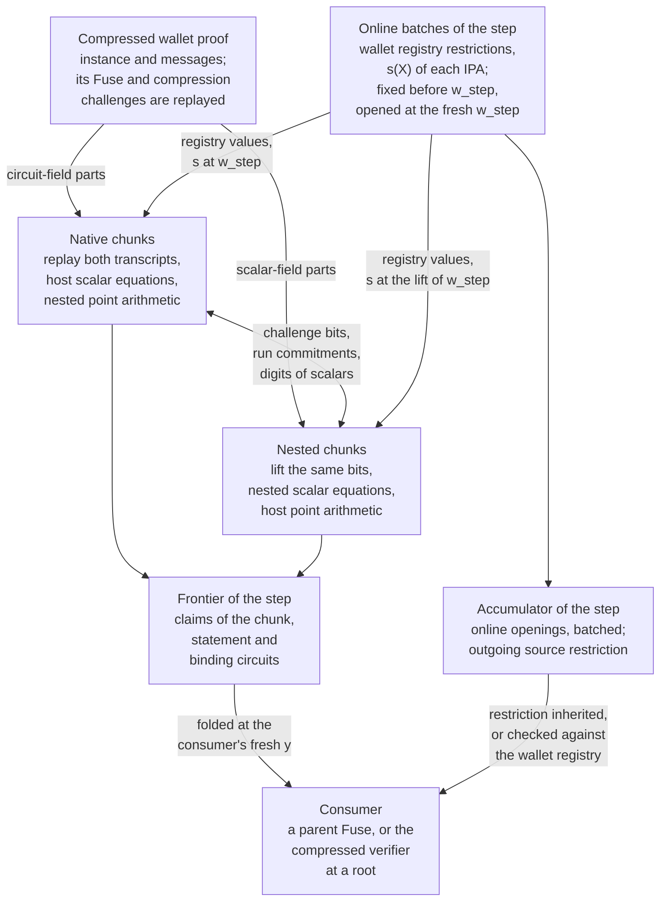
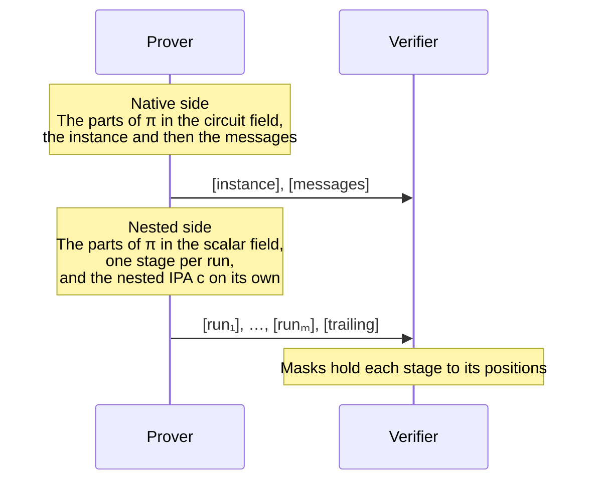
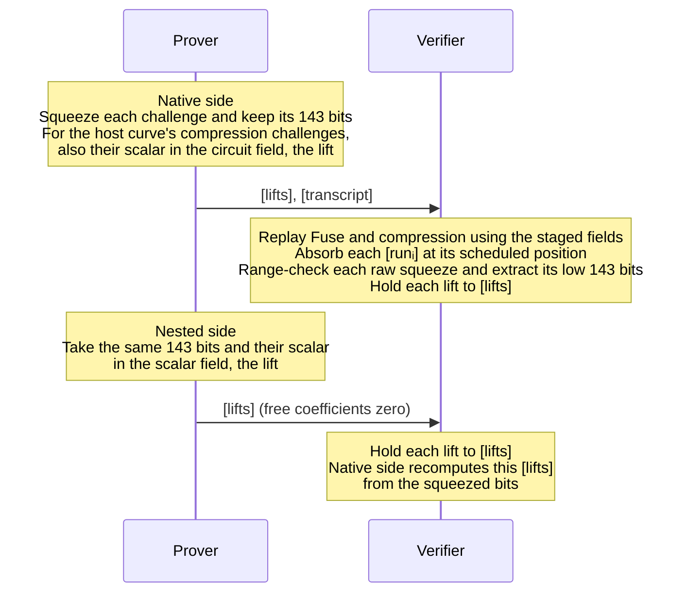
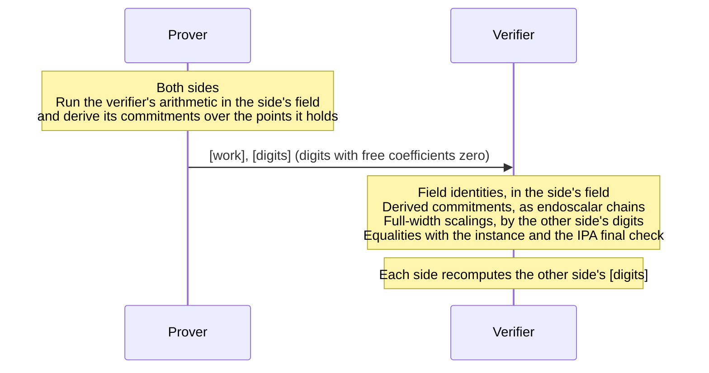
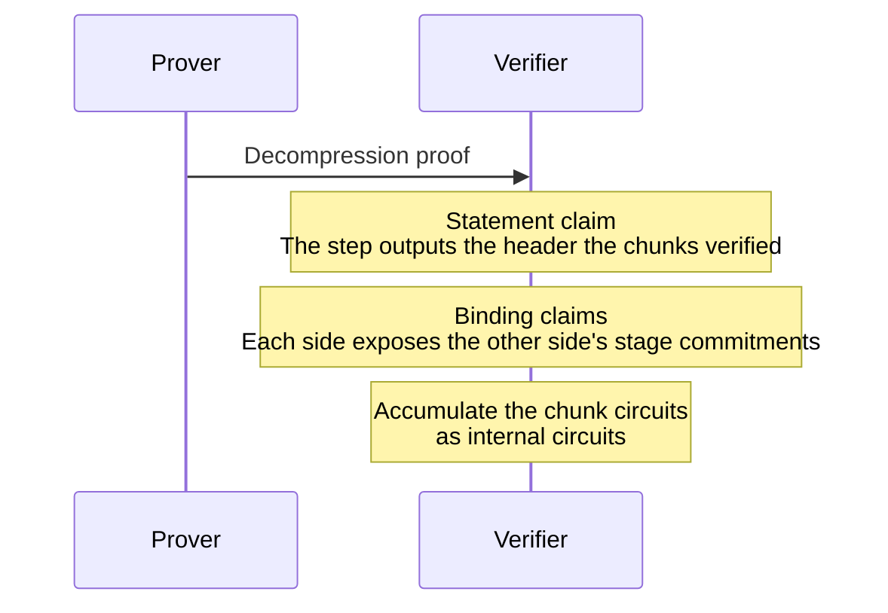

# Decompression

Decompression takes a [compressed wallet proof](compression.md) and produces
an aggregator proof of the same output header. The aggregator runs the wallet
verifier's equations inside a new [Fuse proof](../iop.md), which can then be
used as a child.

## Preliminaries {#decompression-preliminaries}

- The wallet application supplies the two source registries and the header
  types. The implementation uses the wallet rank $k=13$ of
  [Compression](compression.md#compression-preliminaries) and the aggregator
  rank $15$. Each encoded header has four field elements. Both applications
  share one parameter instance.
  On each curve the wallet's generators are a prefix of the aggregator's.
- For each application-defined output suffix a wallet step uses, the
  aggregator must register the wallet's own header type. That type must
  leave both output slots to padding. The decompression step uses the first
  slot for the host IPA's challenge polynomial and the second for padding.
  `finalize_with` checks the header types, slot declarations and shared
  parameters.
- The aggregator divides the wallet verifier's arithmetic into *chunks* and
  packs them into internal circuits at the aggregator rank. Native chunks run
  over the
  circuit field $\F_p$, nested chunks over the scalar field $\F_q$.
  The diagrams show the stage commitments carried by the aggregator proof.
  The chunks draw no challenges of their own.
- Four protocol runs meet in a decompression, and a subscript names the run
  that a challenge belongs to. The field side, native or nested, is a
  separate matter, marked by $q$ as elsewhere.

  | Run | Subscript | Its Challenges in This Chapter |
  |---|---|---|
  | the Fuse that produced the wallet proof | $F$ | replayed by the chunks: raw squeezes on the native side, their lifts on the nested side and for both $\beta$ |
  | the compression of the wallet proof | $C$ | replayed by the chunks: each is the lift of a squeeze, with squeezes of its own for each curve |
  | the Fuse of the aggregator step that carries the chunks | $\text{step}$ | fresh: $w_{\rm step}$ is the point of the step's online openings |
  | a Fuse that takes the result as a child | $\text{parent}$ | fresh: its $y$ is the point at which the claim targets are evaluated |

  The sequence diagrams below show what the prover commits and what the
  circuits check, phase by phase. They are views of one construction, and the
  chunk circuits exchange no messages and draw no challenges.

## Protocol in Detail {#decompression-protocol}

The prover $\mathcal P$ has a compressed wallet proof $\pi$ and its output
header data. `Application::decompress` first runs the wallet verifier on
$\pi$ while preparing the witness. If it succeeds, the decompression step
fuses two bootstrap proofs with unit input headers. The step encodes the
wallet proof's output header data and constrains the encoded header's
type suffix to differ from `Dummy` and zero.

Every aggregator proof carries the chunk, statement and binding circuits.
For the decompression step the prover supplies $\pi$ to these circuits.
For any other step the prover reuses witnesses prepared at setup from the
wallet application's compressed bootstrap proof. The
[statement check](#4-claims) gives the required header and openings.

The chunks replay the wallet's Fuse and compression transcripts. The
aggregator step's own Fuse supplies $w_{\rm step}$ for its openings.
When another Fuse consumes the result, it evaluates the native claim
targets at its fresh $y$ and the nested targets at the lift $y_q$.

The figure has four parts: the wallet proof with the two transcripts that
it fixes, the chunks of each side, and the enclosing step with its consumer.
Neither side's chunks verify the wallet proof alone. Each side does the scalar
arithmetic of its own field and the group arithmetic on the other side's
points, and what one side takes from the other is held by the binding
claims. What leaves the step is of two kinds. The online openings, the
registry values among them, are batched into the step's accumulator, and the
outgoing source restriction is an obligation that a parent inherits. The
chunk, statement and binding circuits are internal circuits of the profile,
so the claims that they are satisfied are in the step's frontier.

### Phase 1. Commit the wallet proof in stages {#1-compressed-proof--stages}

Stage masks specify where the chunks read each field of $\pi$.
$\mathcal P$ commits to those stages and keeps the field values as witnesses.
A mask confines a stage to its gates and does nothing else. It does not make
an accepted stage the encoding of $\pi$ that the honest prover commits, which
has zeros in every unused coefficient.
[Phase 2](#2-transcript--challenges) says where the difference matters.

1. **Native.** The host commitments $[\mathrm{instance}]$ and
   $[\mathrm{messages}]$ hold the circuit-field parts of the instance and
   the compression messages, respectively. The instance stage also holds
   the wallet proof's encoded output header, followed by a flag and three
   opening fields for the enclosing step's statement claim.
2. **Nested.** Each scalar-field run of the compression transcript has its
   own nested stage commitment $[\mathrm{run}_i]$. The nested IPA's final
   scalar $c$ is checked after the last squeeze and occupies a separate
   $[\mathrm{trailing}]$ stage.

### Phase 2. Replay the wallet transcripts {#2-transcript--challenges}

1. **Native replay.** Replay wallet Fuse over its eight bridge commitments.
   For [wallet compression](compression.md#compression-protocol), read the
   instance fields, the encoded output header and the compression messages
   in that order.
   Skip the four enclosing-step fields. Absorb each $[\mathrm{run}_i]$ at
   its scheduled position. The $[\mathrm{transcript}]$ stage carries sponge
   states between chunks.
2. **Challenge extraction.** Range-check each raw squeeze against $2^{254}$
   and extract its low 143 bits. Both curves use lifts of the compression
   challenges. Fuse uses the first eight raw squeezes on the native side,
   their lifts on the nested side, and a lift of the ninth for each $\beta$.
   The native $[\mathrm{lifts}]$ stage holds the host compression lifts.
3. **Nested lifts.** The nested chunks receive the challenge bits as
   witnesses. In order, their $[\mathrm{lifts}]$ stage, whose free
   coefficients are zero, holds the nested compression lifts, the wallet Fuse
   lifts of $x_F,y_F,u_F,w_F$, then the host compression lifts into $\F_q$.
   Each chunk that uses the bits constrains their lift to the matching stage
   wire. The native chunks
   recompute the commitment with the bits from replay. The native binding
   claim checks it against the nested stage.

The honest prover zeroes unused run coefficients, reproducing the points
`verify_compressed` absorbs. The stage masks permit other values there.
The circuit absorbs the full stage commitment, so the same wallet proof
fields can produce different challenges across attempts. Each commitment
binds the run's used wires before the next challenge.
[Compression's single-challenge bound](compression.md#compression-verifier)
applies to a fixed false identity. A bound for adaptive queries across all
rounds of this circuit transcript remains open.

### Phase 3. Check the wallet verifier's equations {#3-challenges--the-verifiers-checks}

All chunks on a side load the same committed $[\mathrm{work}]$ stage.
One chunk constrains an intermediate value at its assigned wire, and a
later chunk can read that wire.

1. **Field equations.** Native chunks check the host scalar equations over
   $\F_p$ and nested chunks check the nested scalar equations over $\F_q$.
   Each recomputes the claim targets, fold, split, opening batch and IPA
   scalars. Inverse checks require the compression challenges $r_C,z_C$,
   every batch denominator $u_C-x_j$ and every IPA round challenge $u_j$ to be
   nonzero.
2. **Curve equations.** Native chunks check nested points. Nested chunks
   check host points. Each side checks curve membership for every supplied
   point, derives the folded commitments and $[H]$, and checks that the
   IPA's final multiscalar multiplication equals the identity. For each
   round $\mathcal P$ supplies a point $Q_j$. The circuit checks
   $u_j Q_j=L_j$ before using it as $u_j^{-1}L_j$.
3. **Scalars used on the other side.** Challenge bits drive endoscaling.
   For the full-width IPA scalars $v,c,c\,b\,z_{\rm IPA}$, each side writes
   signed digits to its $[\mathrm{digits}]$ stage, whose free coefficients
   are zero. The other
   side uses the digits for its point scalings and recomputes the stage
   commitment. Native digits also carry the decompression flag. Nested
   digits also carry both coordinates of $[A]$, $[B]$ and the `PointsAb`
   commitment, and $\texttt{bridge\_alpha}^2$. The native chunks use these
   seven values to rebuild `BridgeAB` and check both `BridgeAB` and
   `ChallengeStage` against the wallet instance.

#### Registry evaluations {#registry-evaluations-and-g}

The standalone wallet verifier evaluates $m(W,X,Y)$ itself. For the same
values, the chunks use openings of nine restrictions $m(W,a,b)$ per field.
In slot order their $(a,b)$ are
$$
(r_C,y_C),\ (x_F,y_F),\ (x^{(0)},y^{(0)}),\ (x^{(1)},y^{(1)}),\ (u_F,y_F),\
(x^{(0)},y_F),\ (x^{(1)},y_F),\ (x^{(0)},u_F),\ (x^{(1)},u_F).
$$
Here $r_C,y_C$ are challenges of the wallet compression,
$w_F,x_F,y_F,u_F$ are challenges of the wallet Fuse, and
$x^{(i)},y^{(i)}$ are those of the wallet proof's child $i$. The polynomial
$m$ of this section is the wallet's registry, and not the aggregator's own.

Open each of the first two restrictions at every internal registry point
$\omega_j$, including the masks' points. Also open
$m(W,x_F,y_F)$ at $w_F$, the wallet proof's own circuit point (native only),
$u_F$, and the wallet compression's $w_C$. Open each of the other seven
restrictions at $w_F$.

1. Before $w_{\rm step}$, the step commits to the two restrictions inherited
   from its aggregator children, then the nine above. The online input
   stage fixes their coordinates and nonfixed opening points.
   Each opening value has a wire in the online query stage. Every extension
   circuit, including the statement and binding circuits, loads these two
   stages first, as does the Fuse helper.
2. The chunks match the coordinates and opening points to the wallet Fuse
   and compression challenges and the children's values. They bind the
   evaluations in $[\mathrm{work}]$ to their query wires. The native side
   also binds the wallet proof's own circuit domain point, which the helper
   checks belongs to the wallet registry domain.
3. The step's Fuse batches the openings and both ends of each
   [mesh intersection](../poly-oracle.md#v6-registry). Seven helper
   restrictions are fixed before $y_{\rm step}$, one before $x_{\rm step}$
   and the outgoing restriction before $\alpha_{\rm step}$. The helpers fix
   the wallet registries' tags. A parent inherits the outgoing restriction.
   At the root the [compressed verifier](../poly-oracle.md#v6-terminal) checks
   it against the wallet registry once per field.

#### IPA generators {#decompression-ipa-generators}

For each wallet IPA, the folded generator is $G'=[s]$, where
$s(X)=\prod_{i=0}^{k-1}(1+u_{k-1-i}X^{2^i})$ over that IPA's round challenges
$u_i$. The decompression step uses
two online polynomials for polynomial oracle access to bind the supplied
$G'$ points, one on each curve.

1. **Fix the round challenges.** Before $w_{\rm step}$ the decompression
   step stages the raw squeeze for the nested IPA's last round challenge.
   This is the wallet compression transcript's final squeeze, after both
   IPAs' round messages. The step opens its left input's first slot at
   that digest.
   Under the decompression flag the native chunks equate the opening point
   with the last squeeze they replayed. This fixes both IPAs' round
   challenges before $w_{\rm step}$ under the sponge's collision and
   preimage resistance.
2. **Host IPA.** The decompression step commits $s$ in its first output
   slot before $w_{\rm step}$ and opens it at $w_{\rm step}$. Under
   the flag, the native chunks check the opened value against
   $s(w_{\rm step})$ and the nested chunks equate the host $G'$ with the
   slot commitment.
3. **Nested IPA.** Every step commits the nested $s$ as its
   online polynomial for polynomial oracle access over $\F_q$ before
   $w_{\rm step}$. Its nested `compute_v` folds the opening at the lift
   $w_{{\rm step},q}$ into its batch. The consumer uses the commitment
   exported by `bind_endoscalar` and the opening exported by `compute_v`.
   The native chunks' $G'$ must equal that commitment, and the nested
   chunks check the opening value against $s(w_{{\rm step},q})$.

For a decompression step, both $s$ and the slot polynomial are fixed before
$w_{\rm step}$. If they differ, they agree only at a root of their
difference. At aggregator rank a uniform nested lift hits such a root with
probability at most $2^{15}/2^{143}=2^{-128}$. The host check uses the
larger range of the raw challenge.

In an ordinary step the flag disables the host slot check. The nested
opening check still runs, but the wallet IPA challenges can depend on
$w_{\rm step}$ because the step stages no digest. The wallet statement in
this case is the unit header.

### Verifier checks {#4-claims}

Accumulation enforces the chunk circuits. A consuming Fuse folds the three
claims below. At a root, the decider checks them at its own challenges.
For each target $k(y)$, Horner-evaluate the listed fields in order at the
consumer's challenge for that side, $y_{\rm parent}$ or its lift, followed
by $0,1$. A point contributes its affine $x$
then $y$ coordinate.

1. **Native statement.** The circuit index determines the flag. For the
   decompression step, start with its encoded output header, then $1$, the
   first output slot's opening point and value, and the left input's
   first-slot opening point (the digest).
   The statement circuit exposes the wallet proof's encoded output header
   and the four fields from $[\mathrm{instance}]$. The step's `hashes_1`
   exports the three opening fields after its output header and circuit index.
   For an ordinary step the extension targets the canonical wallet proof's
   unit header and four zeros. The application step has its own output header.
2. **Native binding.** Match the run commitments absorbed in replay and the
   recomputed nested $[\mathrm{lifts}]$ and $[\mathrm{digits}]$ commitments
   against the nested stages. Match the nested IPA's $G'$ against the
   step's exported $\F_q$ commitment.
3. **Nested binding.** Match the recomputed native $[\mathrm{digits}]$
   commitment against its stage and the exposed slot point against the
   first output slot's commitment. Under the flag this point also equals
   the host IPA's $G'$. Match the exposed $\F_q$ opening point and value
   against the opening folded by nested `compute_v`.

### Output {#decompression-output}

`Application::decompress` returns an aggregator-rank proof with the wallet
proof's output header data. It can be used as a child of Fuse or compressed
with the aggregator's parameters.

In the code, decompression is the `decompress` module of `ragu_pcd`, which is
private to the crate and behind the `unstable-aggregator` feature. Its
`program` module schedules the verifier's arithmetic into chunks, `chunk` has
the chunk, statement and binding circuits, `stages` has their stages,
`extension` registers them as the aggregator profile's extension, and `prover`
fills their polynomials.

## Privacy {#privacy}

Compressing a decompressed proof publishes its run commitments. The first
binds the wallet instance's host commitment coordinates and the second
binds its nested scalars, both with free coefficients zero. These points stay
the same across fresh compressions of the same underlying wallet proof, so
observers can link the published proofs.

When an ordinary Fuse consumes the decompressed proof, the parent's run
stages use the canonical wallet bootstrap proof. Compressing the parent
publishes those run commitments and uses Ragu's non-hiding
[compression](compression.md).
