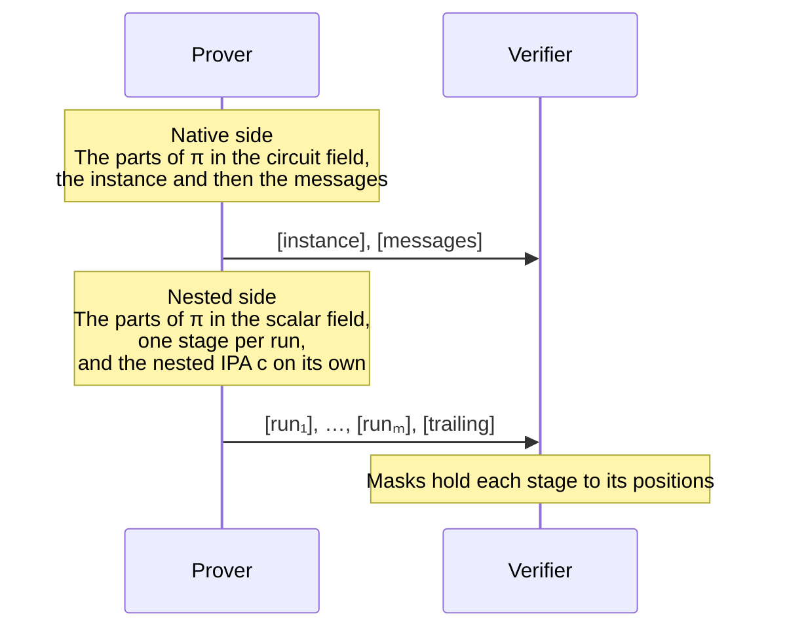
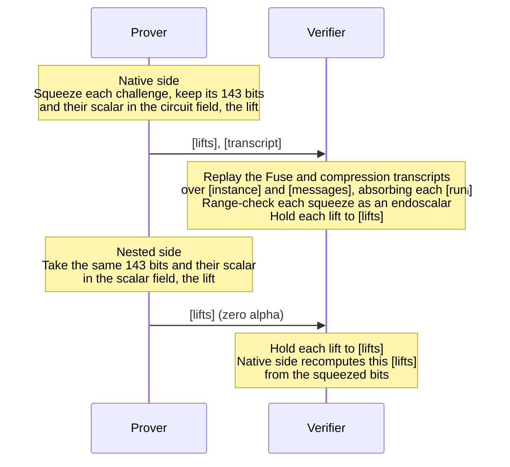
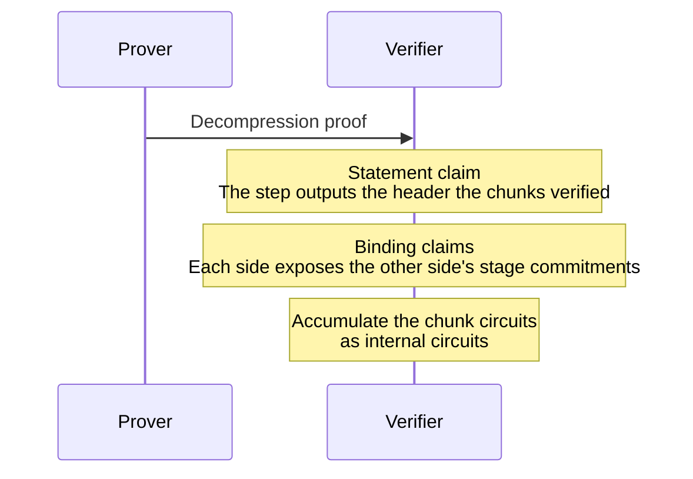

# Decompression

Decompression uses a [compressed proof](compression.md) as a witness to
produce a new accumulator proof the fuse can take as a child. The circuits
check the wallet verifier's equations, and the wallet statement becomes the
new proof's output header. Below is the interactive form of the aggregator
profile's decompression circuits. P holds a compressed proof $\pi$ of the
wallet application. V is the verifier of the proof P produces, which the
fuse accumulates like any proof. V's checks are the chunk circuits'
constraints, which the accumulation enforces, and three claims the proof's
consumer checks at the fuse's $k(y)$.

The chunks sample no challenge of their own. Every challenge they use is
the compression's, re-derived from the transcript on one side and taken as
bits on the other; the fuse that consumes the proof supplies the randomness
its claims are checked under, and the step's own fuse the randomness the
registry's evaluations are opened under.

**Shared inputs:** the wallet application's registry and header types, its
rank $K$ and the aggregator rank $R > K$, and generators of both curves at
rank $R$, of which the wallet's tables are a prefix.

On each side of the cycle, the checks are cut into chunks that pack into
chunk circuits at rank $R$. A chunk loads the stages it needs, reads earlier
chunks' results from a work stage and leaves its own there; a stage is one
commitment every chunk loads, so later chunks read what earlier ones wrote.

## 1. Compressed proof → stages

P lays $\pi$ out as stage polynomials, each value at the position the chunks
read it from, and sends their commitments; the values stay with P as the
witness every chunk loads. [instance] and [messages] are host-curve
commitments to circuit-field polynomials; $[\mathrm{run}_1], \ldots, [\mathrm{run}_m]$ and [trailing]
are nested-curve commitments to scalar-field polynomials, a run being a
stretch of scalar-field values that compression committed as one point
before a challenge.

**Output:** every value of $\pi$ as a stage wire, on the side whose field
holds it.

## 2. Transcript → challenges

The circuit-field side follows the native verifier's absorption order, first
over the instance's bridge commitments and then over the compression
messages, absorbing each $[\mathrm{run}_i]$ at the corresponding position.
The honest prover leaves each run stage's unused coefficients at zero to
match the commitment `verify_compressed` computes from the run values.
The mask permits other coefficients in those slots, and the circuit absorbs
the full stage commitment, so the same proof fields can lead to different
challenges.

Every challenge is squeezed as an endoscalar, 143 bits that either field reads
as a scalar, its *lift*. The lift into the circuit field goes to this side's
[lifts] for its field checks; [transcript] carries the sponge state between
transcript chunks.

The nested side has no transcript. Every challenge it uses, the nested
curve's, the host curve's and Fuse's $x$, $y$ and $u$, enters as 143 witness
bits, lifted into the scalar field and held to its [lifts], so every chunk
reads the same bits. The native side recomputes that commitment by
endoscaling its generators by the bits it squeezed, and phase 4 holds the two
together, which ties the nested side's bits to the transcript.

**Output:** both curves' challenges on both sides.

## 3. Challenges → the verifier's checks

On each side, [work] is the scratch stage, one slot per intermediate result,
written by the chunk that computes it and read by the chunks that use it;
[digits] holds the signed digits of the scalars of this side's field that the
other side scales points by, committed with a zero alpha so that side can
recompute it.

Each side then makes its share of the checks of
[compression](compression.md) phases 1–3 and the IPA, with phase 2's
challenges as the weights throughout: as lifts they weight the field
arithmetic, as bits they endoscale the points by the same challenges, so the
two agree. The field arithmetic recomputes the targets, the fold, the split,
the batch and the IPA's scalars, with inverses as advised witnesses; the
point arithmetic derives the fold's commitments, batches them into $[H]$ and
folds $[H]$ through the IPA's rounds to a final multi-scalar multiplication
that must equal the identity. Every point a side took from P is held to its
curve before a chain uses it. The native side also recomputes Fuse's
challenge and AB-bridge stages and holds them to the instance's commitments.
Two inputs are not arithmetic over $\pi$, and the step that proves the
chunks binds them (see *Registry evaluations and $G'$*): the registry's
evaluations are values its fuse opens on restrictions of the wallet
registry, and each curve's $G'$ is held to a commitment the step made
before its challenge, over round challenges a digest the step committed
with it fixes.

**Output:** the verifier's equations checked with the circuit's challenges,
and each side's recomputation of the other side's [digits].

## 4. Claims

**Three $k(y)$ claims,** folded by the consuming fuse and checked by the
decider:

- **Statement:** the decompressing step's output header equals the header in
  [instance], the one the chunks verified $\pi$ against. The claim also
  carries the step binding below; a step folds its own application claim, so
  it exports the two openings the binding reads beside its output header, in
  `hashes_1`'s instance.
- **Binding,** one claim per side: every point a side took from the other as
  a witness, the absorbed run commitments and each side's recomputation of
  the other's [lifts] and [digits], equals the stage commitment the proof
  carries.

Each absorbed run commitment binds the values the chunks read before the
next challenge. Soundness for the wallet header must account for adaptive
queries to the circuit transcript, including repeated trials with different
unused coefficients. [Compression](compression.md) gives a bound for a
single fresh challenge and a fixed false identity. A bound across all
verifier rounds with these choices remains open.

The chunk, statement and binding circuits are internal circuits of the
aggregator profile, so every proof of the profile carries their polynomials:
a step that decompresses nothing runs them over the application's canonical
compressed proof.

## Registry evaluations and $G'$

`verify_compressed` evaluates the wallet registry $m(W, X, Y)$ itself: at
the circuits' domain points for the claims' wiring restrictions, at the
instance's opening point, and at $\pi$'s and its children's points for the
values the wire bindings expect. The chunks read these evaluations from
[work], where P writes them, and hold each to a value of the step's
[online batch](../poly-oracle.md#v6) of its field:

- **Nine restrictions.** Every evaluation is a value of one of nine
  restrictions $m(W, a, b)$ of the registry, on each field. The step
  commits the nine before its challenge $w$, with their coordinates and the
  points they are read at in its online input stage, and claims each
  evaluation as an opening whose value is a wire of its online query stage.
  Every chunk circuit loads the two stages first, as the fuse's helper
  does, so the chunks read the wires the fuse committed.
- **The coordinates.** The chunks hold the input stage's coordinates and
  points to the values they derive from $\pi$: the lifts of its
  compression's challenges, its fuse's challenges, its children's values
  and its circuits' domain points. The stage is committed before $w$, so
  the restrictions are fixed before the challenges that test them.
- **The registry.** The step's fuse batches the openings into its
  accumulator, as it does an application's, and its
  [source-registry mesh](../poly-oracle.md#v6-registry) holds each
  committed polynomial to the wallet registry's restriction at its
  coordinates, through the outgoing restriction its parent inherits.
  [Compression closes the root's](../poly-oracle.md#v6-terminal): the
  verifier of an aggregator's compressed proof evaluates the wallet
  registry it holds, once per field.
- **The domain.** The helper holds $\pi$'s own circuit's domain point to
  the wallet registry's domain, as `verify_compressed` holds the circuit
  id.

The wallet application is so part of what V builds: the helper circuits fix
the wallet registries' tags, and the terminal checks evaluate the wallet
registries themselves.

Each IPA's $G' = \langle s, G \rangle$ is the commitment to
$s(X) = \prod_{i<k}(1 + u_{k-1-i} X^{2^i})$ over the same generators, and is
bound as that: the step commits a polynomial before its challenge $w$, opens
it at a point derived from $w$, and the chunks hold the opened value to $s$
there and their $G'$ to the commitment. That shows the polynomial is $s$ only
if the round challenges $u_i$ were fixed before $w$ too, so the
decompression step commits to them first:

- **The round challenges.** The decompression step stages the digest of
  P's compression transcript, its last squeeze, taken after every round
  message of both IPAs. The application stage is committed before $w$, and
  the step exposes the staged value as the point at which it opens its left
  input's first slot. In a proof of that step the native chunks hold it to
  the last squeeze of the transcript they run. The transcript is one sponge
  and each round challenge a squeeze of what it absorbed before, so both
  IPAs' round challenges, and both $s$, are fixed before $w$ unless the
  prover finds a collision or a preimage in the sponge.
- **The host curve's.** The decompression step commits $s$ in its first
  output slot before its challenge and opens it there. The native chunks
  hold the opened value to $s$ at that point over the round challenges they
  squeezed, and the nested chunks hold their $G'$ to the slot's commitment,
  both only in a proof of that step, which a flag the statement circuit's
  claim sets tells them.
- **The nested curve's.** Its $s$ is over the other field, so every step
  commits it as its online $\F_q$ polynomial, for the proof its chunks run
  over. The step exports the commitment and the opening its nested
  `compute_v` folded, through `bind_endoscalar`'s and `compute_v`'s
  instances; the parent holds each once, so the native chunks' $G'$ is that
  commitment and the opening the nested chunks hold to $s$ is that one.

With the polynomial and the round challenges both fixed before the point, a
slot holding another polynomial than $s$ passes only if the point is a root
of the difference: for the nested curve's, whose point is the lift of a
143-bit endoscalar, with probability at most $2^{15}/2^{143}$ at the
aggregator rank, and less for the host curve's. A step that decompresses
nothing stages no digest, and its openings establish nothing about the
canonical proof's $G'$, whose statement binds nothing.

## Privacy

Compressing the output of `Application::decompress` publishes the
commitments to its run stages. The first two are zero-alpha commitments to
the wallet proof's instance commitments and scalars. Recompressing the
same underlying wallet proof with fresh randomness leaves those commitments
unchanged, so observers can link the published decompression proofs even
when their compression messages differ.

When an ordinary fuse consumes a decompressed child, the parent's own run
stages use the canonical wallet bootstrap proof. Compressing the parent
publishes those run commitments. The parent still uses Ragu's non-hiding
[compression](compression.md).
